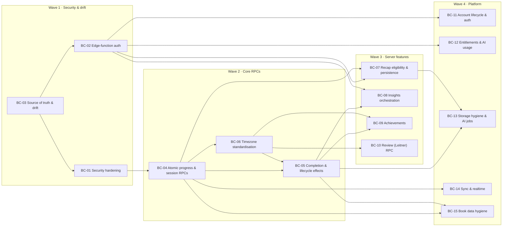

# Backend Consolidation Plan — Phase 0

Last updated: 2026-10-18

**The Chronicler** (internal code name **BookHero**) runs one Supabase backend (project `zlndhygpqacygceivuvk`) for the web PWA today, the native iOS app next, and Android later (D-05). This plan covers **Phase 0**: the backend work that must land **before the native iOS build starts**. Every work package (BC-01 … BC-15) is client-agnostic. The PWA keeps working throughout and moves to the new RPCs as well.

Evidence base: the business-rules audit of web `master` @ `8d8701c` and the live database on 2026-10-18 (read-only catalog queries), plus the read-only live snapshot [`supabase/reference/live-baseline-2026-10-18.sql`](../supabase/reference/live-baseline-2026-10-18.sql) (D-16). Facts marked *verified 2026-10-18* were re-checked against the live project while this plan was written.

Related documents:

| Document | Role |
|---|---|
| [Business-rules catalog](business-rules/README.md) | Numbered rules (stable IDs), known defects, open decisions, and the owner decisions log D-01 … D-17 |
| [Backend contract](backend-contract.md) | What the live backend does today (§1–§15) and the planned changes (§16), which point back here |
| [Live schema reference](../supabase/reference/README.md) | Read-only live DDL snapshot. Not a migration |
| [Legal & compliance review](legal-compliance-review.md) | Privacy and copyright invariants that Phase 0 must preserve |

---

## Contents

1. [Purpose & principles](#1-purpose--principles)
2. [Sequencing](#2-sequencing)
3. Work packages: [BC-01](#bc-01--security-hardening) · [BC-02](#bc-02--edge-function-auth) · [BC-03](#bc-03--source-of-truth--drift) · [BC-04](#bc-04--atomic-progress--session-rpcs) · [BC-05](#bc-05--server-owned-completion--lifecycle-effects) · [BC-06](#bc-06--timezone-standardisation) · [BC-07](#bc-07--recap-eligibility--persistence-server-side) · [BC-08](#bc-08--insights-orchestration-server-side--fallback) · [BC-09](#bc-09--achievements-server-side) · [BC-10](#bc-10--review-leitner-rpc) · [BC-11](#bc-11--account-lifecycle--auth) · [BC-12](#bc-12--entitlements--ai-usage-foundation) · [BC-13](#bc-13--storage-hygiene--ai-job-robustness) · [BC-14](#bc-14--sync--realtime-readiness) · [BC-15](#bc-15--book-data-hygiene)
4. [PWA changes required](#4-pwa-changes-required)
5. [What stays client-side](#5-what-stays-client-side)
6. [Out of scope for Phase 0](#6-out-of-scope-for-phase-0)
7. [Risks](#7-risks)

---

## 1. Purpose & principles

### 1.1 Purpose

1. **Close the security holes** that a public native binary would expose: cross-user RPC reads, anon-executable destructive functions, and forgeable edge-function auth (BC-01, BC-02).
2. **Make the repo the source of truth again**, both for migrations and for edge-function sources (BC-03).
3. **Move core business logic server-side** so iOS (and later Android) stays thin and cannot drift from the web. Per D-06 this covers atomic progress saves on the server clock, completion side effects, recap eligibility, Insight generation and achievements (BC-04 … BC-10).
4. **Add the platform pieces the App Store and a second client need**: account deletion, Sign in with Apple, password reset, entitlement and usage hooks, storage hygiene, and sync readiness (BC-11 … BC-15).

### 1.2 Principles

| # | Principle | What it means in practice |
|---|---|---|
| P1 | **Client-agnostic** (D-05) | Rules live in SQL, RPCs, triggers or edge functions. They never depend on which client wrote the row. Server triggers cover legacy write paths too, so effects are the same for web, iOS, offline replays and imports. |
| P2 | **Backward compatible: expand → migrate → contract** | (1) *Expand*: add columns, RPCs and versioned edge modes. Legacy paths keep working and are tagged. (2) *Migrate*: the PWA and iOS switch to the new paths. (3) *Contract*: revoke legacy write privileges, but only after the legacy-write counters read zero for 14 days. |
| P3 | **The PWA migrates too** | Each work package lists its PWA changes ([§4](#4-pwa-changes-required)). Rules are written once for every client and are never iOS-only. |
| P4 | **Server clock, server-owned effects** (D-06) | `recorded_at`, session timestamps, completion and eligibility are computed with server `now()`. Client time is accepted only as the occurred-at time of an offline replay, inside a bounded window. |
| P5 | **Rule IDs are the acceptance tests** | Every acceptance criterion cites catalog rule IDs. Database tests (pgTAP via `supabase test db`) and edge-function tests are named after the rule IDs they prove. When a package lands, the catalog entries for those rules change from "client-only" to "server-enforced" in the same PR. |
| P6 | **Least privilege by default** | New functions are `SECURITY DEFINER` with a pinned `search_path` and take identity from `auth.uid()`, never from a parameter. Every one is created with `revoke all … from public, anon` and gets an explicit `grant execute … to authenticated`. Helpers live in a non-exposed `private` schema. |
| P7 | **Migration discipline** (BC-03) | Every change is a timestamped migration in the repo. No dashboard SQL. Each PR also updates `backend-contract.md` and regenerates the live reference snapshot. |
| P8 | **Thin native client** | Native clients render state, collect input and call RPCs. They do not re-implement completion, eligibility, achievements or Insight logic. |

### 1.3 Conventions for every new or changed backend surface

| Topic | Convention |
|---|---|
| RPC naming | `verb_noun` in `snake_case` (`save_progress`, `get_recap_eligibility`). JSON keys in responses are camelCase, matching the existing RPCs. |
| Identity | Derived from `(select auth.uid())`. Existing `p_user_id` parameters stay for PWA compatibility but must equal the caller (BC-01). New RPCs have no `p_user_id`. |
| Errors | Business errors: `raise exception '<code>' using errcode = 'P0001'`. PostgREST returns HTTP 400 `{code:"P0001", message:"<code>"}`, and clients switch on `message`. Authorization failures use `errcode = '42501'`: HTTP 403 for signed-in callers, 401 for anon. |
| Signature changes | `CREATE OR REPLACE` cannot add parameters. Use `DROP FUNCTION` + `CREATE FUNCTION` in one migration and re-apply the grants. Never leave two overloads with the same name, or PostgREST fails with `PGRST203`. New parameters go last and have defaults. |
| Time zones | New RPCs take `p_timezone text default null`, resolved as validated parameter → stored reader zone → `'UTC'` (BC-06). The legacy `p_time_zone` name of `get_book_passport_stats` stays. |
| Edge-function versions | New behaviour sits behind `apiVersion: 2` in the request body. Requests without it keep the legacy contract until the PWA migrates. |
| Legacy-write tagging | Tables that move behind RPCs get a `write_source` column (`rpc` · `legacy_client` · `import` · `system`) defaulting to `legacy_client`. Retiring direct writes is decided by counting recent `legacy_client` rows. |

### 1.4 Catalog legend

Rule IDs cited in this plan are the stable IDs of the [business-rules catalog](business-rules/README.md):

| Prefix | Catalog file |
|---|---|
| LIB | [01 · Library](business-rules/01-library.md) |
| SES | [02 · Reading sessions](business-rules/02-reading-sessions.md) |
| REC | [03 · Recaps](business-rules/03-recaps.md) |
| CAP | [04 · Capture, resume & quiz](business-rules/04-capture-resume-quiz.md) |
| LEX | [05 · Codex & lexicon](business-rules/05-codex-lexicon.md) |
| INS | [06 · Insights](business-rules/06-insights.md) |
| PRO | [07 · Profile, stats & goals](business-rules/07-profile-stats-goals.md) |
| PLT | [08 · Platform, auth & account](business-rules/08-platform-auth-account.md) |
| BE | [09 · Database invariants](business-rules/09-database-invariants.md) |
| COM | [10 · Community & circles](business-rules/10-community-circles.md) |
| XD | [11 · Cross-domain interactions](business-rules/11-cross-domain.md) |
| CL | [12 · Client-logic register](business-rules/12-client-logic-register.md) |

Each domain file also has **Known defects** (`<PREFIX>-Dnn`) and **Open decisions** (`<PREFIX>-Qnn`) sections.

- In the *Why* tables below, rule IDs come first; IDs after a `·` are the catalog defects the package fixes (for example `SES-87 · SES-D04`).
- Open points raised here are numbered `OP-<bc>.<n>` (for example OP-04.2). Each names the matching catalog decision in parentheses (for example `(SES-Q18)`).
- Once the owner decides an open point, it moves into the catalog's decisions log.

---

## 2. Sequencing

### 2.1 Waves

| Wave | Packages | Goal | Exit criterion |
|---|---|---|---|
| **1 · Security & drift** | BC-03 (baseline first) → BC-01, BC-02 | No cross-user reads or deletes, no forgeable AI endpoints, repo == live | Security advisor clean for the allowlist (see BC-01). `supabase db diff` against live is empty. `supabase/config.toml` committed. |
| **2 · Core RPCs** | BC-04 → BC-06 → BC-05 | One atomic, server-clocked write path for progress and sessions, one time-zone convention, one owner for completion effects | The PWA writes progress only through RPCs. Completion effects are identical across all six completion paths ([XD · complete a book](business-rules/11-cross-domain.md)). |
| **3 · Server features** | BC-07, BC-08, BC-09, BC-10 | Recap lock, Insights, achievements and review math run on the server | No AI call can be triggered by a client outside the server-side eligibility rules. Achievements and Insights are written only by the server. |
| **4 · Platform** | BC-11, BC-12, BC-13, BC-14, BC-15 | App Store prerequisites, cost controls, hygiene, sync | In-app account deletion works on web. Every AI call is ledgered. No orphaned storage. |

Waves give the recommended order, not hard gates. **BC-11 (account deletion, Sign in with Apple) blocks App Store submission** and can start as soon as BC-02 lands. The iOS build starts when Waves 1–3 are done. Wave 4 must be done before the first TestFlight build goes to external testers.

### 2.2 Dependency graph



How to read the edges:

- **BC-04 → BC-06**: the stats-RPC rewrite applies BC-04's counting contract and needs the `progress_history.kind` column.
- **BC-06 → BC-05**: frozen passport stats need the stored reader time zone.
- **BC-05 → BC-08 / BC-13**: both use the job queue that BC-05 introduces.
- **BC-04 / BC-05 → BC-15**: the import RPC relies on `completed_at` stamping and baseline rows.

### 2.3 Shared infrastructure introduced in Phase 0

| ID | Component | Introduced by | Used by |
|---|---|---|---|
| E-1 | `supabase/functions/_shared/auth.ts`: `requireUser(req)`, real JWT verification | BC-02 | all edge functions, BC-07/08/11/12/15 |
| E-2 | `supabase/functions/_shared/usage.ts`: `guardAiCall()`, `recordAiUsage()` | BC-12 | all AI functions, job handlers |
| J-1 | Job queue: `public.background_jobs` + `pg_net` dispatch + `pg_cron` sweeper + `process-jobs` edge function | BC-05 | BC-05 (passport, DNA, deferred capture purge), BC-08 (Insights), BC-13 (images, storage cleanup) |
| L-1 | Lifecycle triggers on `reading_progress` and `books` (completion, forward page change, DNF, page-count edit) | BC-04/05 | BC-05, BC-08, BC-09, BC-15 |
| T-1 | `user_settings.time_zone` + `private.reader_tz()` / `private.reader_today()` | BC-06 | BC-05, BC-09, BC-10 |
| F-1 | `public.backend_flags(key, enabled)` + `get_backend_flags()`: switches server-side effects on once the PWA stops doing them | BC-05 | BC-05, BC-07, BC-08, BC-09, BC-11/BC-12 (`ai_consent_enforced`) |

### 2.4 Summary

| ID | Title | Status | Wave | Effort | Depends on | PWA must change? |
|---|---|---|---|---|---|---|
| BC-01 | Security hardening | Required — not started | 1 | M | BC-03 | No (recommended: user-scoped offline queue) |
| BC-02 | Edge-function auth | Required — not started | 1 | S | BC-03 | No (recommended: `apikey` header, 401 refresh-retry) |
| BC-03 | Source of truth & drift | Decided — in progress (live snapshot committed 2026-10-18) | 1 | M | — | No |
| BC-04 | Atomic progress & session RPCs | Decided — not started | 2 | L | BC-01 | **Yes** |
| BC-05 | Server-owned completion & lifecycle effects | Decided — not started | 2 | L | BC-04, BC-06 | **Yes** |
| BC-06 | Timezone standardisation | Decided — not started | 2 | M | BC-04 | **Yes** (small) |
| BC-07 | Recap eligibility & persistence server-side | Decided — not started | 3 | L | BC-02, BC-04 | **Yes** |
| BC-08 | Insights orchestration server-side + fallback | Decided — not started | 3 | L | BC-02, BC-05 | **Yes** |
| BC-09 | Achievements server-side | Decided — not started | 3 | M | BC-05, BC-06 | **Yes** |
| BC-10 | Review (Leitner) RPC | Recommended — not started | 3 | M | BC-06 | **Yes** |
| BC-11 | Account lifecycle & auth | Decided — not started | 4 (can start after BC-02) | L | BC-02 | **Yes** |
| BC-12 | Entitlements & AI-usage foundation | Decided in principle; tiers undecided — not started | 4 | M | BC-02 | Later (error copy) |
| BC-13 | Storage hygiene & AI-job robustness | Recommended — not started | 4 | M | BC-05, BC-07 | Small |
| BC-14 | Sync & realtime readiness | Recommended — not started | 4 | M | BC-04 | Optional |
| BC-15 | Book data hygiene | Recommended — not started | 4 | L | BC-04, BC-05 | **Yes** |

---

## 3. Work packages

### BC-01 — Security hardening

**Status:** Required — not started · Wave 1 · Effort M

#### Why

| # | Finding (live unless noted) | Rule IDs |
|---|---|---|
| 1 | **IDOR in four `SECURITY DEFINER` RPCs.** `get_library_with_progress`, `get_library_breakdown`, `get_last_session` and `get_reading_velocity` take `p_user_id` and never compare it to `auth.uid()`; their bodies do not reference `auth.uid()` at all (*verified 2026-10-18*). Any signed-in user can read any other user's library, ISBNs, descriptions, progress, DNF and active-session state, and their **private session notes**. User ids leak through `get_public_profile_by_username` and `search_community_readers`. This bypasses `community_profile_privacy` entirely. | BE-07, PLT-77, SES-85, PRO-31 · BE-D01, PLT-D01, PRO-D02, PRO-D03, LIB-D01, SES-D01 |
| 2 | **Anon bypass of `get_reading_quest_summary`.** Its guard `if p_user_id <> auth.uid()` evaluates to NULL for anon callers, so nothing is raised. Anyone holding the public anon key can read any user's goal, completions, XP, level and activity counts. Verified live by the audit. | BE-07, PRO-17 · BE-D02, PLT-D02, PRO-D01, CAP-D03 |
| 3 | **Anon/PUBLIC EXECUTE.** 22 of 69 `public` functions are anon-executable, 17 of them `SECURITY DEFINER` (*verified 2026-10-18*). The set includes the destructive `prune_page_captures_for_book` and `community_remove_pair_follows`. Root cause: `pg_default_acl` for owners `postgres` and `supabase_admin` grants `EXECUTE` on every new function, and full DML on every new table, to `anon` and `authenticated` (*verified 2026-10-18*). The 2026-05-02 revoke migration only covered functions that existed at the time. | BE-06 · BE-D04, PLT-D05, PRO-D05 |
| 4 | **Dead and destructive objects.** `after_page_capture_saved()` is attached to no trigger. `prune_page_captures_for_book(p_user_id, p_book_id, p_keep)` has no identity check and deletes all but the newest `p_keep` (≥ 1) captures of **any** user's book. | CAP-41, BE-06 · BE-D03, BE-D42, PLT-D03, PRO-D04, CAP-D02 |
| 5 | **Leaking helpers callable by `authenticated`.** These take arbitrary user ids: `circle_progress_location(p_circle_id, p_user_id)` returns any user's current page for a book whose ISBN matches a circle the attacker creates. `community_relationship_payload`, `community_has_block_between`, `community_interaction_reason` and `community_can_view_profile` reveal follow and block edges between any two users. `circle_user_is_member`, `circle_user_is_owner`, `circle_members_have_block`, `circle_book_matches`, `circle_member_count` and `circle_users_can_share` act as oracles. `community_reconcile_follow_counts` runs a global recompute. Only `circle_user_is_member` and `circle_user_is_owner` are referenced by RLS policies (*verified 2026-10-18*). | BE-07 · BE-D05 |
| 6 | **RLS checks `user_id` but not book ownership.** Owner policies on child tables let a client attach rows to another user's `book_id`. The account-switch offline-queue replay and the Insight account-switch insert can reach this path. Live count of such cross-user rows: **0** in `reading_progress`, `progress_history`, `recaps`, `lexicon_entries`, `page_captures`, `lore_cards` and `up_next_order` (*verified 2026-10-18*), so tightening the policies is safe. | BE-02, SES-84, INS-32, PLT-76, INS-58 · BE-D06, PLT-D06, SES-D03, CAP-D25, LEX-D31, INS-D02 |
| 7 | **Direct-table bypass of RPC rules.** `follows_follower_insert` only checks `follower_id = auth.uid()`, so a user can follow private profiles or people who blocked them. The direct INSERT/UPDATE policies on `community_profiles` bypass the reserved-username list and avatar URL hygiene. | BE-05, COM-14 · BE-D07, PRO-D07 |
| 8 | **Advisor debt.** `auth_rls_initplan` on 25 older policies. 7 unindexed FKs: `book_passports.user_id`, and `book_id` on `lexicon_entries`, `lore_cards`, `page_captures`, `reading_quest_events`, `up_next_order`, `vocabulary_extractions`. 1 duplicate index (`progress_history_user_recorded_at_idx` ≡ `…_desc_idx`) plus indexes that duplicate unique constraints (`idx_page_captures_user_book_page`, `idx_anki_review_sessions_user`, `reading_goals_user_year_idx`). | BE-01 · BE-D14, PRO-D41, INS-D16, LEX-D35; [backend contract §14](backend-contract.md#14-advisors--performance) |

#### Scope

1. **Owner checks (BC-01.1).** Convert the four IDOR RPCs to `plpgsql`, or wrap them, and **keep the `(p_user_id …)` signatures** for PWA compatibility:

   ```sql
   if (select auth.uid()) is null or p_user_id is distinct from (select auth.uid()) then
     raise exception 'not_allowed' using errcode = '42501';
   end if;
   ```

   Document that `p_user_id` must equal the caller. New RPCs (BC-14 `get_library_changes`) have no such parameter.
2. **NULL-safe guard (BC-01.2)** in `get_reading_quest_summary`, same predicate as above.
3. **Grants (BC-01.3).**
   - (a) `revoke execute on all functions in schema public from public, anon;`.
   - (b) Revoke `EXECUTE` from `authenticated` on every function outside the client allowlist.
   - (c) Grant to `authenticated` only on the allowlist:
     - reading RPCs: `get_library_with_progress`, `get_reading_stats`, `get_last_session`, `get_library_breakdown`, `get_reading_velocity`, `get_book_passport_stats`, `get_reading_calendar`, `get_monthly_reading`, `get_reading_records`, `get_reading_quest_summary`;
     - identity: `get_my_community_profile`, `upsert_my_community_profile`, `is_username_available`;
     - the dormant community and circle RPCs, which already use `auth.uid()`;
     - `normalize_isbn` (immutable, no data access; used by the `books_normalized_isbn_user_idx` expression index).
   - (d) `alter default privileges for role postgres in schema public revoke execute on functions from public, anon, authenticated;`, so every future function needs an explicit grant (P6).
   - (e) Recommended (OP-01.1): revoke all `anon` privileges on existing tables, plus the defaults for future tables. The product has no anonymous data access.
   - Defaults owned by `supabase_admin` cannot be changed from a `postgres` migration. Document this, and run all migrations as `postgres`.
4. **Remove dead objects (BC-01.4).** Drop `after_page_capture_saved()`. Drop `prune_page_captures_for_book()`: live behaviour already keeps captures until completion. If a retention cap is decided later (catalog CAP open decision), recreate it in `private`.
5. **Helpers out of the API (BC-01.5).**
   - Create schema `private`. It is not in PostgREST's exposed schemas. `grant usage on schema private to authenticated` happens only for the two policy helpers.
   - Move every `circle_*`, `community_*` and cursor helper there.
   - Repoint the two RLS policies at `private.circle_user_is_member` and `private.circle_user_is_owner`, the only helpers a policy calls.
   - `community_reconcile_follow_counts` becomes service-role only. Scheduling it belongs to the later Community phase.
   - `normalize_isbn` stays in `public`: it is an immutable invoker function used by `books_normalized_isbn_user_idx` and exposes no data.
6. **Book-ownership RLS (BC-01.6).** On `reading_progress`, `progress_history`, `recaps`, `lexicon_entries`, `page_captures`, `lore_cards`, `up_next_order`, `book_passports`, `book_quizzes` and `vocabulary_extractions`, use:

   ```sql
   using (user_id = (select auth.uid()))
   with check (user_id = (select auth.uid())
               and exists (select 1 from public.books b
                           where b.id = book_id and b.user_id = (select auth.uid())))
   ```

   Split `FOR ALL` policies per command where needed.
7. **Close direct-table bypasses (BC-01.7).**
   - Drop `follows_follower_insert`; follows are written only by `follow_community_user`.
   - Drop the `community_profiles` owner INSERT/UPDATE policies. The PWA writes through `upsert_my_community_profile`, which is `SECURITY DEFINER` and therefore unaffected.
   - Inside `upsert_my_community_profile`, add (recommended, because this is the identity surface iOS v1 uses per D-13):
     - `display_name` ≤ 60 code points (COM-12);
     - `avatar_url` must be a public URL of the `community-avatars` bucket under the caller's uid;
     - whitespace trimming with `btrim(x, E' \t\r\n')` (COM-10).
8. **Performance hygiene (BC-01.8).**
   - Rewrite the 25 `auth_rls_initplan` policies to `(select auth.uid())`.
   - Add indexes on the 7 unindexed FKs.
   - Drop `progress_history_user_recorded_at_idx` (keep `…_desc_idx`), `idx_page_captures_user_book_page`, `idx_anki_review_sessions_user` and `reading_goals_user_year_idx`.
9. **Auth setting.** Turning on leaked-password protection is tracked in BC-11 because it is an Auth configuration change, not a migration.

#### Compatibility & rollout

- The PWA always passes its own uid (`src/stores/books.ts`, `useLastSession.ts`, `useLibraryBreakdown.ts`, `useReadingVelocity.ts`) → unaffected.
- The PWA calls none of the helpers being moved, never writes `follows`, and saves profiles through the RPC → unaffected.
- One PWA path changes behaviour. After an account switch, a queued offline save for the previous user's `book_id` now fails RLS (`42501`) instead of creating an orphan row (PLT-46, SES-84). The record then stays queued, as records for deleted books already do. The PWA should scope its IndexedDB queue per user ([§4](#4-pwa-changes-required)).
- Rollout: one migration `bc01_security_hardening` on top of the BC-03 baseline. Rehearse it on a Supabase branch. Run the security and performance advisors, then regenerate the live snapshot.

#### Acceptance criteria

| # | Criterion | Rules |
|---|---|---|
| 01-1 | As user A, `rpc/get_library_with_progress {p_user_id: <B>}` returns 403 `not_allowed`. The same holds for `get_last_session`, `get_library_breakdown` and `get_reading_velocity`. With A's own id the payload is byte-identical to before. | BE-07, SES-85, PRO-31 |
| 01-2 | An anon call to `get_reading_quest_summary` with any uuid returns 401 and no data. | BE-07, PRO-17 |
| 01-3 | `select count(*) from pg_proc p join pg_namespace n on n.oid = p.pronamespace where n.nspname = 'public' and has_function_privilege('anon', p.oid, 'EXECUTE')` = 0. Every function `authenticated` can execute is on the allowlist. | BE-06 |
| 01-4 | A function created by a later migration without explicit grants is not executable by `anon` or `authenticated`. | BE-06 |
| 01-5 | `after_page_capture_saved` and `prune_page_captures_for_book` do not exist. | CAP-41 |
| 01-6 | `/rest/v1/rpc/circle_progress_location` and `/rest/v1/rpc/community_remove_pair_follows` return 404 (not exposed). Circle RLS still works for members. | BE-07 |
| 01-7 | Inserting into `reading_progress`, `progress_history`, `recaps`, `lexicon_entries`, `page_captures`, `lore_cards`, `up_next_order`, `book_passports`, `book_quizzes` or `vocabulary_extractions` with another user's `book_id` fails with `42501`. | BE-02, INS-32 |
| 01-8 | A direct `insert into follows` from a client is denied. | BE-05 |
| 01-9 | Advisors: 0 `anon_security_definer_function_executable` lints. `authenticated_security_definer_function_executable` only for allowlisted RPCs. 0 `auth_rls_initplan`, 0 `unindexed_foreign_keys`, 0 `duplicate_index` on in-scope tables. | BE-01, BE-06 |
| 01-10 | PWA smoke test passes: Dashboard, Library, Profile, Trophy Room, Reading Stats, Profile edit. | — |

#### Open points

- **OP-01.1** Revoke all `anon` table privileges (existing and default). *Recommendation: yes.*
- **OP-01.2** For a mismatched `p_user_id`, raise `42501` (recommended) or silently return empty like `get_reading_stats`.
- **OP-01.3** Confirm deferral of dormant community defects to the Community phase (D-13): pagination skips, unescaped `LIKE` in search, block evicting circle owners, public-profile privacy gaps ([§6](#6-out-of-scope-for-phase-0)).

---

### BC-02 — Edge-function auth

**Status:** Required — not started · Wave 1 · Effort S

#### Why

| # | Finding | Rule IDs |
|---|---|---|
| 1 | `generate-recap` (v84), `generate-lore` (v18) and `ocr-page` (v2) are deployed with `verify_jwt = false` (*verified 2026-10-18*). They only base64-decode the JWT payload: no signature check, no `exp` check. Anyone can forge a `sub` and spend Gemini 2.5 Pro with search grounding, Gemini Flash and OpenAI image credits. In `recap_image` mode the **service-role** client updates `recaps` and uploads `recap-images/{sub}/{recapId}.png` for the forged `sub`. `ocr-page` accepts expired tokens. | REC-21, INS-23, PLT-78, BE-75, BE-80 · BE-D08, PLT-D04, REC-D01, CAP-D01, INS-D01, SES-D02 |
| 2 | `generate-recap` (`auth.ts`) and `ocr-page` call `atob()` on the raw **base64url** payload without mapping `-`→`+` and `_`→`/`. A *genuine* token whose payload encodes to those characters gets a spurious 401. This becomes likely once Sign in with Apple puts non-ASCII names into `user_metadata`. The other five functions do the mapping. | REC-21, PLT-78 · BE-D09, PLT-D07, REC-D03 |
| 3 | `generate-recap` 500 responses return `detail: String(err)` (internal error text). A malformed JSON body gives 500 instead of 400. There is no HTTP-method check. | PLT-39, BE-75, REC-20 · BE-D11, BE-D43, PLT-D08, REC-D19 |
| 4 | `recap_image` runs the paid pipeline even when `recapId` does not exist or belongs to someone else, because 0-row updates are silent. It then uploads an orphan object. | BE-78, REC-42 · BE-D36, REC-D02 |
| 5 | There is no `supabase/config.toml`, so the `verify_jwt` flags live only in deployed metadata. A redeploy from the repo cannot reproduce production. | PLT-61 · BE-D10, PLT-D11, REC-D32 |

#### Scope

1. **`_shared/auth.ts` (E-1).**
   - `requireUser(req)` reads the bearer token and verifies it: `supabase.auth.getClaims(token)` against the project JWKS (asymmetric keys), or `supabase.auth.getUser(token)`. It checks `exp` and returns `{ userId, claims }`.
   - On failure it returns 401 with each function's **existing** error body (`{"error":"Unauthorized"}` / `{"error":"unauthorized"}`), so clients see no shape change.
2. **Gateway verification.** Set `verify_jwt = true` for `generate-recap`, `generate-lore` and `ocr-page`, and keep the in-function check as defence in depth. Before flipping the flag, confirm on a staging slug that the gateway accepts the project's current signing keys. The comment in `generate-recap/auth.ts` cites "ES256 compat", but four functions already run with `verify_jwt = true`.
3. **Delete hand-rolled decoders** (`manualJwtDecode`, `decodeJwt`) from all seven functions and use `requireUser`.
4. **Error hygiene.** Return 500 bodies as `{"error":"Internal server error","requestId":"<uuid>"}` and log details server-side only. A malformed body returns 400 `invalid_input`. A non-POST request returns 405 in `generate-recap` and `ocr-page`.
5. **Ownership before cost.** `recap_image` (and later the BC-13 job) selects `recaps where id = :recapId and user_id = :userId` before any AI call. If nothing matches, it returns 404 `{"error":"recap_not_found"}`.
6. **Commit `supabase/config.toml`**, with the project id, `[functions.<slug>] verify_jwt = true` and the import-map paths for all seven functions.
7. **CORS (OP-02.1).** Optionally restrict `Access-Control-Allow-Origin` to the production web origin plus localhost. Native clients do not use CORS.

#### Compatibility & rollout

The PWA already sends the user's access token on every call (raw `fetch` with `Authorization: Bearer …` in `recapService.ts`, `loreService.ts`, `useCapture.ts` and `bookPassport.ts`, and `functions.invoke` elsewhere) → no change is required. Two PWA changes are recommended:

- add the `apikey` header to the four raw `fetch` callers;
- refresh the session once and retry on a 401 from an edge function.

Deploy in-function verification first (it works with either gateway setting), then flip `verify_jwt` and commit `config.toml` in the same PR.

#### Acceptance criteria

| # | Criterion | Rules |
|---|---|---|
| 02-1 | All seven functions return 401, with no AI call made, for an unsigned token, a token signed with another key, an expired token, or the anon key used as the bearer. | REC-21, INS-23, PLT-78 |
| 02-2 | A genuine token whose payload base64url contains `-` or `_` gets 200 from `generate-recap` and `ocr-page`. | REC-21 |
| 02-3 | No 4xx/5xx body contains stack traces or `String(err)`. A malformed JSON body returns 400. | PLT-39, BE-75 |
| 02-4 | `recap_image` with a `recapId` the caller does not own returns 404. Gemini and OpenAI are not called and no object is uploaded. | BE-78 |
| 02-5 | Deploying all functions from the repo reproduces the live `verify_jwt` flags (`list_edge_functions` shows `true` for all seven). | PLT-61 |
| 02-6 | PWA regression: recap, Insight, OCR capture and passport generation all succeed. | — |

#### Open points

- **OP-02.1** Restrict CORS to known origins. *Recommendation: yes, after BC-11 confirms the production domain.*

---

### BC-03 — Source of truth & drift

**Status:** Decided — in progress (the read-only live snapshot `supabase/reference/live-baseline-2026-10-18.sql` is committed, D-16) · Wave 1 · Effort M

#### Why

| # | Finding | Rule IDs |
|---|---|---|
| 1 | **Migration drift.** Remote history has 44 entries; the repo has 24 files. 55 of 69 live functions have no local definition, including the whole community and circles layer, `normalize_isbn` and `set_updated_at`. `user_settings`, `upsert_weekly_goal`, `get_retention_summary`, `prune_page_captures_for_book` and `after_page_capture_saved` have no migration anywhere. 7 local files were applied out-of-band. `recap_fragments` and `book_maps` were dropped without a migration. | BE-D40, PRO-D42, LEX-D34; [backend contract §13](backend-contract.md#13-drift-migrations--deployed-sources) |
| 2 | **Replay hazards.** Replaying the local folder would: regress `get_reading_stats`, because file-name order puts `library_import` before `sessions_this_month_fix` and loses the `source = 'manual'` filter; re-add the stale `lore_cards.type` CHECK (`History`, `Myth`, `Geography`), which rejects live `Lore`/`Culture` rows; and set the `recap-images` bucket limit to 512 KB instead of the live 10 MiB, which would break 1024² PNG uploads. | BE-29, PRO-23 · INS-D14 |
| 3 | **Edge drift.** Deployed `generate-lore` v18 differs from the repo: accuracy-first "canon" prompt, temperature 0.35 vs 0.85, and `thinkingBudget: 1000` + `includeThoughts: true` misplaced at the `config` root instead of inside `thinkingConfig`. Deployed `generate-reading-dna` v8 adds `tools: [{googleSearch: {}}]`, a misplaced `dynamicRetrievalConfig` and `thinkingBudget: 1` (repo: 0, no tools). Every function imports `npm:@google/genai` **unpinned**. `generate-book-quiz` is deployed but missing from the old contract. | INS-26, INS-27, PRO-61, PRO-62, REC-26, BE-79, BE-84 · BE-D41, INS-D12, INS-D13, PRO-D37, REC-D32, CAP-D31 |

**Owner decision D-09:** the **deployed** versions are canonical (generate-lore v18 accuracy-first at temperature 0.35; generate-reading-dna v8 with Google Search grounding). The repo is synced to them.

#### Scope

1. **Keep the live snapshot.** `supabase/reference/live-baseline-2026-10-18.sql` stays a read-only reference, outside `supabase/migrations/`. Regenerate it (with a new dated file) after every package that changes the live schema.
2. **Baseline squash.**
   1. Generate `supabase/migrations/20261018000000_baseline.sql` from live. Use `supabase db dump` for the schema, plus the storage bucket rows, storage policies and extensions.
   2. Move the 24 existing files to `supabase/migrations/_archive/`, outside the CLI's path.
   3. Run `supabase migration repair` so remote history marks the baseline as applied. `supabase migration list` must then show local == remote.
3. **Discipline (P7).** Every change is a new file created with `supabase migration new` and applied through the CLI, or through MCP `apply_migration` using the same name. No dashboard SQL. Before every deploy, `supabase db diff --linked` must be empty. The PR checklist covers:
   - migration file;
   - `backend-contract.md` update;
   - catalog rule updates;
   - regenerated snapshot;
   - edge sources deployed from the repo only.
4. **Sync edge sources to deployed (D-09), then fix:**
   - **`generate-lore`**: import the v18 source verbatim (prompt and temperature 0.35 unchanged). Move `thinkingBudget` into `thinkingConfig`, keeping the intended 1000, and set `includeThoughts: false` (thoughts are not used). Verify that JSON extraction (first `{` to last `}`) and the `MAX_TOKENS` rate are unaffected.
   - **`generate-reading-dna`**: import the v8 source, keep `googleSearch` grounding, and remove the misplaced `dynamicRetrievalConfig` (ignored by 2.5 models). Keep the deployed thinking budget unless tests show otherwise. Verify that grounded output still parses.
   - **`generate-recap`**: remove the misplaced `dynamicRetrievalConfig` in `extraction/runExtraction.ts` and the unused `TEMPERATURE` constant. v84 semantics are otherwise unchanged.
   - **All functions**: pin `npm:@google/genai@<one version>` through the shared `supabase/functions/deno.json` import map.
5. **`supabase/functions/_shared/`** holds the shared modules: E-1 from BC-02 and E-2 from BC-12.
6. **Keep [backend-contract.md](backend-contract.md) in sync.** Its §13 "Drift" shrinks as items close. §16 "Planned changes" tracks the BC status and links back here.

#### Compatibility & rollout

No client-visible change. The `generate-lore` thinking fix changes its token budget: test on a staging slug (for example `generate-lore-staging`) before promoting.

#### Acceptance criteria

| # | Criterion | Rules |
|---|---|---|
| 03-1 | A fresh `supabase db reset` from the repo, followed by `supabase db diff --linked`, produces an empty diff. | — |
| 03-2 | `supabase migration list` shows identical local and remote history. | — |
| 03-3 | On a reset local stack, `get_reading_stats.totalPagesRead` excludes imported books (`source <> 'manual'`) exactly as live does. | PRO-23 |
| 03-4 | The deployed bundles of all seven functions are byte-equivalent to the repo after a deploy from the repo. The repo `generate-lore` uses temperature 0.35 and the accuracy-first prompt. The repo `generate-reading-dna` has `googleSearch`. | INS-26, PRO-61 |
| 03-5 | No `npm:` import without a version (grep over `supabase/functions`). | — |
| 03-6 | `backend-contract.md` documents all seven functions, including `generate-book-quiz`. | — |

#### Open points

- **OP-03.1** Archive or delete the old migration files. *Recommendation: archive.*
- **OP-03.2** Adopt declarative schemas (`supabase/schemas/`) now or later. *Recommendation: later, after Phase 0.*
- **OP-03.3** Final thinking budgets for `generate-lore` (1000) and `generate-reading-dna` (1 vs 0), to be confirmed after the staging comparison.

---

### BC-04 — Atomic progress & session RPCs

**Status:** Decided — not started · Wave 2 · Effort L

#### Why

| # | Finding | Rule IDs |
|---|---|---|
| 1 | **Non-atomic save.** A page save is three separate client calls: upsert `reading_progress`, insert `progress_history`, then a fire-and-forget session clear. A failed history insert is swallowed, so the page is saved but the session is lost from stats. A failed clear resurrects the session and double-counts hours on the next save. | SES-30, SES-31, PRO-04, BE-15, BE-16 · BE-D18, PRO-D28, SES-D07, SES-D08 |
| 2 | **Device clocks.** `session_start_at`, `session_paused_at`, `dnf_at` and `recorded_at` come from the device clock, mixed with server `updated_at` and `created_at`. Clock skew corrupts durations, streaks, records and the recap lock. | SES-12, PLT-66, PRO-100, REC-05c · BE-D20, SES-D35 |
| 3 | **No idempotency.** A double tap or a client retry writes duplicate history rows. | BE-15, SES-30 · BE-D16, SES-D09 |
| 4 | **Lossy offline replay.** The replay upserts only `current_page`: no history, no session end, no capture prompt, no Insight, no passport. A stale replay overwrites newer progress written by another device. Completion is credited at drain time, so a book finished on Dec 31 and synced on Jan 2 counts toward the new year. | PLT-43, PLT-45, PLT-46, PLT-49, SES-76, SES-77, SES-78, PRO-99, REC-05b, INS-07 · BE-D17, PLT-D25, PRO-D30, SES-D05, SES-D29, REC-D24 |
| 5 | **Session start and DNF rewind progress.** Both upserts send the locally cached `current_page`, or 0 when no row is cached, so a stale device rewinds the server page with no history trail. | SES-87, SES-75 · SES-D04, LIB-D23 |
| 6 | **Guards are client-only.** Nothing on the server stops a session start on a complete or DNF book, or a `current_page` outside `[0, total_pages]`. | SES-05, SES-10, SES-24, BE-13 · BE-D15, SES-D34 |
| 7 | **Zombie sessions** survive on completed books after offline or stale completing saves, and no UI can clear them. Live count: 0 (*verified 2026-10-18*). | SES-89 · SES-D06 |
| 8 | **Quest "completed this year" uses `reading_progress.updated_at`**, which moves on every later write (session start, pause, DNF, re-save). | BE-14, BE-38, PRO-09, PRO-10 · BE-D19, PLT-D29, PRO-D31, SES-D23 |
| 9 | **First-save inflation.** For a book added mid-way, the first history row is compared with page 0, so starting at page 200 counts 200 pages read on that day, session and week. | BE-40, PRO-91, SES-72, LIB-14 · BE-D25, PRO-D10, SES-D18, LIB-D34 |
| 10 | **Three definitions of "session".** Every history row counts for XP and `sessions_50/100`. Timed rows of at least 60 s with at least 1 page count for `sessionsThisMonth`, hours and velocity. Any timed row up to 12 h counts for records. Streak days count backward and zero-delta saves. Backward-then-forward corrections are re-counted. | PRO-04, PRO-22, PRO-35, BE-40 · BE-D26, BE-D28, BE-D29, PRO-D34, PRO-D35, PRO-D43, SES-D19 |

**Owner decisions:**

- **D-06**: an atomic save-progress RPC that writes page + history + session end + completion side effects on the server clock.
- **D-08**: *any forward page change counts for pages, streaks and charts, including offline saves replayed with their original timestamp. Session XP, session-count badges and the Last Session card require a real timed session.*

#### Scope

**A. Schema (additive)**

| Object | Change | Backfill |
|---|---|---|
| `reading_progress.completed_at timestamptz null` | First-completion time. The BEFORE trigger stamps it once when `current_page` first reaches `total_pages`. Exception — import status writes: `app.write_source = 'import'`, or a legacy write on a `source <> 'manual'` book with no non-baseline history. These keep the value given by the import (CSV "Date Read") or null (BC-15, LIB-Q08). Never cleared (OP-05.4). Drives "finished this year" (BC-06). | For rows currently complete: the `recorded_at` of the first history row with `page ≥ total_pages`; else `updated_at` for manual books; else null for imported books (LIB-Q08). |
| `reading_progress` CHECK `current_page >= 0` | Range floor. The ceiling is enforced in the RPCs, because a CHECK cannot read `books.total_pages`. | Live: 0 negative rows, 0 rows above total (*verified 2026-10-18*). |
| `progress_history.kind text not null` | `session` (timed session end) · `update` (untimed page change) · `baseline` (starting page, not reading). A `BEFORE INSERT` trigger fills legacy inserts: `session` when `session_start_at` is not null, else `update`. | Same rule for existing rows. |
| `progress_history.client_occurred_at timestamptz null` | The client-recorded time of an offline replay, kept for audit. `recorded_at` then holds the accepted occurred time. | — |
| `progress_history.write_source text not null default 'legacy_client'` | `rpc` · `legacy_client` · `import` · `system` (P2 legacy tagging). | Existing rows: `legacy_client`. |
| `progress_write_requests(user_id, idempotency_key, response jsonb, created_at)` PK `(user_id, idempotency_key)` | Idempotency ledger for `save_progress`. Rows are pruned after 30 days. | — |

**B. RPCs** — all `SECURITY DEFINER`, identity from `auth.uid()`, `EXECUTE` for `authenticated` only, typed `P0001` errors. Every RPC returns the **progress state** object:

```json
{
  "bookId": "uuid", "currentPage": 120, "totalPages": 350, "percentage": 34.29,
  "status": "reading", "sessionStartAt": "2026-10-18T19:02:11.123Z", "sessionPausedAt": null,
  "dnfAt": null, "completedAt": null, "updatedAt": "2026-10-18T19:02:11.123Z",
  "serverTime": "2026-10-18T19:02:11.140Z"
}
```

`status` and `percentage` follow `get_library_with_progress`: DNF first, then unread, finished, reading; percentage capped at 100 (SES-03, BE-17).

| RPC | Effect | Typed errors |
|---|---|---|
| `start_session(p_book_id uuid) → jsonb` | Inserts the progress row with `current_page = 0` if missing, **never touches `current_page` otherwise**, and sets `session_start_at = now()`, `session_paused_at = null`. If a session is already active it returns the current state with `"alreadyActive": true`. Sessions on several books may run at once (OP-04.6). | `book_not_found`, `book_complete`, `book_dnf` |
| `pause_session(p_book_id uuid) → jsonb` | Sets `session_paused_at = now()` if a session is active and not paused; otherwise a no-op that returns the state. | `book_not_found`, `no_active_session` |
| `resume_session(p_book_id uuid) → jsonb` | `session_start_at += now() − session_paused_at`, then `session_paused_at = null`. | `book_not_found`, `no_active_session` |
| `cancel_session(p_book_id uuid) → jsonb` | Clears both session columns. Writes no history. | `book_not_found` |
| `save_progress(p_book_id uuid, p_page int, p_note text default null, p_client_occurred_at timestamptz default null, p_idempotency_key uuid default null) → jsonb` | Atomic save (algorithm below). | `book_not_found`, `book_dnf`, `page_out_of_range`, `page_unchanged`, `no_pages_read`, `note_too_long`, `invalid_occurred_at` |
| `set_session_note(p_history_id uuid, p_note text) → jsonb` | Trims the note (≤ 160 code points, non-blank) and sets it on the caller's history row. Returns `{historyId, sessionNote}`. | `not_found`, `note_too_long`, `note_blank` |
| `mark_dnf(p_book_id uuid) → jsonb` | Inserts with `current_page = 0` if missing, otherwise updates **only** `dnf_at = now()` and the session columns (null). Writes no history (OP-04.4). | `book_not_found`, `book_complete` |
| `resume_dnf(p_book_id uuid) → jsonb` | Sets `dnf_at = null`. Requires an existing row. | `book_not_found`, `not_dnf` |
| `set_initial_status(p_book_id uuid, p_status text, p_page int default null) → jsonb` | Replaces the client's `setInitialProgress`. `queued`: no row. `reading`: page clamped to `[1, total − 1]`. `finished`: `total_pages`. For `reading`/`finished` it writes one `baseline` history row (section D). No session, no XP-bearing history. | `book_not_found`, `invalid_status` |

**`save_progress` algorithm** (one transaction; `reading_progress` row locked `FOR UPDATE`):

1. **Idempotency.** If `(auth.uid(), p_idempotency_key)` exists in `progress_write_requests`, return the stored response with `"replayed": true`.
2. **Validate.**
   - The book is owned by the caller and not DNF.
   - `0 ≤ p_page ≤ total_pages`.
   - The note is trimmed, ≤ 160 code points, and stored as null when blank.
3. **Occurred time `v_at`.**
   - Online save: `v_at = now()`.
   - Replay: if `p_client_occurred_at` is not null, accept it when `now() − interval '30 days' ≤ t ≤ now() + interval '5 minutes'` (clamped to `now()` if in the future). Otherwise raise `invalid_occurred_at` (OP-04.5).
4. **Session.** If `session_start_at` is not null and `session_start_at ≤ v_at`, the save ends a **timed** session (`kind = 'session'`). When paused before `v_at`, the effective start becomes `session_start_at + (v_at − session_paused_at)`, so paused time never counts (SES-18, SES-21). Otherwise `kind = 'update'`.
5. **Unchanged page.** "Previous page" means the latest history row before `v_at`, else `current_page`.
   - Page equals the previous page and `kind = 'update'` → `page_unchanged` (SES-25).
   - Page equals the previous page and `kind = 'session'` → `no_pages_read` (SES-27).
6. **Stale replay.** A replay is stale if a history row of the book exists with `recorded_at > v_at`. In that case the history row is still inserted at `v_at` (the reading happened), but `reading_progress.current_page` is **not** changed, and the response says `"stale": true` (fixes stale-replay overwrite, PLT-46).
7. **Write progress.**
   - `update reading_progress set current_page = p_page`, clearing the session columns if a session ended.
   - Before the update, set `set_config('app.occurred_at', v_at::text, true)` and `set_config('app.write_source', 'rpc', true)`, so the L-1 triggers stamp `completed_at = v_at` and attribute the write.
   - On completion the BEFORE trigger also clears any session (fixes SES-89).
8. **Insert history.** `progress_history(book_id, user_id, page, recorded_at = v_at, session_start_at = <effective start | null>, session_note, kind, client_occurred_at, write_source = 'rpc')`.
9. **Lifecycle effects.** BC-05 L-1 triggers fire: milestone jobs, completion effects, achievements.
10. **Respond.** Store the response under the idempotency key and return it.

**`save_progress` response:**

```json
{
  "progress": { "...": "progress state object" },
  "history": { "id": "uuid", "page": 150, "recordedAt": "…", "kind": "session",
               "sessionStartAt": "…", "durationSeconds": 1840, "pagesDelta": 30, "countsAsSession": true },
  "completion": { "completedNow": false, "completedAt": null },
  "effects": { "insightMilestonesQueued": [40], "passportQueued": false,
               "achievementsEarned": [], "captureAllowed": true },
  "replayed": false,
  "stale": false
}
```

`effects.captureAllowed` is false on the completing save, because captures of a completed book are purged by the completion pipeline (BC-05, CAP-42) and, under OP-05.3, a new capture on a complete book is rejected (CAP-43). Clients use it to suppress the capture prompt.

**C. Read-side counting contract (D-08).** These are the rules every stats RPC applies. They are implemented in the BC-06 RPC rewrite, one rewrite per RPC.

| Metric (RPC) | Counts | Today |
|---|---|---|
| Pages read: `pagesThisWeek/Month`, monthly chart `pages`, records `bestDay`, calendar activity | Forward page changes of `session` and `update` rows, using high-water-mark deltas (OP-04.2). A `baseline` row adds 0 pages but sets the previous page. Replayed offline rows count at their occurred time. | `lag()` delta from 0. Offline reading never counted. Backward-then-forward re-counted (BE-40, PRO-21, PRO-99). |
| Reading day (streaks, calendar) | A local day (BC-06) with ≥ 1 row whose delta > 0. | Any history row, including backward and zero-delta (BE-40). |
| Session XP (`readingSessions` × 10), `sessions_50/100`, `sessionsThisMonth`, `totalReadingHours`, velocity | **Real timed session** = `kind = 'session'`, duration ≥ 60 s on the server clock, delta ≥ 1 (PRO-Q19). Durations count at most 12 h in every duration-based stat (PRO-Q11). | XP: every history row (PRO-04). Stats: valid sessions without a cap (PRO-22). |
| Records `longestSession`, `nightOwl` | Real timed sessions (same definition, 12 h cap). | Any timed row with 0 < duration ≤ 12 h (PRO-35). |
| Last Session card (`get_last_session`) | Latest real timed session across books. Untimed updates are not selected (OP-04.8 decides whether an optional `lastUpdate` field stays). | Latest row of any kind; untimed rows give "Last Update" (SES-72, SES-73). |
| Quest "completed this year" | `completed_at` within the reader's local year (BC-06). | `updated_at` within the UTC year (PRO-09). |

**D. Baseline rows.**
- `set_initial_status` writes a baseline row (`kind = 'baseline'`, `recorded_at = now()`, `write_source = 'rpc'`). So does `import_library` (BC-15), with `write_source = 'import'`.
- No baseline is written automatically on the legacy PWA path. A legacy first save (`updateProgress` on a never-started book) also inserts `reading_progress` with `current_page > 0` before its history row, so it cannot be told apart from an add-book initial status. A trigger-written baseline would cancel the reader's first real session. The inflation therefore remains until the PWA calls `set_initial_status`.
- Rows written before this package keep their history unchanged (OP-04.3).

**E. Contract step.** Once the PWA ships the RPC path and recent `legacy_client` rows stay at 0 for 14 days, reduce client privileges:
- `progress_history`: `authenticated` keeps `SELECT` only (closes client-writable XP and stats);
- `reading_progress`: `authenticated` keeps `SELECT` only.

#### Compatibility & rollout

1. **Expand.**
   - Columns, triggers and RPCs land.
   - Legacy direct writes keep working: kinds are filled by trigger, rows are tagged `legacy_client`, and completion is stamped by trigger.
   - The response gains fields without breaking anyone (`get_library_with_progress` adds `completedAt` and `sessionPausedAt`, see BC-14).
2. **Migrate the PWA.**
   - `src/stores/progress.ts` routes `startSession`, `pauseSession`, `resumeSession`, `clearSession`, `updateProgress`, `markDnf`, `resumeDnf`, `setInitialProgress` and `syncToSupabase` to the RPCs, and `saveSessionNote` to `set_session_note`.
   - `src/composables/useOfflineSync.ts`: each queued record gets `idempotencyKey`, `occurredAt` and `userId`, and replays through `save_progress`.
3. **iOS** uses only the RPCs from day one.
4. **Contract** (section E).

The counting contract (section C) changes numbers that existing users already see. It ships with BC-06 and is announced ([§7](#7-risks), R-1).

#### Acceptance criteria

| # | Criterion | Rules |
|---|---|---|
| 04-1 | `save_progress` writes the `reading_progress` update, one `progress_history` row and the session end in one transaction. An injected failure after the history insert leaves no change at all. | SES-30, SES-31 |
| 04-2 | For an online save, `recorded_at` equals server `now()` whatever the device clock says. `p_client_occurred_at` outside the allowed window raises `invalid_occurred_at`. | SES-12, PRO-100, REC-05c |
| 04-3 | Two calls with the same idempotency key produce exactly one history row. The second returns `"replayed": true` with the same `history.id`. | BE-15 |
| 04-4 | An offline replay older than the latest history row inserts its row at the original time and leaves `current_page` unchanged (`"stale": true`). | PLT-46, SES-78 |
| 04-5 | `start_session` and `mark_dnf` never change `current_page` of an existing row. On a book without progress they create `current_page = 0`. | SES-87, SES-75 |
| 04-6 | `start_session` on a complete or DNF book raises `book_complete` / `book_dnf`. `save_progress` with page < 0 or > total raises `page_out_of_range`. | SES-10, SES-24, BE-13 |
| 04-7 | Pause then resume shifts `session_start_at` by the paused span measured on the server clock. Saving while paused excludes the paused tail. | SES-18, SES-21 |
| 04-8 | The first save reaching `total_pages` sets `completed_at` (= occurred time for replays) and clears any session. Later writes, including session or DNF calls, never change `completed_at`. | SES-89, PRO-09, PRO-10, PRO-99 |
| 04-9 | A book added as "reading" at page 200 followed by a session ending at 210 counts 10 pages in stats, records and the passport, not 210. | BE-40, PRO-91, SES-72 |
| 04-10 | Counting contract fixtures (section C): a backward or zero-delta save creates no reading day and no pages. An untimed forward save counts pages, a streak day and the calendar, but no session XP and no `sessions_50` progress, and is not returned by `get_last_session`. A timed session of at least 60 s with at least 1 page counts everywhere. | PRO-04, PRO-22, PRO-35, SES-72 |
| 04-11 | After the PWA migrates: no direct `reading_progress` or `progress_history` writes remain in `src/` (grep), and `legacy_client` rows from the last 14 days = 0 before the contract step. | — |

#### Open points

- **OP-04.1** (SES-Q03) Offline-*started* sessions on iOS. Add `p_offline_session_started_at` to `save_progress`, accepted only when the server has no active session for the book. Today sessions require a connection (SES-09).
- **OP-04.2** Pages metric: high-water-mark deltas (the passport already uses them) everywhere, or `lag()` deltas (SES-D19). *Recommendation: high-water mark.* It stops backward-then-forward corrections inflating totals and still counts every forward change beyond the previous maximum.
- **OP-04.3** (SES-Q17) Retroactive baselines for books whose first history row already inflated stats. *Recommendation: no rewrite of history.*
- **OP-04.4** DNF while a session is running: cancel it (today) or record it first.
- **OP-04.5** (SES-Q18) Replay window: 30 days back and +5 minutes of clock skew. Confirm.
- **OP-04.6** (SES-Q02) Concurrent sessions across books stay allowed (SES-08). Confirm.
- **OP-04.7** (SES-Q16) Stale sessions. *Recommendation, per the catalog:* the server reports a session older than 12 h as stale (`"sessionStale": true` in the progress state) and clients ask the reader to end or cancel it. No history row is written automatically.
- **OP-04.8** Retire the untimed "Last Update" card, or keep an optional `lastUpdate` field in `get_last_session`.
- **OP-04.9** (PRO-Q19, PRO-Q11) "Real timed session" = ≥ 60 s and ≥ 1 page, with a 12 h cap on every duration-based stat (section C). Confirm.
- **OP-04.10** (BE-Q04, LIB-Q11) Saves on DNF-shelved books. This plan rejects them with `book_dnf`, matching today's UI, which hides page controls. BE-Q04 instead allows them and clears `dnf_at` when the last page is reached. Choose one rule.
- **OP-04.11** (BE-Q02) Scope of the contract step. Lock down direct writes to the server-owned tables (`reading_progress`, `progress_history`, `recaps`, `lore_cards`, `book_passports`, `achievements`). Keep direct writes for client-owned data (`books`, `lexicon_entries`, `up_next_order`).

---

### BC-05 — Server-owned completion & lifecycle effects

**Status:** Decided — not started · Wave 2 · Effort L

#### Why

Today six completion paths fire six different subsets of effects ([XD · complete a book](business-rules/11-cross-domain.md)):

| Path | Purge (captures, quiz) | History | Passport | Insight | XP / quest credit |
|---|---|---|---|---|---|
| Online save on Dashboard | yes | yes | yes, if no row | ≤ 90 % bucket | `updated_at` year |
| Online save on Book Detail | yes | yes | yes | ≤ 90 % bucket | `updated_at` year |
| Offline save → later drain | at drain | no | **no** | **no** | drain-time year |
| Add book as "Already finished" | yes | no | no ("View Journey" dead end) | no | yes (manual) |
| CSV import "read" | yes | no | no | no | no (imported) |
| `total_pages` lowered to ≤ `current_page` | **no** (no trigger on `books`) | no | no | no | retroactive, possibly a past year |

Further problems:

- **Passport.** Generation is client-only, happens once, and is not retried. A failure leaves "being generated" forever (SES-46, SES-47, SES-50, REC-35, LIB-86 · SES-D10, SES-D12, REC-D22, LIB-D16). Stats are rewritten on every view, in the viewing device's time zone (SES-48 · SES-D11).
- **Insights.** Milestones are lost offline (INS-07 · INS-D06).
- **Achievements.** Evaluated only when the Trophy Room is opened (PRO-51 · PRO-D24).
- **DNA.** Runs on Profile mount, blocks first paint, and races across devices. A failed DNA read triggers a needless regeneration (PRO-55, PRO-56, PRO-57, PRO-60 · PRO-D11, PRO-D19).
- **Captures on a completed book.** A capture saved on a book that is already complete is inserted, earns its +5 XP event, and is deleted in the same statement by `record_page_capture_quest_event` (CAP-43, LEX-94, PRO-05 · BE-D21, PRO-D27, SES-D13, CAP-D06, LEX-D23).
- **Page-count edits.** Changing `total_pages` fires nothing. Lowering it never purges captures or the quiz; raising it un-completes imported placeholder books (LIB-63, CAP-47, SES-29 · BE-D22, LIB-D15, CAP-D26, SES-D22).
- **Book delete.** In-flight AI jobs still pay and then write orphans ([XD · delete a book](business-rules/11-cross-domain.md) · LIB-D24, SES-D40).

**Owner decision D-06:** one server owner for completion effects, whatever the client or path.

#### Scope

**1. Job queue J-1** (shared infrastructure)

- Extensions: `pg_net`, `pg_cron`.
- Table `public.background_jobs`:

  | Column | Notes |
  |---|---|
  | `id`, `user_id`, `book_id` (nullable) | `book_id` FK `ON DELETE CASCADE`, so deleting a book removes its queued jobs |
  | `kind` | `passport_summary` · `insight` · `dna` · `capture_purge` · `recap_image` · `storage_cleanup` |
  | `payload jsonb` | Ids and parameters only. Never secrets, never capture text. |
  | `status` | `queued` · `running` · `succeeded` · `failed` · `cancelled` |
  | `attempts`, `max_attempts`, `run_after`, `last_error` | Retry state |
  | `dedupe_key text` | Unique among non-terminal jobs (partial unique index `where status in ('queued','running')`). For example `passport:{bookId}`, `insight:{bookId}:{milestone}`, `dna:{userId}`, `capture_purge:{bookId}`. |
  | `created_at`, `updated_at` | — |

- Clients have no write access. Owners read status through `get_my_jobs(p_book_id uuid default null) → jsonb [{id, kind, bookId, status, createdAt, updatedAt}]`; payloads are never exposed.
- **Dispatch.**
  - An `AFTER INSERT` statement trigger calls `net.http_post` to `/functions/v1/process-jobs`, authenticated with a shared secret read from Vault (secret name `job_runner_secret`).
  - `pg_cron` runs every minute. It re-dispatches `queued` jobs whose `run_after ≤ now()`, resets `running` jobs older than 10 minutes, applies exponential backoff, and fails a job after `max_attempts` (default 3).
- **`process-jobs` edge function.**
  - Verifies the shared secret.
  - Claims work with `private.claim_jobs(p_limit)` (`FOR UPDATE SKIP LOCKED`) and dispatches to handlers.
  - Records AI usage (BC-12).
  - **Re-checks that the book or recap still exists and belongs to the job's user before writing** (fixes the paid-orphan case after a book delete).

**2. Lifecycle triggers L-1**

- `a10_reading_progress_before` (`BEFORE INSERT OR UPDATE`):
  - clamps `current_page` to `total_pages`;
  - on the first crossing to `≥ total_pages`, stamps `completed_at = coalesce(nullif(current_setting('app.occurred_at', true), '')::timestamptz, now())`, except for the import status writes listed in BC-04 A;
  - clears the session on completion.
- `a10_reading_progress_lifecycle` (`AFTER INSERT OR UPDATE OF current_page, dnf_at`): detects the events and applies the effects below.
- `a10_books_lifecycle` (`AFTER UPDATE OF total_pages` on `books`): re-evaluates completion when the page count changes (OP-05.4).

**Proposed: the capture and quiz purge moves to the end of the completion pipeline** (CAP-Q03; decision pending as OP-08.6). Today the triggers `page_captures_delete_on_completion` and `book_quizzes_delete_on_completion` purge immediately on the completing write, and until OP-08.6 is decided BC-05 keeps these existing triggers as the owner of the purge. If the proposal is accepted:

- Completion enqueues a `capture_purge` job. It runs once no non-terminal `insight` job remains for the book, and **at most 24 h after completion**.
- The BC-08 capture fallback and milestone backfill can therefore still read the reader's captures, and no capture text is ever copied into job payloads.
- The two immediate triggers are dropped when the `deferred_purge` flag turns on. Until then they keep working as today.
- The privacy invariant becomes "captures are deleted within 24 h of completion". [Legal review §1](legal-compliance-review.md) must be updated to match.

| Event | Server effect | Replaces client logic |
|---|---|---|
| **Completion** (first crossing, any path) | `completed_at` (BC-04). Session ended. Passport row with **frozen stats** (item 3). Enqueue `passport_summary` when the book has reading history. Evaluate achievements (BC-09). Evaluate DNA eligibility and enqueue `dna` (item 4). Insight detection for the crossed milestone and backlog (BC-08). Enqueue `capture_purge` (above). | SES-39, SES-46, PRO-51, PRO-57, INS-06, CAP-42 |
| **Forward page change** (not completion) | Insight milestone detection and backfill (BC-08). Cheap achievement checks (BC-09). | INS-02, INS-03, INS-04, INS-07 |
| **DNF set** | Session ended. Queued (not running) `insight` jobs for the book cancelled. No purge (CAP-46). | SES-75 |
| **DNF cleared** | None. | — |
| **`total_pages` changed** | Recommended (SES-Q05): a book with `completed_at` **stays complete**, so `current_page` follows the new total. This also fixes imported placeholder books (LIB-82, SES-29). Lowering `total_pages` to ≤ `current_page` on an unfinished book runs the completion pipeline. Decision: OP-05.4. | LIB-63, CAP-47, BE-11b |
| **Book deleted** | Jobs cascade. Storage cleanup enqueued (BC-13). | XD · delete a book |
| **Capture saved on a completed book** | Per OP-05.3: reject with `book_complete` (recommended), or keep today's insert-then-purge with +5 XP. | CAP-43, LEX-94, PRO-05 |

Effects are guarded by F-1 flags (`completion_effects`, `insight_jobs`, `dna_jobs`, `deferred_purge`). Each flag is switched on only once the PWA no longer performs that effect itself (see rollout).

**3. Passport rules**

- **Creation.** A row is created at the first completion of a book that has at least one non-baseline history row, whatever the client or path, including offline replays. Books completed without reading history (add-as-finished, import, page-count edit) get no passport and no AI job. Clients show "View Reading Journey" whenever a passport row exists, replacing the `source = 'manual'` gate (OP-05.2; SES-Q06, LIB-Q09; LIB-86, SES-52 · SES-D14).
- **Frozen stats.** `total_days`, `peak_day`, `peak_day_pages` and `vocabulary_count` are computed **once**, by `private.passport_stats(user, book, reader_tz)` — the shared core of `get_book_passport_stats` without its caller check. New columns: `stats_frozen_at timestamptz`, and `summary_status text` (`pending` · `succeeded` · `failed`). Clients stop rewriting stats on view (SES-48).
- **Summary job.** It reuses the `passport_summary` prompt (title, author, ISBN; SES-49) and writes `ai_summary` only when the output is non-empty (fixes the empty-summary row). Transient failures are retried; a final failure sets `summary_status = 'failed'` and clients show stats without a summary (fixes the dead end of SES-50).
- **Contract step.** Revoke client `INSERT`/`UPDATE` on `book_passports`.

**4. DNA eligibility**

- `private.dna_due(user)`: finished books ≥ 2, and (no DNA, or Δ finished ≥ 2 since generation, or ≥ 90 days since generation) (PRO-55, PRO-56). Which books count as "finished" depends on OP-05.5.
- A job is enqueued on completion and through `request_dna_refresh() → jsonb {status: 'up_to_date'|'queued'|'generating', generatedAt}`. Clients call this cheaply when the Profile opens; it is idempotent through `dedupe_key`.
- The job loads the books list from the database, calls the generate-reading-dna logic (v8, D-09), and upserts `reading_dna`. On failure the previous DNA is kept (PRO-60).
- Clients only read `reading_dna`. Contract step: revoke client `INSERT`/`UPDATE`.

#### Compatibility & rollout

1. **Expand.** Ship J-1, L-1, the passport columns and `request_dna_refresh` with all F-1 flags **off**. Only `completed_at` stamping and the session-end-on-completion run immediately; both are safe for the PWA.
2. **PWA release.** Remove client-side passport generation and the passport stat rewrite (`src/stores/progress.ts` completion block, `src/stores/bookPassport.ts`), and the DNA generation (`src/stores/readingDna.ts`). The PWA renders job status instead.
3. **Flip flags.** If old tabs still run during the overlap, conflict targets (`book_passports.book_id` unique, `reading_dna` primary key) stop data corruption; the only cost is a possible double AI call.
4. **Contract step.** Revoke client writes on `book_passports` and `reading_dna`.

#### Acceptance criteria

| # | Criterion | Rules |
|---|---|---|
| 05-1 | For each completion path in the table under *Why* (and an iOS save), the same server effects are observed: `completed_at`, session ended, passport row (when reading history exists), `passport_summary` job, achievement evaluation, DNA eligibility, purge. | SES-39, SES-40, XD |
| 05-2 | Viewing a passport never writes `book_passports`. Stats equal the values at completion, computed in the reader's stored time zone. | SES-48 |
| 05-3 | An injected AI failure is retried up to `max_attempts`. The final state is `summary_status = 'failed'`, never a permanent "being generated". | SES-47, SES-50, REC-35 |
| 05-4 | With `deferred_purge` on, captures and quiz of a completed book are deleted once the book's Insight jobs are terminal, and never later than 24 h after `completed_at`. A 90 % Insight generated from captures on the completing save still finds its captures. | CAP-42, INS-06 |
| 05-5 | Deleting a book while its job is `running` results in no write and no storage object after the job ends. | XD · delete a book |
| 05-6 | Only one `dna` job can be queued or running per user. Two devices opening Profile at once produce one AI call. | PRO-57, PRO-60 |
| 05-7 | Completion via offline replay credits the year of the occurred time. | PRO-99 |

#### Open points

- **OP-05.1** Job infrastructure: a plain table + `pg_net` + `pg_cron` (recommended: simple and auditable) or Supabase Queues (`pgmq`).
- **OP-05.2** (SES-Q06, LIB-Q01, LIB-Q09) Passport for completions without reading history (add-as-finished, import, page-count edit). *Recommendation: none; show "View Reading Journey" only when a passport exists.*
- **OP-05.3** (CAP-Q02) Capture saved on a completed book. *Recommendation: reject with `book_complete` and no XP.* Today it is inserted, earns +5 XP and is deleted (CAP-43). Either way clients suppress the prompt on the completing save.
- **OP-05.4** (SES-Q05, LIB-Q04, SES-Q04) Page-count edits. *Recommendation:* completed books stay complete (`current_page` follows the new total). Lowering the total to ≤ `current_page` on an unfinished book runs the completion pipeline. Un-completing a book would need an explicit "Read again" action (SES-Q04), which is not part of Phase 0.
- **OP-05.5** (PRO-Q01, PRO-Q02, PRO-Q05, LIB-Q16, LIB-Q11) Canonical "books finished" for DNA and the stats RPCs. Five definitions coexist today (profile pill, breakdown, XP, quest, monthly chart), and imports and DNF-at-100 % are counted inconsistently (LIB-D33, PRO-D33). *Catalog recommendation:* finished = `completed_at IS NOT NULL` and not currently DNF, exposed by one server definition. Backfills (imports, "already finished" adds) count as finished but earn no XP.
- **OP-05.6** (CAP-Q03, LIB-Q11) Should DNF purge captures and quiz? *Recommendation: no (keep CAP-46).* Confirm the 24 h maximum delay of the deferred completion purge.
- **OP-05.7** `completed_at` is never cleared. Under OP-05.4 a completed book cannot become unfinished, so the quest-year question only arises with a future "Read again" flow.

---

### BC-06 — Timezone standardisation

**Status:** Decided — not started · Wave 2 · Effort M

#### Why

| Concern | Today | Rule IDs |
|---|---|---|
| Streak days, `pagesThisMonth`, `sessionsThisMonth` | UTC (`date(recorded_at)`, `date_trunc('month', now())`) | BE-41, PRO-23, PRO-24, PLT-63 |
| Quest year | UTC window, while the client requests the **local** year | BE-38, PRO-09, PLT-64 |
| Velocity day fallback | UTC day buckets | BE-48, SES-90 · SES-D16, LIB-D29 |
| Calendar, monthly chart, records, passport | Device time zone passed by the client | BE-42, PRO-32, PLT-62 |
| Word-of-the-Day cache, `dueTodayCount` | UTC date | LEX-45, LEX-98, PLT-65 |
| Review tally, eligibility | Device local midnight | LEX-34, LEX-37 |
| Manual lexicon default `next_review_at` | Server UTC `CURRENT_DATE` | LEX-98, BE-26 |
| Auto-extracted `next_review_at` | UTC date of now + 24 h | LEX-89 |

As a result, a late-evening reader west of UTC sees streak and month numbers disagree with the calendar on the same screen (BE-D27, PLT-D30, PRO-D32, LEX-D13).

**Owner decision D-07:** all day, week, month and year boundaries use the reader's IANA time zone. Stats RPCs take a time-zone parameter, and the zone is stored server-side for jobs.

#### Scope

1. **Persist (T-1).**
   - Add `user_settings.time_zone text null`. The table exists live with `weekly_goal` (*verified 2026-10-18*); the weekly-goal feature stays dormant.
   - `set_my_time_zone(p_time_zone text) → jsonb {timeZone, previous}` validates against `pg_timezone_names` (error `invalid_time_zone`) and upserts the caller's `user_settings` row, which may not exist yet.
   - Clients call it at launch and on a system time-zone change.
2. **Resolution helpers.** `private.reader_tz(p_user_id uuid, p_timezone text) → text` resolves a valid parameter, then the stored zone, then `'UTC'`. `private.reader_today(p_user_id) → date` returns the local date.
3. **RPC changes.** Rewrite each RPC once, applying BC-04's counting contract at the same time. Use `DROP` + `CREATE`, put `p_timezone text default null` last, and re-grant to `authenticated`.

| RPC | After | Boundary changes |
|---|---|---|
| `get_reading_stats(p_user_id, p_timezone)` | adds `p_timezone` | Local reading days. Current streak alive while the last day ≥ local today − 1. Local calendar month. `pagesThisWeek` = local ISO week starting Monday (OP-06.1). |
| `get_reading_quest_summary(p_user_id, p_year, p_timezone)` | adds `p_timezone` | Year window `[p_year-01-01 00:00, next year)` local. `completedBooks(year)` counts `completed_at` in that window. Months elapsed are measured from the local year start. |
| `get_reading_velocity(p_user_id, p_book_ids, p_timezone)` | adds `p_timezone` | Local day buckets in the day-average fallback. |
| `get_reading_calendar`, `get_monthly_reading`, `get_reading_records` | default `'UTC'` → `null` | Omitted → stored zone. An invalid zone raises `invalid_time_zone` (P0001) instead of a raw `22023`. |
| `get_book_passport_stats(…, p_time_zone)` | default `'UTC'` → `null` | Same. The parameter name `p_time_zone` is kept for compatibility. |
| `get_retention_summary`, `get_public_profile_by_username` (dormant) | unchanged signature | Fall back to the stored zone (the owner's zone for public streaks). |
| `lexicon_entries.next_review_at` default | `CURRENT_DATE` → `private.reader_today(auth.uid())` | Manual words are due on the reader's local today. |
| Review tally, WotD day (BC-10) | new RPCs | Local day via `p_timezone`, else the stored zone. |

4. **Rule for new RPCs.** Every new RPC with a day boundary takes `p_timezone`.

#### Compatibility & rollout

- Old PWA calls omit `p_timezone`. They resolve to the stored zone, and until a zone is stored they get `'UTC'` — exactly today's behaviour. Results switch to local boundaries once the PWA calls `set_my_time_zone` at boot.
- PWA changes:
  - call `set_my_time_zone(Intl.DateTimeFormat().resolvedOptions().timeZone)` at boot when it differs from the last value sent;
  - pass `p_timezone` to `get_reading_stats`, `get_reading_quest_summary` and `get_reading_velocity`.
- Changing day boundaries changes streak and quest numbers for existing users ([§7](#7-risks), R-1).

#### Acceptance criteria

| # | Criterion | Rules |
|---|---|---|
| 06-1 | Reader in `America/Sao_Paulo` saves forward at 22:30 local on 31 Dec. The streak day, calendar day and monthly bucket are 31 Dec. The book completed in that save counts toward that year's quest. | PRO-09, PRO-24, PLT-63, PLT-64 |
| 06-2 | For the same history, `get_reading_stats.currentStreakDays` agrees with the active days returned by `get_reading_calendar`. | PRO-24, PRO-33 |
| 06-3 | `p_timezone = 'WEST'` raises `invalid_time_zone`. Omitted with no stored zone → UTC. Omitted with a stored zone → stored zone. | BE-42 |
| 06-4 | `select count(*) from pg_proc where proname = 'get_reading_stats'` = 1 (no overload ambiguity). Same for every rewritten RPC. | — |
| 06-5 | A manual lexicon entry inserted at 00:30 local in UTC+9 is due on that local date, not on the previous UTC date. | LEX-98 |

#### Open points

- **OP-06.1** `pagesThisWeek`: local ISO week (Monday start, matching the Monday-first calendar and `get_retention_summary`) or rolling 7 × 24 h. *Recommendation: local ISO week.* The field is not shown in the UI today.
- **OP-06.2** Travelling readers: every aggregate is computed in the **current** stored zone, retroactively. Accept this. Alternatively store a per-row zone on history, which is not recommended.
- **OP-06.3** (PRO-Q02) Quest credit for backfills. *Catalog recommendation:* a backfilled book counts toward a year only when it carries a real completion date in that year (import "Date Read"). Manual "already finished" adds stamped at add time do not count. This changes the quest RPC rewrite.

---

### BC-07 — Recap eligibility & persistence server-side

**Status:** Decided — not started · Wave 3 · Effort L

#### Why

| # | Finding | Rule IDs |
|---|---|---|
| 1 | **No server gating.** Neither RLS nor `generate-recap` enforces the lock, quotas, completion or DNF, so a client can generate unlimited recaps (2.5 Pro with search grounding, plus images). | REC-11 · REC-D04 |
| 2 | **The lock is client-only and compares mixed clocks:** a client-stamped `recorded_at` against server-stamped `created_at`/`updated_at`, both measured with the device clock. It also does not react to time passing. Rules: +5 % page threshold, 6 h cooldown anchored on `max(last recap, last page save)`, 72 h idle grant that requires the last recap to be ≥ 6 h old. | REC-03, REC-04, REC-05, REC-05c, REC-06, REC-07, REC-08, REC-10 · REC-D17, REC-D24 |
| 3 | **Mode selection is client-only and inconsistent.** The warning dialog checks captures in `(latest, current]` while the store selects corpus mode from `(previous-but-one, current]`. The server trusts whatever captures arrive. If the recap list fails to load, `fromPage` becomes 0. | REC-13, REC-14, REC-15, REC-16, REC-17, REC-19, REC-25 · REC-D05, REC-D06, REC-D07 |
| 4 | **The client parses and persists.** It parses the streamed JSON, inserts the `recaps` row, then fires the image request. If that request fails, the row stays `pending` forever. | REC-36, REC-37, REC-41, REC-42 · REC-D15, REC-D18 |
| 5 | **Abort semantics differ by surface.** The Dashboard discards on dismiss, Book Detail saves anyway, and a hero switch never aborts. Pre-flight errors leave an endless shimmer. | REC-38, REC-40 · REC-D10, REC-D11, REC-D13 |
| 6 | **Retry floor can look beyond the reader.** Low-confidence retries floor at `fromPage + 1`, which can be past the reader's page. The extractor's `_internal_audit.book_ending_to_avoid` reaches the composer verbatim. The inferred path has no timeout. | REC-29, REC-30, REC-30b · REC-D08, REC-D09, REC-D30 |

**Owner decision D-06:** recap eligibility is enforced in `generate-recap`.

#### Scope

1. **One eligibility implementation.** `private.recap_eligibility(user, book, at)` uses the constants of REC-03, REC-04 and REC-06 on the **server clock**. It returns:

   ```json
   {
     "eligible": false, "reason": "pages",
     "unlockPage": 128, "pagesRemaining": 12, "unlockAt": null,
     "idleGrant": false, "bookState": "reading",
     "latestRecap": { "id": "uuid", "pageSnapshot": 116, "progressSnapshot": 33.14, "createdAt": "…" }
   }
   ```

   - `reason` is one of `pages`, `cooldown`, `book_complete`, `book_dnf`, or `null` when eligible.
   - Exposed as `get_recap_eligibility(p_book_id uuid) → jsonb`. Clients render the lock labels of REC-09 from it and re-query when `unlockAt` passes, which fixes REC-10.
   - The cooldown anchor's "last page save" is the latest history row with a forward page change. After BC-04 that time is the server clock.
2. **Request v2.** `POST /functions/v1/generate-recap` with body `{ "apiVersion": 2, "bookId": "uuid", "requestId": "uuid", "kind": "recap" }`.
   - The server loads the book, progress, recaps and captures under the verified user.
   - It computes eligibility (`409 {"error":"recap_locked","eligibility":{…}}` when locked) and `fromPage` from the latest recap's `page_snapshot`.
   - It selects the capture window per OP-07.1 and derives `mode` itself. `progress_snapshot` and `page_snapshot` come from the database, not the client.
   - Page 0 routes to the blurb path, per OP-07.4.
3. **Generation hardening.** Clamp the extraction retry page to `≤ currentPage` (REC-29). Refuse when `currentPage ≤ fromPage`, unless an idle grant applies (OP-07.5). Strip `_internal_audit` before composing (OP-07.6).
4. **Persistence and image.**
   - The output is validated: three non-empty strings, trimmed; `concept_watchlist` split on commas and capped at 5 items.
   - The function inserts the `recaps` row itself with `image_status = 'pending'`, then enqueues a `recap_image` job (J-1 / BC-13). The client never calls `mode: "recap_image"` again.
5. **Idempotency and concurrency.** Table `recap_requests(id = requestId, user_id, book_id, status ('running'|'succeeded'|'failed'), recap_id, error, created_at)`.
   - At most one `running` request per user and book; another one gets `409 recap_in_progress`.
   - A repeated `requestId` returns the existing outcome.
   - `get_recap_request(p_request_id uuid) → jsonb` lets a reconnecting client, or another device, find the result.
6. **Response v2.** `application/x-ndjson`, one JSON object per line, with a heartbeat at least every 15 s to keep the connection alive during inferred extraction:

   ```text
   {"type":"accepted","requestId":"…","mode":"corpus"}
   {"type":"progress","stage":"extracting"}
   {"type":"progress","stage":"composing"}
   {"type":"recap","recap":{"id":"…","bookId":"…","progressSnapshot":42.5,"pageSnapshot":128,"memoryJogger":"…","conceptWatchlist":"…","thematicBridge":"…","mode":"corpus","imageStatus":"pending","createdAt":"…"}}
   ```

   On failure the last line is `{"type":"error","error":"ai_output_invalid","detail":"provider_safety_block"}`, where `detail` is one of `provider_safety_block`, `low_confidence`, `no_json`, `composition_failed`.
7. **Abort and background semantics ("once paid, finish and save").** Once the first AI call has started, generation runs inside `EdgeRuntime.waitUntil`. A client dismiss or disconnect does not cancel it, and the recap is saved and appears in history. A disconnect before the AI stage cancels cleanly. No surface discards a paid recap any more.
8. **Legacy mode** (no `apiVersion`).
   - Kept until the PWA migrates: the client supplies the fields and captures, gets the streamed text as today, and still persists the row.
   - Legacy payloads carry no book id (REC-18), so the lock cannot be enforced on them as they are. A small early PWA release adds `bookId` to the legacy payload. From then on the lock is **enforced** (409) on legacy requests too. Requests without `bookId` stay unenforced (and are logged) until legacy mode is retired.
   - `mode: "passport_summary"` remains served for old tabs; new passports are generated by the BC-05 job.
   - `mode: "recap_image"` stays accepted and is idempotent: if a job exists it answers 202 and does nothing.
   - Retire legacy mode when no legacy calls have been seen for 14 days. Edge logs show the request mode.
9. **Quotas.** Call `guardAiCall({feature: 'recap'})` (BC-12) before the first AI call.

#### Compatibility & rollout

- Lock enforcement in legacy mode uses the same constants as the PWA's client lock. Users only notice it when clock skew is involved; the server is right.
- PWA changes, step 1 (early): add `bookId` to the legacy request body.
- PWA changes, step 2:
  - `src/stores/recaps.ts` and `src/services/recapService.ts` switch to v2: send `bookId` and `requestId`, parse NDJSON, stop inserting, stop requesting images;
  - `src/composables/useRecapLock.ts` reads `get_recap_eligibility` and keeps only label formatting;
  - Dashboard and Book Detail dismiss just closes the dialog.

#### Acceptance criteria

| # | Criterion | Rules |
|---|---|---|
| 07-1 | A v2 request, or a legacy request carrying `bookId`, made while locked returns 409 with the same `reason`, `unlockPage` and `unlockAt` that `get_recap_eligibility` returns. No AI call is made. | REC-03, REC-04, REC-06, REC-08, REC-11 |
| 07-2 | Eligibility fixtures on the server clock: +5 % threshold; 6 h cooldown after a recap or a forward save; 72 h idle grant only when the last recap is ≥ 6 h old. A skewed device clock changes nothing. | REC-03, REC-04, REC-05c, REC-06 |
| 07-3 | A v2 request on a complete or DNF book returns `409 recap_locked` with reason `book_complete` / `book_dnf`. | REC-02 |
| 07-4 | A v2 recap row has a server-derived `mode`, `progress_snapshot` and `page_snapshot`. Client-sent captures are ignored. | REC-14, REC-16, REC-25 |
| 07-5 | Disconnecting after the `accepted` line still yields exactly one persisted recap and one `recap_image` job. A repeated `requestId` yields no second recap. | REC-38, REC-41 |
| 07-6 | Extraction never targets a page beyond `currentPage`. The composer input contains no `_internal_audit` (if OP-07.6 is accepted). | REC-29, REC-30 |
| 07-7 | No `pending` image is left after the BC-13 timeout. | REC-42, REC-48 |

#### Open points

- **OP-07.1** (REC-Q02) Corpus window: captures in the current delta `(fromPage, currentPage]` (the edge contract and spec intent), or two recaps back (today's code). The warning dialog must use the same rule.
- **OP-07.2** (REC-Q01) Cooldown anchor: last recap only, or `max(last recap, last forward save)` (today).
- **OP-07.3** (REC-Q04) Idle-grant anchor: `reading_progress.updated_at`, which a session start resets (REC-07), or the last forward page change. *Recommendation: last forward page change.*
- **OP-07.4** (REC-Q05) Page-0 blurbs: keep them as recaps (counted for XP, image, history), give them a separate surface, or remove them.
- **OP-07.5** (REC-Q03) Same-page recaps under the idle grant: refuse, or treat as "story so far".
- **OP-07.6** (REC-D09) Strip `_internal_audit` (it contains the book's ending) before composing. *Recommendation: yes.*
- **OP-07.7** (REC-Q07) A final recap at 100 % (hidden today).
- **OP-07.8** (REC-Q11, REC-Q12) Wire format and lock-label source. This plan proposes NDJSON with heartbeats and `get_recap_eligibility`. Confirm.
- **OP-07.9** (REC-Q17) Persist the range start and the capture pages used on the row (`recaps.from_page int`, `recaps.source_capture_pages int[]`, additive). *Recommendation: yes.* It makes journal labels independent of neighbouring rows.
- **OP-07.10** (REC-Q06) Inferred-recap scope: delta-only or story-so-far (today).

---

### BC-08 — Insights orchestration server-side + fallback

**Status:** Decided — not started · Wave 3 · Effort L

#### Why

| # | Finding | Rule IDs |
|---|---|---|
| 1 | Milestone detection, dedupe, master-recap assembly, the AI call and the insert all run on the client. The edge function trusts any `masterRecap`, so the spoiler wall is client-built. After a `total_pages` edit a stale cached percentage can make a forward save look backward. | INS-02, INS-03, INS-11, INS-13, INS-18, INS-24 · INS-D03, INS-D11 |
| 2 | **Lost milestones.** A multi-bucket jump generates only the latest milestone. Offline-crossed milestones are lost, and failures are silent with no retry. | INS-04, INS-07, INS-20 · INS-D05, INS-D06, INS-D07 |
| 3 | **A recap is required.** No qualifying recap means no Insight, and the recap lock gates the first one (live: the 10 % milestone has 4 cards versus 8–11 for every other milestone). The hero nudge still promises Insights. | INS-12, INS-12a, INS-51, REC-59 · INS-D04, INS-D25, REC-D25, SES-D37 |
| 4 | **Races and integrity.** The dedupe check runs after a stale cache read, and concurrent generations do not see each other's topics. An account switch mid-call inserts the card under the new user. RLS lets owners insert fabricated cards (+15 XP each). | INS-11, INS-16, INS-58, INS-59, INS-32 · INS-D02, INS-D08, INS-D09, INS-D10 |

**Owner decision D-12:** when no qualifying recap exists, generate from the reader's page captures, or from spoiler-guarded book metadata. Backfill milestones that were skipped, crossed offline or failed.

#### Scope

1. **Detection (server).** The L-1 forward-page-change event fires for every path, including offline replays and other devices.
   - `pct` is computed from the integers in the database, which removes client rounding drift.
   - Due milestones: every `m ∈ {10, 20, …, 90}` with `m ≤ min(90, floor(pct / 10) · 10)` that has no `lore_cards` row and no active or permanently failed job. Only milestones above the book's starting page (its BC-04 baseline row) are eligible. Milestones that failed under today's client flow have no card, so they are due like any other (D-12).
   - Each due milestone gets a job (`dedupe_key = insight:{bookId}:{m}`).
   - Order and cap (INS-Q01): the newest due milestone first, then missing lower ones oldest-first. One job in flight per book. At most 3 AI calls per book per save; the rest are enqueued by later saves or the sweeper (OP-08.1). The completing save backfills like any other.
   - No jobs for DNF books (INS-10). Queued jobs are cancelled on DNF (BC-05).
2. **Context fallback chain**, built by the job under the job's user. The **window page** is the milestone's page (`ceil(m / 100 · total_pages)`) when sources exist up to it, else the current page (INS-Q01). Nothing beyond the reader's current page is ever used.

   | Order | Source | Rule |
   |---|---|---|
   | a | **Recap** | Master recap exactly as REC-58 / INS-13: `progress_snapshot > 0`, `page_snapshot ≤ window page`, sorted by page, three labelled lines, `\n\n---\n\n` separator. |
   | b | **Captures** | When no qualifying recap exists: the newest ≤ 5 captures with `page ≤ window page`, capped at about 8 000 characters in total (INS-Q02). Captures are read at job time. On a completed book they still exist, because the completion purge runs only after the book's Insight jobs end (BC-05, CAP-Q03; see OP-08.6). Capture text is never copied into job payloads. |
   | c | **Metadata** | `title`, `author`, `genre` and `description`. The prompt variant is limited to the premise and setting stated in the description and the opening of the book (INS-Q02). Clients show a subtle "Based on book info" label on these cards. |

   New column `lore_cards.context_source text check (context_source in ('recap','captures','metadata'))` (additive, null for existing rows).
3. **`generate-lore` v2** (called server-to-server by `process-jobs`).
   - Input: `{ apiVersion: 2, userId, bookId, milestone, contextSource, context, existingTopics }`. `existingTopics` are the existing card titles (INS-16).
   - Uses the deployed v18 accuracy-first prompt (D-09) with a preamble specific to the context source. Output validation is as INS-28 / INS-29.
   - Insert: `insert … on conflict (user_id, book_id, unlocked_at_milestone) do nothing returning *`, with `seen = false` and `unlocked_at_page` = the page saved (today's meaning, INS-Q01).
   - Records AI usage (BC-12).
4. **Retries** (INS-Q03). Transient failures are retried up to 3 times with backoff, by later saves or the sweeper. After a safety block or invalid output, the job tries the next fallback source once, then marks the milestone permanently failed. Errors never reach the reader.
5. **Client surface.**
   - Clients list cards (`lore_cards` select).
   - `mark_insights_seen(p_book_id uuid) → jsonb {updated}` replaces the client `UPDATE`.
   - A "generating" banner (INS-Q13): `save_progress` returns `effects.insightMilestonesQueued`. Clients show the banner until the card appears, using bounded polling of `get_my_jobs(p_book_id)` (≤ 60 s), refresh on foreground, or Realtime once `lore_cards` is published (BC-14).
   - The nudge "N pages to your next Insight" is now honest, because a metadata fallback always exists (INS-51).
6. **Contract step.** Revoke client `INSERT` on `lore_cards` and keep column-level `UPDATE (seen)` only (closes fabricated XP). Retire the legacy client mode of `generate-lore` (BC-02 already verifies its JWT) after the PWA migrates.

#### Compatibility & rollout

Ship detection and jobs behind the `insight_jobs` flag (F-1). The PWA release removes `maybeUnlockForMilestone` (`src/stores/loreCards.ts`), `src/services/loreService.ts` and the milestone call in `src/stores/progress.ts`, and switches seen-marking to the RPC. Then the flag is flipped. During the overlap, the unique milestone constraint prevents duplicate cards; the only cost is a possible double AI call.

#### Acceptance criteria

| # | Criterion | Rules |
|---|---|---|
| 08-1 | A forward save from 8 % to 35 % on a book started in-app generates 30 %, then 10 %, then 20 % (one in flight, ≤ 3 per save). Each exists exactly once. | INS-03, INS-04 |
| 08-2 | An offline replay crossing 40 % produces the 40 % card. | INS-07 |
| 08-3 | With no qualifying recap but captures ≤ current page, a card is generated with `context_source = 'captures'`. With neither, `context_source = 'metadata'`. | INS-12 |
| 08-4 | No card's context contains text from pages beyond the reader's page at detection. | INS-13 |
| 08-5 | Racing two jobs for the same milestone yields one row and one AI call (dedupe key). | INS-11, INS-59 |
| 08-6 | After the contract step, a client `insert into lore_cards` is denied. `mark_insights_seen` clears only the caller's cards. | INS-32, INS-40 |
| 08-7 | A job started for user A never writes a row for user B (job identity binding). | INS-58 |
| 08-8 | `background_jobs.payload` never contains capture text. A completing save that unlocks the 90 % card from captures yields a `captures` card before `capture_purge` runs. | CAP-42 |

#### Open points

- **OP-08.1** (INS-Q01) Backfill order and cap: newest first, then oldest-first, one in flight per book, ≤ 3 AI calls per book per save. Confirm.
- **OP-08.2** (INS-Q01) Books added mid-way or imported: only milestones above the baseline page are due. Confirm.
- **OP-08.3** (INS-Q01) Context window: up to the milestone's page when sources exist, else the current page. Confirm.
- **OP-08.4** (INS-Q02) Wording of the metadata spoiler guard. The accuracy-first "canon" prompt (D-09) increases the risk of later-book knowledge ([§7](#7-risks), R-8).
- **OP-08.5** (INS-Q06) Seen semantics: clear on Book Detail open (today), or only when the card is expanded or displayed.
- **OP-08.6** (CAP-Q03 vs INS-Q02) Purge timing for the capture fallback on a completing save. This plan follows CAP-Q03: defer the purge to the end of the completion pipeline (≤ 24 h). INS-Q02 instead recommends snapshotting capture text before an immediate purge. One rule must be chosen and both catalog entries aligned. *Recommendation: deferred purge*, because no capture text is ever copied.
- **OP-08.7** (INS-Q04) XP for backfilled and fallback cards: keep +15 for every card.

---

### BC-09 — Achievements server-side

**Status:** Decided — not started · Wave 3 · Effort M

#### Why

| # | Finding | Rule IDs |
|---|---|---|
| 1 | The catalog and unlock conditions for the 17 keys exist only in `src/utils/achievements.ts`. The server accepts any key string, so cheating is trivial. Two clients would have to ship identical logic. | PRO-47, PRO-48, PRO-50 · PRO-D08 |
| 2 | Sync runs only when the Trophy Room is opened, so `earned_at` is the visit time rather than the accomplishment time. The ledger is read once per app session, so a second device stamps its own later date. Module state survives an account switch. | PRO-49, PRO-51 · PRO-D24, PRO-D09 |
| 3 | Inputs mix definitions: manual-only quest sources versus the profile pill; "session" counts every history row (changed by D-08). | PRO-48, PRO-04 · PRO-D33, PRO-D34 |

**Owner decision D-06:** server-side achievements.

#### Scope

1. **`achievement_definitions`** (catalog, `SELECT` for `authenticated`):

   | Column | Notes |
   |---|---|
   | `key` | The persisted contract — the 17 keys of PRO-47 (`first_book` … `night_owl`) |
   | `title`, `hint` | Display text |
   | `icon` | A semantic name; clients map it to PrimeIcons or SF Symbols |
   | `sort_order`, `active` | Display order, retirement |
   | `metric` | `completed_books` · `pages_read` · `timed_sessions` · `page_captures` · `recaps` · `insights` · `longest_streak_days` · `best_day_pages` · `longest_session_minutes` · `fastest_finish_days` · `night_owl` |
   | `comparator`, `threshold` | `gte` · `lte` · `is_true`, and the threshold value |

2. **Evaluation.** `private.evaluate_achievements(user, at) → text[]` computes the metrics in SQL with the PRO-48 inputs, with two changes:
   - `timed_sessions` follows D-08 (real timed sessions), replacing "every history row";
   - streaks and records use the reader's time zone (BC-06).

   It inserts missing keys with `earned_at = at` and returns the newly earned keys.
3. **Hooks.**
   - BC-05 lifecycle (save, completion) for history-based metrics; `save_progress` returns `effects.achievementsEarned` so clients can celebrate.
   - `AFTER INSERT` on `recaps`, `lore_cards` and `reading_quest_events` for count metrics.
   - Heavy metrics (streaks, records) are evaluated only in the save path, within the 8 s statement timeout (BE-08a). If that gets too slow, they move to a job.
4. **`sync_achievements() → jsonb`** performs an idempotent full evaluation for the caller and returns:

   ```json
   {
     "definitions": [{ "key": "first_book", "title": "First victory", "hint": "Finish your first book", "icon": "flag", "sortOrder": 1 }],
     "earned": [{ "key": "first_book", "earnedAt": "…" }],
     "newlyEarned": ["first_book"]
   }
   ```

   Clients call it when the Trophy Room opens and once after sign-in (backfill for existing users).
5. **Contract step.** Revoke client `INSERT` on `achievements`, making `earned_at` server-authoritative. Existing ledger rows stay, so badges never regress (PRO-50).

#### Compatibility & rollout

Additive. Until the switch, the PWA's own inserts (`ignoreDuplicates`) are harmless. The PWA release replaces the client sync in `src/composables/useAchievements.ts` with `sync_achievements` and renders the server catalog (`src/utils/achievements.ts` becomes icon mapping only). Then the `achievements_server` flag is turned on and the contract step follows.

#### Acceptance criteria

| # | Criterion | Rules |
|---|---|---|
| 09-1 | `sync_achievements()` returns the same earned set for the same user on web and iOS. The catalog has exactly the 17 PRO-47 keys. | PRO-47 |
| 09-2 | Finishing the first manual book via `save_progress` inserts `first_book` with `earned_at` within the save transaction, without opening the Trophy Room. | PRO-51 |
| 09-3 | `sessions_50` counts only real timed sessions. Rows already in the ledger are kept. | PRO-04, PRO-50 |
| 09-4 | After the contract step a client `insert into achievements` is denied. | PRO-50 |
| 09-5 | `night_owl` and `streak_*` evaluate in the reader's time zone. | PRO-35, PRO-24 |

#### Open points

- **OP-09.1** (PRO-Q10) Backdate `earned_at` for historical accomplishments during the first sync. *Recommendation: no.* Use `now()` for new keys and never rewrite an existing `earned_at`.
- **OP-09.2** (PRO-Q02) Should book and page achievements count imported books? Today they are manual-only, which disagrees with the profile "Books" pill.
- **OP-09.3** (PRO-Q09) Celebrate newly earned badges; Game Center mirror on iOS (later).

---

### BC-10 — Review (Leitner) RPC

**Status:** Recommended — not started · Wave 3 · Effort M. The catalog recommends adopting it before iOS v1 (LEX-Q27), because iOS, widgets and notification actions all write reviews.

#### Why

| # | Finding | Rule IDs |
|---|---|---|
| 1 | Leitner transitions, the interval table, mastery, eligibility, the shared 20/day cap and the WotD pick are client-computed. The iOS app, widgets and notification actions would have to replicate them bit-exactly. | LEX-24, LEX-25, LEX-26, LEX-29, LEX-34, LEX-36, LEX-37, LEX-38, LEX-39, LEX-47 |
| 2 | **Mixed day boundaries.** The WotD cache uses the UTC date while the tally uses local midnight. The cached pick is not revalidated. The "caught up" preview can pick a quote. "Review more" is lost on reload and never resets at midnight. | LEX-41, LEX-45, LEX-98, LEX-49 · LEX-D13, LEX-D14, LEX-D16, LEX-D17, LEX-D42, LEX-D49 |
| 3 | Anki aggregates are read-modify-write upserts, so increments are lost or overwritten across devices and after reloads. "Review more" drops the finished batch. | LEX-67, LEX-68 · LEX-D07, LEX-D09, LEX-D10 |
| 4 | Undo has races (double-step, re-answering the previous card). | LEX-63 · LEX-D41 |

#### Scope

1. **`review_lexicon_entry(p_entry_id uuid, p_outcome text, p_surface text, p_timezone text default null) → jsonb`.**
   - `p_outcome`:
     - `advance`: WotD arrow, notification "I know this" — `min(box + 1, 5)`, next = local today + `[1,2,4,8,16][newBox − 1]` days (LEX-25);
     - `reset`: Anki "Didn't know" — box 1, next = local today (LEX-26);
     - `master`: Anki "Knew it" — `mastered = true`, box and next unchanged (LEX-29).
   - `p_surface`: `wotd` · `anki` · `notification` · `widget`.
   - Stamps `last_reviewed_at = now()`. Quotes raise `not_reviewable` (LEX-33). A mastered entry raises `already_mastered`.
   - Response:

     ```json
     { "entryId": "uuid", "leitnerBox": 3, "nextReviewAt": "2026-10-22", "mastered": false,
       "lastReviewedAt": "…", "reviewId": "uuid", "dailyTally": { "reviewedToday": 7, "dailyLimit": 20 } }
     ```

   - Writes `lexicon_review_events(id, user_id, entry_id, outcome, surface, before jsonb, reviewed_at, undone_at)`.
2. **`undo_lexicon_review(p_review_id uuid) → jsonb`** restores `before` (box, next, mastered, `last_reviewed_at`) if it is the caller's latest un-undone review of that entry. Idempotent (LEX-43, LEX-63).
3. **`get_todays_review(p_timezone text default null) → jsonb`.**
   - Response: `{ date, dailyLimit: 20, extraAllotment, reviewedToday, remaining, extraAvailable, items: [entry…], wordOfTheDay: { entryId, isPreview } }`.
   - Eligibility per LEX-34, with a deterministic tie-break (`created_at`, `id`). Cap per LEX-36 … LEX-40. WotD pick per LEX-47, with quotes excluded from the preview pick.
   - All on the local date (BC-06).
4. **`request_more_reviews(p_timezone text default null) → jsonb`** adds 20 to the caller's allotment for the local day. The allotment is stored in `review_allotments(user_id, local_date, extra int)`, so it persists across relaunches and devices and resets at local midnight (LEX-41, LEX-Q05).
5. **`record_anki_session(p_known int, p_unknown int, p_idempotency_key uuid) → jsonb`** atomically increments `anki_review_sessions`, inserting the row if missing. Each "Review more" batch is recorded as its own session (LEX-Q07).

#### Compatibility & rollout

Additive. Direct owner `UPDATE`s on `lexicon_entries` stay allowed (future Codex editing). PWA changes:

- `src/stores/lexicon.ts`: `updateLeitner`, `masterWord`, `restoreEntryState` and `resolveWordOfTheDay` call the RPCs;
- `src/composables/useLeitner.ts`;
- `src/stores/ankiSession.ts` and `src/composables/useAnkiSession.ts`.

#### Acceptance criteria

| # | Criterion | Rules |
|---|---|---|
| 10-1 | RPC results equal today's client math for the fixtures in the lexicon unit tests (advance, reset, master, cap, ordering). | LEX-24, LEX-25, LEX-26, LEX-29, LEX-34, LEX-39 |
| 10-2 | In UTC+9 at 01:00 local, the tally and the WotD both use the new local day. | LEX-37, LEX-45, LEX-98 |
| 10-3 | `undo_lexicon_review` restores box, next date, mastery and `last_reviewed_at`. A second undo is a no-op. | LEX-63 |
| 10-4 | Two devices each record a session of 5 known: the totals increase by 10. | LEX-68 |
| 10-5 | The WotD preview never returns a quote. | LEX-47, LEX-33 |
| 10-6 | After `request_more_reviews`, a relaunch on another device shows the raised allotment. It resets at the reader's local midnight. | LEX-41 |

#### Open points

- **OP-10.1** (LEX-Q03) Can the WotD master a word, or should box 5 graduate automatically?
- **OP-10.2** (LEX-Q05) "Review more" allotments stored per local day on the server (this plan). Confirm.
- **OP-10.3** (LEX-Q17) Notification actions: "I know this" = `advance` (recommended), not `master`.
- **OP-10.4** (LEX-Q04) First review of a new entry: a manual word due on local today, an auto word on local tomorrow. Confirm; BC-06 implements the manual default.
- **OP-10.5** (LEX-Q28) Offline review on native clients. Not in v1. If added later, answers replay with their original time and an idempotency key.

---

### BC-11 — Account lifecycle & auth

**Status:** Decided — not started · Wave 4 (can start right after BC-02; **blocks App Store submission**) · Effort L

#### Why

| # | Finding | Rule IDs |
|---|---|---|
| 1 | **No in-app account deletion, password reset, password change or data export** (App Store Guideline 5.1.1(v); GDPR). Deleting an `auth.users` row cascades every table, but storage objects survive, and `storage.protect_delete` blocks SQL deletes. | PLT-71, PLT-72, PLT-73, PLT-74, BE-71, BE-73, LEX-96, INS-34, REC-63 · BE-D38, PLT-D09 |
| 2 | **Email/password and magic link only.** The magic link has no redirect URL (it lands on the Site URL), email confirmation is effectively off, and leaked-password protection is disabled. All live identities are `email` (*verified 2026-10-18*). The requested deep link is lost through the login redirect. | PLT-01, PLT-02, PLT-03, PLT-05, PLT-06 · BE-D13, PLT-D17, PLT-D18 |
| 3 | **Hide-My-Email.** Apple's relay address would create a new, empty account for existing email users. | PLT-01 |
| 4 | **Profile writes are full-replace.** `upsert_my_community_profile` resets omitted fields (`isPublic` → true, privacy → `nobody`). An iOS v1 client without privacy UI (D-13) would overwrite settings made on the web. | COM-14, BE-52 |
| 5 | **No AI-processing consent or disclosure** (App Review 5.1.2(i)) and no legal pages. | PLT-79 · PLT-D47 |

**Owner decisions:**

- **D-10**: immediate hard delete through a new `delete-account` edge function, with confirmation and re-authentication, on web and iOS.
- **D-11**: Sign in with Apple + email/password; password reset on both clients; magic and reset links through universal links; linking an Apple ID from settings.
- **D-13**: iOS v1 profile = username + display name + avatar only.

#### Scope

1. **`delete-account` edge function** (D-10). `POST`, `verify_jwt = true` + `requireUser`, body `{"confirm": "DELETE"}`.
   - **Re-auth:** the newest authentication timestamp in the token's `amr` claim must be within the last 5 minutes. `iat` is not enough, because every silent token refresh resets it. The client re-authenticates just before calling: password, fresh Sign in with Apple credential, or OTP. Otherwise the function returns `401 {"error":"reauth_required"}`.
   - Steps:
     1. List and remove `recap-images/{uid}/` and `community-avatars/{uid}/` through the Storage API (paginated, service role).
     2. If an Apple identity exists, revoke its token (`POST https://appleid.apple.com/auth/revoke`) using the stored refresh token (item 2). A revocation failure does not block deletion; it is logged for retry (PLT-Q16).
     3. Call `auth.admin.deleteUser(uid)` (hard delete); FK cascades remove every row (BE-73, COM-95).
     4. Return `{"deleted": true}`.
   - Idempotent: if the user is already gone, the function returns 200.
   - If the storage purge fails, the function aborts before deleting the user, so a retry is safe. A failed `deleteUser` returns a retryable 500.
   - The confirmation copy lists what is deleted, including any (dormant) reading circles the user owns.
2. **Sign in with Apple.**
   - Enable the Apple provider: Services ID for web, bundle id for native. Configuration names: Team ID, Key ID, private key.
   - Native: `signInWithIdToken(provider: .apple, idToken, nonce)`. Web: the OAuth redirect flow, so accounts created on iOS can use the PWA (D-05).
   - **Apple refresh-token capture for revocation:** a `store-apple-token` edge function exchanges the authorization code for a refresh token and stores it encrypted (Vault, or `private.apple_tokens`) (OP-11.4).
3. **Identity linking.** Enable manual linking. Settings → "Link Apple ID" (`linkIdentity`) for existing email users. The sign-in screen tells existing users to sign in with email first and then link Apple. When a Sign in with Apple sign-up yields a brand-new account with zero books, the client offers to switch to email sign-in and the empty account is removed through `delete-account` (OP-11.5).
4. **Password reset** on both clients: `resetPasswordForEmail(email, { redirectTo: 'https://<web-domain>/auth/reset' })` plus a "set new password" screen. On iOS the link opens the app through the universal link.
5. **Redirect URLs and universal links.**
   - Auth allow-list: `https://<web-domain>/auth/callback`, `https://<web-domain>/auth/reset`, and local dev origins.
   - Magic links pass `emailRedirectTo`.
   - iOS uses the PKCE flow, with Associated Domains `applinks:<web-domain>` and an `apple-app-site-association` file served by the web host for `/auth/*`.
6. **Email.** Custom SMTP provider; templates branded "The Chronicler" (D-03). Decide email confirmation (OP-11.1).
7. **Password policy.** Turn on leaked-password protection (advisor) and set a minimum password length.
8. **Partial profile updates for iOS v1** (D-13, PRO-Q20). Change `upsert_my_community_profile` so that **absent keys keep their current values** instead of being reset (COM-14).
   - This is backward compatible, because the PWA always sends every key.
   - A profile created without `isPublic` gets `false` (BE-Q09; the RPC default is `true` today) and `nobody` for every privacy surface.
   - iOS sends only `username`, `displayName` and `avatarUrl`. The checks from BC-01.7 apply (username rules, display name ≤ 60, avatar URL bucket prefix).
9. **AI-processing consent record** (App Review 5.1.2(i), PLT-Q03).
   - Add `user_settings.ai_consent_at timestamptz` and `ai_consent_version text`, and `record_ai_consent(p_version text) → jsonb`.
   - The consent UI lives in the clients.
   - The BC-12 shared guard refuses AI calls without consent: `403 {"error":"ai_consent_required"}`. Non-AI features keep working.
   - Enforcement sits behind the F-1 flag `ai_consent_enforced`. It is turned on only after both the PWA and iOS show the consent sheet, so the current PWA keeps working (P2).
10. **Optional data export.** `export-my-data` edge function returning JSON of all the caller's rows, plus a CSV of the library (OP-11.3).

#### Compatibility & rollout

All additive. PWA changes:

- `src/pages/AuthPage.vue`: "Forgot password?", `emailRedirectTo`, a Sign in with Apple button, and the set-password route;
- `src/stores/auth.ts`;
- a Settings screen for "Delete account" and "Link Apple ID".

iOS ships the same flows. Configure Auth settings (provider, redirects, SMTP, password policy) per environment, and record their names in [backend contract §1](backend-contract.md#1-connection-auth--runtime-limits).

#### Acceptance criteria

| # | Criterion | Rules |
|---|---|---|
| 11-1 | After `delete-account`, the user's objects under both bucket prefixes are gone, the `auth.users` row is gone, and no public table holds a row with that `user_id`. | PLT-73, PLT-74, BE-73 |
| 11-2 | `delete-account` with a token whose last authentication (`amr`) is older than 5 minutes returns `reauth_required`, even if the token was just refreshed. A replay after success returns 200. | — |
| 11-3 | For a Sign in with Apple account, the Apple token is revoked (Apple endpoint returns 200) before the user is deleted. | — |
| 11-4 | The password-reset link opens the app on iOS and the PWA on the web, and the new password works on both. | PLT-72 |
| 11-5 | An existing email user links an Apple ID in Settings, then signs in with Apple and sees the same library (no second account). | PLT-01 |
| 11-6 | `upsert_my_community_profile` called with only `username`, `displayName` and `avatarUrl` leaves `is_public` and all privacy values unchanged. The PWA's full payload behaves as before. | COM-14 |
| 11-7 | The security advisor reports no `auth_leaked_password_protection` lint. | PLT-03 |
| 11-8 | With `ai_consent_enforced` on and no consent record, every AI function returns `ai_consent_required` before any provider call. After `record_ai_consent`, calls succeed. With the flag off, nothing changes. | PLT-79 |

#### Open points

- **OP-11.1** (PLT-Q02) Email confirmation on or off (today effectively off).
- **OP-11.2** (PLT-Q01) Sign-out scope. Today it is `global` (every device). *Catalog recommendation:* local by default plus a separate "Sign out of all devices" action; sign out locally even when the network call fails.
- **OP-11.3** (PLT-Q07) Data export in v1 or later.
- **OP-11.4** Apple refresh-token storage: Vault, or an encrypted column in `private`.
- **OP-11.5** Hide-My-Email duplicate handling: client guidance only, or automatic empty-account cleanup.
- **OP-11.6** (BE-Q09, PRO-Q08) `is_public` default for new profiles. *Recommendation: `false`.* The RPC defaults to `true` today, the column to `false`, and the PWA intro copy says "private until you say otherwise".
- **OP-11.7** (PLT-Q05) The canonical web domain that serves `apple-app-site-association`, and the universal-link scope (`/auth/*` only, or also `/books/*`).

---

### BC-12 — Entitlements & AI-usage foundation

**Status:** Decided in principle; **tiers undecided** (D-14) — not started · Wave 4 · Effort M

#### Why

- No AI edge function checks entitlements or rate limits. Until BC-02, three of them did not even verify identity (REC-11 · BE-D12, REC-D04, INS-D15, PRO-D06; [backend contract §12](backend-contract.md#12-security-status)).
- iOS subscriptions (StoreKit 2) need a server-side mirror before any gating.
- The catalog's free-tier ideas (for example a capped number of lexicon entries or recaps) can only be enforced on the server.

**Owner decision D-14:** subscriptions and paywall are undecided. Any tier table is a non-binding draft; the design must not fix tiers or prices.

#### Scope

1. **`entitlements`.**
   - Columns: `user_id`, `entitlement` (name, non-binding), `status` (`active` · `grace` · `expired` · `revoked`), `source` (`app_store` · `revenuecat` · `manual` · `web`), `product_id`, `original_transaction_id` (unique), `environment` (`sandbox` · `production`), `expires_at`, `updated_at`.
   - RLS: owner `SELECT`; writes by the service role only.
   - `get_my_entitlements() → jsonb [{entitlement, status, expiresAt, source}]`.
2. **Ingestion** (OP-12.1):
   - `app-store-notifications`: App Store Server Notifications v2; verify the signed JWS chain; `appAccountToken` = Supabase user id; or
   - `revenuecat-webhook` (shared-secret header).
3. **`ai_usage` ledger.**
   - Columns: `id`, `user_id`, `feature` (`recap` · `recap_blurb` · `recap_image` · `passport_summary` · `insight` · `ocr` · `vocabulary` · `page_resume` · `book_quiz` · `reading_dna` · `book_search`), `request_id`, `status` (`allowed` · `denied` · `succeeded` · `failed`), `model`, `input_tokens`, `output_tokens`, `images`, `created_at`.
   - Service-role writes; optional owner `SELECT`.
4. **Shared guard (E-2).** `guardAiCall({ userId, feature })` runs in every AI function and job handler before the provider call, followed by `recordAiUsage(...)` with the outcome and tokens. It also checks AI consent once `ai_consent_enforced` is on (BC-11.9).
   - The policy table `ai_usage_policies(feature, entitlement, period, max_units)` starts **empty**, which means allow-all.
   - Responses once policies exist: `402 {"error":"entitlement_required","feature":"…"}` and `429 {"error":"quota_exceeded","feature":"…","resetAt":"…"}`.
5. **Abuse ceiling** (OP-12.2): per-user, per-feature hourly hard limits far above normal use. These are independent of tiers.
6. **Draft tier table** (non-binding): kept in the catalog decisions log as a draft, never seeded into `ai_usage_policies` until D-14 is decided.

#### Compatibility & rollout

Allow-all means no client impact. Later, the PWA and iOS map 402/429 to copy. Precondition, from the legal review: confirm that the Gemini key belongs to a paid, billing-enabled project before more data flows through server-side jobs.

#### Acceptance criteria

| # | Criterion | Rules |
|---|---|---|
| 12-1 | Every AI call from every function and job writes one `ai_usage` row with feature, user and final status. | REC-11 |
| 12-2 | With an empty policy table every request is allowed. With a test policy of 1 unit per hour, the second call returns 429 before any provider call. | — |
| 12-3 | A sandbox App Store notification creates or updates an `entitlements` row for the user in `appAccountToken`. | — |

#### Open points

- **OP-12.1** (PLT-Q14) StoreKit 2 + App Store Server Notifications directly, or RevenueCat. Are web purchases planned?
- **OP-12.2** (BE-Q08) Abuse-ceiling values per feature.
- **OP-12.3** Unit of usage per feature (call, token, image).

---

### BC-13 — Storage hygiene & AI-job robustness

**Status:** Recommended — not started · Wave 4 · Effort M

#### Why

| # | Finding | Rule IDs |
|---|---|---|
| 1 | No storage object is deleted when a recap, book or user is deleted. Live: **3 orphaned** `recap-images` objects (*verified 2026-10-18*). Triggers cannot delete storage rows (`storage.protect_delete`). The profile gallery keeps rendering deleted books' images. | BE-71, BE-72, REC-63, PLT-74 · BE-D37, REC-D23, LIB-D24 |
| 2 | Avatar cleanup runs **before** the profile save. If the save then fails, `avatar_url` points at a file that was just deleted. | PRO-86, BE-70 · PRO-D13 |
| 3 | The image job has `try/finally` but no `catch`. An upload or update exception, or a runtime kill, leaves `image_status = 'pending'` forever, and clients poll every 2 s without a cap. Live: no pending rows today; 71 `succeeded`, 10 legacy `NULL` (*verified 2026-10-18*). | BE-78, REC-42, REC-48 · BE-D36, REC-D15 |
| 4 | The job pays for recaps that do not exist or are not owned (BC-02 closes the API path; the job must also re-check). An interrupted vocabulary extraction leaves a permanent `pending` ledger row. `ocr-page` does not abort the losing Gemini call after its 10 s timeout. | BE-78, LEX-91, BE-80 · BE-D44, REC-D02, CAP-D19, LEX-D24 |

#### Scope

1. **Storage cleanup queue.** An `AFTER DELETE` row trigger on `recaps` (it also fires for cascades from book and user deletes) inserts `{bucket: 'recap-images', path: image_path}` into `private.storage_cleanup_queue`. That table has no FK to users, so entries survive the cascade. `process-jobs` (J-1) deletes the objects through the Storage API. `delete-account` (BC-11) purges whole folders directly.
2. **Orphan sweep** (daily `pg_cron` job):
   - `recap-images` objects older than 24 h with no matching `recaps.image_path`;
   - `community-avatars` objects under `{uid}/` older than 24 h that are not the profile's current `avatar_url`.
3. **`recap_image` as a J-1 job** (enqueued by BC-07). The handler:
   - verifies that the recap exists and is owned before any AI call;
   - wraps the pipeline in `try/catch`, setting `failed_transient` with `last_error` on exceptions;
   - keeps the current safety and transient retry logic (REC-45).

   A sweeper moves `pending` rows older than **10 minutes** to `failed_transient`; the live p90 from insert to `succeeded` is ≈ 57 s.
4. **Vocabulary ledger sweep.** `pending` rows older than 1 h become `failed`.
5. **`ocr-page`.** Abort the timed-out Gemini call (AbortController). Make the 10 s budget apply per attempt, or explicitly document it as covering both attempts.
6. **Client rule** (PWA and iOS): upload the avatar → save the profile → only then clean up stale files. The sweep is the safety net.

#### Compatibility & rollout

Additive server work. PWA changes:

- reorder the avatar cleanup (`src/composables/useCommunityIdentity.ts`, `src/pages/ProfileEditPage.vue`);
- cap image polling and show the terminal state (`src/composables/useRecapImage.ts`);
- purge gallery items for a deleted book (`src/composables/useRecapGallery.ts`).

#### Acceptance criteria

| # | Criterion | Rules |
|---|---|---|
| 13-1 | Deleting a recap, or a book with recaps, removes the image objects within 5 minutes. The orphan count returns to 0 after the first sweep. | REC-63, BE-71 |
| 13-2 | An injected storage failure in the image job ends in `failed_transient`, never `pending`. No row stays `pending` longer than 10 minutes. | BE-78, REC-42 |
| 13-3 | A failed profile save never deletes the currently referenced avatar. | PRO-86 |
| 13-4 | No `vocabulary_extractions` row stays `pending` longer than 1 h. | LEX-91 |

#### Open points

- **OP-13.1** (REC-Q09) The stale-`pending` timeout value (10 min proposed). Should failed images ever be retried manually (a spec says never), and should failed states be shown?

---

### BC-14 — Sync & realtime readiness

**Status:** Recommended — not started · Wave 4 · Effort M

#### Why

- The `supabase_realtime` publication has **no tables** (*verified 2026-10-18*). The PWA's `recaps` subscription is dead code, and image status arrives only through 2 s polling (REC-48 · BE-D39, REC-D16).
- No server-driven invalidation exists, yet the PWA and iOS will run side by side: a session started on the web should appear on the iPhone, for example in a Live Activity.
- `get_library_with_progress` has no pagination or delta (table selects are capped by `max_rows`). It omits `session_paused_at`, which clients fetch separately once per page lifetime (SES-20, BE-17).
- `books` has no `updated_at` (BE-11).
- APNs will later need device tokens.

#### Scope

1. **Realtime** (OP-14.1). `alter publication supabase_realtime add table public.recaps, public.reading_progress;` (optionally also `lore_cards` and `background_jobs`). Postgres-changes delivery respects RLS for authenticated subscribers. Refresh-on-foreground stays mandatory as the fallback.
2. **Library delta RPC.**
   - `get_library_changes(p_since timestamptz default null, p_limit int default 200, p_cursor text default null) → jsonb`, identity from `auth.uid()`:

     ```json
     {
       "items": [{ "id": "uuid", "title": "…", "…": "LibraryBookEntry fields", "sessionPausedAt": null, "completedAt": null, "bookUpdatedAt": "…" }],
       "deletedBookIds": ["uuid"],
       "nextCursor": "opaque",
       "serverTime": "…"
     }
     ```

   - Requires `books.updated_at` (column plus trigger) and tombstones in `deleted_records(user_id, entity, entity_id, deleted_at)`, filled by an `AFTER DELETE` trigger on `books`. Tombstones are pruned after 90 days; older clients do a full refresh.
   - Additive fields in `get_library_with_progress`: `sessionPausedAt` and `completedAt`.
3. **`device_tokens`** (for APNs later).
   - Columns: `id`, `user_id`, `token` (unique), `platform` (`ios`), `environment` (`sandbox` · `production`), `app_version`, `created_at`, `last_seen_at`. RLS: owner ALL.
   - `register_device_token(p_token text, p_environment text, p_app_version text) → jsonb`.
   - Clients delete their token on sign-out; rows cascade on user delete.

#### Compatibility & rollout

All additive. The PWA's existing `recaps` subscription starts receiving events once the table is published, with polling still as backup.

#### Acceptance criteria

| # | Criterion | Rules |
|---|---|---|
| 14-1 | A subscribed client receives the `UPDATE` when `image_status` flips to `succeeded`. Another user subscribing receives nothing. | REC-48 |
| 14-2 | `get_library_changes(p_since)` returns only books changed or deleted since `p_since`, including `sessionPausedAt`. A full refresh with `p_since = null` equals `get_library_with_progress`. | SES-20, BE-17 |
| 14-3 | `device_tokens` rows are visible only to their owner. | — |

#### Open points

- **OP-14.1** (PLT-Q12, BE-Q06) Realtime or refresh-on-foreground only. *Catalog recommendation:* for v1, refresh-on-foreground plus bounded polling for image status; publish `recaps` and `reading_progress` once cross-device sessions or Live Activities need push.
- **OP-14.2** (BE-Q10) Keyset pagination plus `p_changed_since`, with `updated_at` columns and triggers on every table a delta needs (`books`, `lexicon_entries`, `recaps`). Confirm the scope.
- **OP-14.3** Push notifications are out of Phase 0; only token storage is prepared. Confirm.

---

### BC-15 — Book data hygiene

**Status:** Recommended — not started · Wave 4 · Effort L

#### Why

| # | Finding | Rule IDs |
|---|---|---|
| 1 | `books_isbn_check` rejects hyphens and spaces. Client normalisation is incomplete, which aborts whole 100-row import chunks. `normalize_isbn` strips a lowercase `x` before uppercasing. There is no checksum and no ISBN-10/13 unification. | LIB-04, LIB-05, LIB-117, BE-09, BE-12 · BE-D32, LIB-D02, LIB-D32 |
| 2 | The Google Books key ships in the client bundle (`VITE_GOOGLE_BOOKS_API_KEY`), so its quota is shared and up to 5 external calls are made per imported book (LIB-66). The tracked `.env.example` appears to hold a real key value; rotate and restrict it. Metadata merge rules are client-only. | LIB-32, LIB-34, LIB-35, LIB-36, LIB-37, LIB-38, LIB-39 · LIB-D30, PLT-D10, LIB-D26, LIB-D28 |
| 3 | **Import is not atomic.** Statuses are written only after all chunks, so a failing chunk loses them. Dedupe is seeded from the in-memory library, which is empty on a cold load or belongs to the previous user. ISBN keys and title+author keys never cross-match. Imported "read" books with the placeholder of 100 pages are demoted to "reading" once enrichment sets the real count. | LIB-24, LIB-75, LIB-76, LIB-77, LIB-78, LIB-82, LIB-83, SES-29 · LIB-D17, LIB-D18, LIB-D19, SES-D22 |

#### Scope

1. **ISBN normalisation trigger** (`BEFORE INSERT OR UPDATE OF isbn` on `books`), using `private.normalize_isbn_strict(text)`:
   - strip everything but `[0-9Xx]`, uppercase;
   - validate length and checksum: ISBN-10 mod 11, with `X` allowed only in the last position; ISBN-13 mod 10, with a `978`/`979` prefix;
   - convert ISBN-10 → ISBN-13 (OP-15.1);
   - invalid input → `NULL` (lenient, recommended) or `invalid_isbn` (OP-15.2).

   Fix `public.normalize_isbn` to uppercase before stripping, and rebuild `books_normalized_isbn_user_idx`. Backfill existing rows after checking for collisions.

   Examples:
   - `978-0-306-40615-7` → `9780306406157`;
   - `0-306-40615-2` → `9780306406157` (if 10 → 13 is adopted);
   - `0-306-40615-3` (bad checksum) → `NULL`.
2. **Book-search proxy** edge function `book-search` (`verify_jwt = true`).
   - Actions: `search {q, page, lang}`, `isbn {isbn}`, `detail {source, key}`, `description {title, author, isbn}`.
   - Merges Google Books and Open Library once, server-side (LIB-34 … LIB-39), and returns the result shape the PWA already uses.
   - Cache `book_metadata_cache(cache_key PK, payload jsonb, fetched_at, expires_at)`: 7 days for search, 30 days for ISBN and detail. Only user-requested lookups are cached; no bulk prefetch and no redistribution (legal review §7).
   - Per-user limits through the BC-12 ledger (`feature = 'book_search'`).
   - Secret name `GOOGLE_BOOKS_API_KEY` (server-side). Rotate the current key and restrict it.
3. **Import RPC.** `import_library(p_source text, p_rows jsonb, p_idempotency_key uuid, p_chunk int default 0) → jsonb`.
   - Rows: `[{rowNumber, title, author, isbn, totalPages, status: 'read'|'dnf'|'queue', dateRead?}]`. `dateRead` is the CSV "Date Read" column. CSV parsing stays in the client.
   - In one transaction:
     - normalise ISBNs;
     - dedupe against the **full** library and within the batch, by normalised ISBN, else `lower(trim(title)) + lower(trim(author))`;
     - insert books (`source`, placeholder 100 + `page_count_estimated` when pages are missing, LIB-09);
     - write statuses: `read` → `current_page = total` with `completed_at = dateRead` when present, else null, so the book is excluded from "finished this year" (LIB-Q08); `dnf` → page 0 with `dnf_at` = import time;
     - write baseline rows (BC-04).
   - `app.write_source = 'import'`, so BC-05 runs no AI effects: quiet write, LIB-77.
   - At most 500 rows per call; idempotent per `(p_idempotency_key, p_chunk)`.
   - Response: `{imported: [{rowNumber, bookId}], skipped: [{rowNumber, reason: 'duplicate'|'invalid'}], estimatedPageCounts, chunk}`.
   - The BC-05 `books` trigger keeps an imported completed placeholder book finished when its page count changes (LIB-82).
4. **Duplicate check for interactive adds.** `find_library_duplicates(p_isbn text, p_title text, p_author text) → jsonb [{bookId, matchType}]`, warn-only (OP-15.3).

#### Compatibility & rollout

- The normalisation trigger only widens what is accepted: hyphenated ISBNs that fail today now succeed, so the PWA is unaffected.
- PWA changes:
  - search and ISBN lookups go through `book-search` (`src/services/bookSearchService.ts`, `src/composables/useIsbn.ts`, description backfill), and `VITE_GOOGLE_BOOKS_API_KEY` is removed;
  - import goes through `import_library` (`src/stores/books.ts` `importBooks`, `src/composables/useLibraryImport.ts`).

#### Acceptance criteria

| # | Criterion | Rules |
|---|---|---|
| 15-1 | ISBN examples above are stored as listed. The CHECK never rejects hyphenated input. `normalize_isbn('080442957x')` = `'080442957X'`. | LIB-04, LIB-05, BE-12 |
| 15-2 | No Google API key in any client bundle. The web and iOS get identical merged results for the same query. | LIB-34 |
| 15-3 | Importing the same CSV twice imports nothing the second time. A failing row is reported in `skipped` without losing other rows' statuses. | LIB-75, LIB-76, LIB-83 |
| 15-4 | An imported "read" book with placeholder pages stays finished after enrichment sets the real page count. | LIB-82, SES-29 |
| 15-5 | Imports write no XP-bearing history and enqueue no AI jobs. | LIB-77, PRO-97 |

#### Open points

- **OP-15.1** Convert ISBN-10 → ISBN-13 on save.
- **OP-15.2** Invalid checksum: store `NULL` (recommended) or reject.
- **OP-15.3** (LIB-Q02) Block duplicates (for example a unique index on `(user_id, normalize_isbn(isbn))`) or warn only. Cross-match ISBN rows with title + author rows during import.
- **OP-15.4** Enrichment: keep it client-orchestrated through the proxy, or run it as a server job.
- **OP-15.5** (LIB-Q16 · BE-D24) Imported books later read in-app: count organic progress after import (baseline at the import page) toward pages and XP, or keep them excluded from pages, completions and the quest.

---

## 4. PWA changes required

| BC | PWA files | Change | Required? | When |
|---|---|---|---|---|
| BC-01 | `src/composables/useOfflineSync.ts`, `src/stores/progress.ts` | Store `userId` with queued records. Drain only the current user's records, and drop or flag the rest. | Recommended | Any time |
| BC-02 | `src/services/recapService.ts`, `src/services/loreService.ts`, `src/composables/useCapture.ts`, `src/stores/bookPassport.ts` | Add the `apikey` header. Refresh the session and retry once on 401. | Recommended | With BC-02 |
| BC-04 | `src/stores/progress.ts` (`startSession`, `pauseSession`, `resumeSession`, `clearSession`, `updateProgress`, `markDnf`, `resumeDnf`, `setInitialProgress`, `saveSessionNote`, `syncToSupabase`), `src/composables/useReadingSession.ts`, `src/composables/useOfflineSync.ts`, `src/stores/books.ts` (add-book initial status) | Call the BC-04 RPCs. Queue offline saves with `idempotencyKey` + `occurredAt` and replay through `save_progress`. Suppress the capture prompt when `effects.captureAllowed = false`. | **Required** before the contract step | Wave 2 |
| BC-05 | `src/stores/progress.ts` (completion block), `src/stores/bookPassport.ts`, `src/stores/readingDna.ts`, `src/pages/BookPassportPage.vue` | Stop client passport and DNA generation and the passport stat rewrite. Call `request_dna_refresh`. Render `summary_status` / job status. Show "View Reading Journey" exactly when a passport row exists, whatever the book's `source`. | **Required** before flags flip | Wave 2 |
| BC-06 | `src/stores/auth.ts` or app boot, `src/composables/useReadingProfile.ts`, `src/stores/readingQuest.ts`, `src/composables/useReadingVelocity.ts` | Call `set_my_time_zone` at boot. Pass `p_timezone` to stats, quest and velocity. | **Required** (small) | Wave 2 |
| BC-07 | `src/stores/recaps.ts`, `src/services/recapService.ts`, `src/composables/useRecapLock.ts`, `src/pages/DashboardPage.vue`, `src/pages/BookDetailPage.vue` | Early: add `bookId` to the legacy request so the server can enforce the lock. Then use `generate-recap` v2 (NDJSON): remove the client insert and image kick-off, take the lock from `get_recap_eligibility`, and make dismiss stop discarding. | **Required** before legacy retirement | Wave 3 (`bookId`: as soon as BC-02 ships) |
| BC-08 | `src/stores/loreCards.ts`, `src/services/loreService.ts`, `src/stores/progress.ts` (milestone call), `src/pages/BookDetailPage.vue` | Remove client Insight generation. Use `mark_insights_seen`. Drive the banner from job status. | **Required** before flags flip | Wave 3 |
| BC-09 | `src/composables/useAchievements.ts`, `src/utils/achievements.ts`, `src/pages/TrophyRoomPage.vue` | Use `sync_achievements` and the server catalog. Keep only the icon mapping. | **Required** before the contract step | Wave 3 |
| BC-10 | `src/stores/lexicon.ts`, `src/composables/useLeitner.ts`, `src/stores/ankiSession.ts`, `src/composables/useAnkiSession.ts`, `src/components/dashboard/WordOfTheDay.vue` | Use the review, undo, today's-set and Anki-session RPCs. Drop the UTC WotD cache. | Required when BC-10 ships | Wave 3 |
| BC-11 | `src/pages/AuthPage.vue`, `src/stores/auth.ts`, new Settings screen | Password reset, `emailRedirectTo`, Sign in with Apple (OAuth), Link Apple ID, Delete account (with re-auth). | **Required** (App Store parity, GDPR) | Wave 4 |
| BC-12 | Edge-function callers | Map 402/429 to copy. | Later | When tiers exist |
| BC-13 | `src/composables/useCommunityIdentity.ts`, `src/pages/ProfileEditPage.vue`, `src/composables/useRecapImage.ts`, `src/composables/useRecapGallery.ts` | Avatar upload → save → cleanup. Cap image polling. Purge the gallery on book delete. | Recommended | Wave 4 |
| BC-14 | `src/composables/useRecapImage.ts`, `src/stores/books.ts` | Optional Realtime use. Optional delta library fetch. | Optional | Wave 4 |
| BC-15 | `src/services/bookSearchService.ts`, `src/composables/useIsbn.ts`, `src/composables/useLibraryImport.ts`, `src/stores/books.ts`, `src/pages/BookDetailPage.vue` (description backfill), `.env*` | Use the `book-search` proxy. Remove the Google key. Import through `import_library`. | **Required** before the key is rotated | Wave 4 |

---

## 5. What stays client-side

Logic in this table stays in the clients. Each client implements it from the catalog's [client-logic register](business-rules/12-client-logic-register.md); "identical" means web and iOS must match the catalog rule exactly.

| Area | Stays on the client | Rules | Notes |
|---|---|---|---|
| Dashboard composition | Hero inference (Up Next index, then recency; explicit choice is ephemeral), onboarding states, section order, In Progress / Up Next ordering | SES-53 … SES-64 | Identical. Built from server data. |
| Forecast & nudges | "N pages to your next Insight" (≤ 15), "N pages left · finish by ~date" | SES-67, SES-68, INS-50, INS-51 | Display math only. After BC-08 the nudge is always honest. |
| Formatting | Greeting hours, relative time, dates, numbers, compact values, the Monday-first calendar | SES-57, SES-74, PLT-67, PLT-68, PRO-41 … PRO-46 | Localised natively on iOS. RPC `YYYY-MM-DD` fields are floating dates (PLT-68). |
| Input UX validation | Page sheet bounds and hints, note counter, goal 1–999, username debounce and availability states, lexicon add form | SES-24, SES-25, SES-34, PRO-19, PRO-75 … PRO-79, LEX-15 | The server re-validates (BC-04, BC-01.7, BC-11.8). |
| Capture & media | Camera and upload, image normalisation (≤ 2000 px JPEG 0.85), capture page = local current page, `word_count`, OCR auto-save (≥ 0.90) and warning (< 0.70) thresholds | CAP-07 … CAP-33 | iOS: Apple Vision first, `ocr-page` fallback on low confidence. The thresholds are Gemini-calibrated and **must be recalibrated for Vision** (D-15). |
| Avatar pipeline | Type and size check, ≤ 512 px JPEG, timestamped path, upload → save → cleanup | PRO-84 … PRO-86 | The BC-13 sweep is the safety net. |
| Session warm-up | Memory Check eligibility (48 h away, material, fresh-recap suppression), "Previously" resume gating, quiz and resume persistence | CAP-48 … CAP-78 | Phase-0 exception. Candidate for a later `get_session_warmup` RPC. |
| Vocabulary auto-extraction | Ledger lifecycle, proper-noun filter, dedupe, auto-word defaults | LEX-83 … LEX-92 | Phase-0 exception. Candidate to move into `extract-vocabulary` with the BC-12 guard. |
| Recap presentation | Journal framing (range label, day gap, byline), master recap for quiz and resume `recapContext`, signed-URL minting, image caching | REC-50 … REC-58, REC-60 | BC-08 builds its own server-side master recap with the same rule. |
| Codex UI | WotD card state precedence, Anki deck presentation (highest box first), pronunciation, Codex search composition | LEX-49, LEX-59, LEX-69, LEX-70 … LEX-79 | Selection and scheduling move server-side in BC-10. |
| Library UI | Search normalisation, grid and list sections from RPC status, Up Next reorder (dense positions) | LIB-46 … LIB-58 | — |
| Caching & offline | SWR TTLs, the invalidation matrix, offline queue storage and drain triggers, full local wipe on user change | PLT-24 … PLT-49 | Replay semantics are server-side (`save_progress`). The queue is scoped per user. |
| Focus mode | Wake lock or idle timer, auto-dim, goal chips, chime | SES-79 … SES-83 | — |
| Profile visuals | Rings, captions, book lengths, DNA recommendation cover resolution | PRO-37 … PRO-46, PRO-64 … PRO-68 | Covers may use the BC-15 proxy. |

---

## 6. Out of scope for Phase 0

| Item | Why deferred | Where tracked |
|---|---|---|
| Community and circles defects: pagination skipping items, unescaped `LIKE` in search, block evicting circle owners, public-profile privacy gaps, UGC moderation and reporting | The follow graph, discovery and circles stay dormant until a much later Community phase (D-13). BC-01 still locks the leaking helpers. | [10 · Community & circles](business-rules/10-community-circles.md) |
| Weekly session goal (`user_settings.weekly_goal`, `upsert_weekly_goal`, `get_retention_summary`) | No client uses it. `user_settings` is reused for `time_zone` and `ai_consent_at`. | [07 · Profile, stats & goals](business-rules/07-profile-stats-goals.md) |
| Sending push notifications | Only `device_tokens` is prepared (BC-14). | — |
| Subscription tiers and prices | Undecided (D-14). BC-12 provides allow-all hooks only. | Catalog decisions log |
| Offline capture queue, `get_session_warmup`, server-side vocabulary extraction | Phase-0 exceptions; listed in [§5](#5-what-stays-client-side). | [12 · Client-logic register](business-rules/12-client-logic-register.md) |

---

## 7. Risks

| # | Risk | Impact | Mitigation |
|---|---|---|---|
| R-1 | **Retroactive number changes.** D-08 and D-07 change live-computed stats: streaks lose days that only had backward or zero-delta saves; session XP drops when only real timed sessions count, **which can lower levels**; month and year boundaries move to local time. | User trust; support questions | Ship BC-04 C and BC-06 together, with release notes. Decide between accepting recalculation and freezing pre-change XP in a ledger (`xp_adjustments`), before shipping. Badges already earned never regress (PRO-50). |
| R-2 | **Overlap windows.** Old PWA tabs run during transitions (the service worker auto-updates, but open tabs lag), so effects can run twice (passport, DNA, Insight). | Extra AI cost | F-1 flags flip only after the PWA release. Conflict targets and dedupe keys prevent data corruption. |
| R-3 | **Statement timeout** (8 s for `authenticated`) as `save_progress` and its triggers do more work. | Failed saves for heavy users | Keep AI and heavy work in J-1 jobs. Evaluate streak and records achievements only in the save path, and move them to a job if p95 exceeds 1 s. Add indexes (BC-01.8). |
| R-4 | **New operational surface:** `pg_net`, `pg_cron`, the `process-jobs` secret. | Silent job failures | Job table status plus a `pg_cron` sweeper. A daily check alerts the owner on `failed` jobs or `queued` jobs older than 15 minutes. |
| R-5 | **Edge runtime limits** for inferred recaps that now persist on the server (up to 3 sequential 2.5 Pro calls). | Timeouts | NDJSON heartbeats, `EdgeRuntime.waitUntil`, and the `recap_requests` status, so reconnecting clients find the result. |
| R-6 | **Migration squash on a live project.** | Broken history, drift reintroduced by dashboard edits | Rehearse on a branch. Use `migration repair`. Pre-deploy `db diff` gate; no dashboard SQL (P7). |
| R-7 | **Sign in with Apple:** Hide-My-Email duplicates, refresh-token key management. | Duplicate empty accounts; failed revocation | Account-linking UX (BC-11.3), encrypted token storage, and revocation tested in the sandbox. |
| R-8 | **Accuracy-first Insight prompt (D-09)** draws on the author's canon and may surface later-book knowledge, especially with the metadata fallback. | Spoilers | Spoiler-guard preamble per context source. `context_source` stored for auditing. Consider a "report/hide Insight" action later. |
| R-9 | **AI cost growth** from Insight backfill and server-driven generation. | Spend | Ledger every call (BC-12) before enabling backfill, cap backfill per save (OP-08.1), abuse ceilings (OP-12.2). |
| R-10 | **Third-party data handling.** More text (captures, recaps) flows through server jobs. | Privacy and copyright | Verify the Gemini paid tier first. Never copy capture text into job payloads. Captures are deleted within 24 h of completion (BC-05); update the [legal review](legal-compliance-review.md) §1 wording and keep its "private forever" invariants. |
| R-11 | **Revoking direct table writes** (contract steps) may break unknown scripts or old clients. | Write failures | Count `legacy_client` rows for 14 days before revoking. Revoke per table. Re-grant is a one-line migration. |

---

*Maintenance: update a package's **Status** line when it starts, lands and is contracted. When an open point is decided, move it to the catalog decisions log and reference the new decision ID here. When a package lands, update the cited catalog rules and [backend-contract.md](backend-contract.md) §16 in the same PR.*
