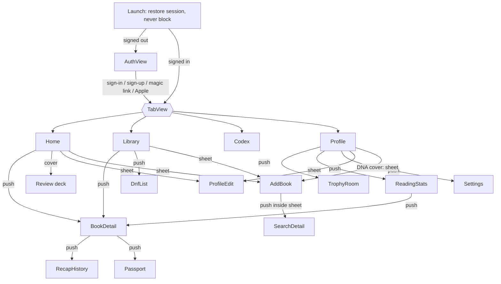

# Screen Inventory — PWA routes and surfaces → iOS screens

Last updated: 2026-10-18

**Source:** web `master` @ `8d8701c` (PWA v3.9.1), `src/router/index.ts`, `src/pages/*`, `src/components/**`, and the live Supabase project, checked on 2026-10-18. Product name **The Chronicler**; "BookHero" is the internal code name (D-03).

This file is the per-screen checklist for the native app: what each screen is for, how the reader gets there, what data it reads and writes, every state it must design (with the PWA's real copy), and how it is presented on iOS 26. **Behaviour lives in the [business-rules catalog][README]**; every row links to the rules that own it. Look and feel lives in the [design brief][brief], the [tokens][tokens] and the [component inventory][components].

## How to read this file

| Term | Meaning |
|---|---|
| **Tab root** | Root view of one of the four tabs, inside its own `NavigationStack`. |
| **Push** | `NavigationLink` / typed route on the current tab's stack. Back is the system back button and swipe; scroll position is preserved (unlike the web's PLT-20). |
| **Sheet** | `.sheet` with detents. System sheets render in Liquid Glass at partial heights on iOS 26. |
| **Cover** | `.fullScreenCover`: immersive or camera tasks with an explicit exit. |
| **Alert / Dialog** | `.alert` (two-choice question) or `.confirmationDialog` (destructive choice). |
| **Inline** | A card or section inside a screen, not a navigation step. |
| **Overlay** | Top banner or capsule drawn above all content (toasts, generation banner). |
| **Phase** | Build phase in the [iOS implementation plan][plan]: **0B** shell, **1** MVP, **2** AI & memory, **3** native polish. |
| **Today (PWA)** | Tables, RPCs, edge functions and external APIs the web calls now. |
| **iOS (after 0A)** | What the iOS app calls once Phase 0A lands ([consolidation plan][bc]). iOS never re-implements a client write that a BC package moves server-side. |
| "Copy" | Quoted strings are the PWA's current English copy. They are the default for iOS unless a rule, an open decision or D-03 changes them. Copy that says "BookHero" becomes "The Chronicler" on iOS. |

---

## 1. Navigation model (iOS)

| Concern | iOS design | Rules |
|---|---|---|
| Root | Restore the stored session without waiting on the network (bounded like the web's 3 s race), show cached UI at once, then `AuthView` or the `TabView`. No full-screen "Loading..." splash beyond the launch screen. | [PLT-09…PLT-12][PLT] |
| Tabs | **Home · Library · Codex · Profile** (the web's labels). The iOS 26 floating Liquid Glass tab bar. The web's fifth "More" button does not exist on iOS. | [PLT-22][PLT] |
| "More" sheet replacement | **Add Book** → `+` toolbar item on Home and Library (plus the empty-state CTAs and a Home Screen quick action). **Light/Dark mode** and **Sign out** → **Settings**, pushed from a Profile toolbar button. | [PLT-22][PLT], D-10, D-11 |
| Running session | `.tabViewBottomAccessory` mini player (book, live timer, pause, End) on every tab while a session runs. Phase 1. | [SES-08…SES-22][SES] |
| Book Detail | Pushed onto the **current** tab's stack (Home, Library, Profile › Stats calendar). Zoom transition from the tapped cover (`.navigationTransition(.zoom)`), off under Reduce Motion. | — |
| Back | Native stack pop. No `window.history.length` heuristic and no hard-coded parents. | [PLT-21][PLT] |
| Deep links | Universal links. v1 claims `/auth/*` (magic-link callback, password reset). Later `/books/*` and `/lexicon` (Codex tab + book filter + Insights tab as a typed route). An unknown link opens Home; there is no 404 screen. | [PLT-23][PLT], PLT-Q05 |
| Signed-out deep link | Hold the pending link across `AuthView` and open it after sign-in (the web loses it). | [PLT-05][PLT] |
| Global overlays | One top **banner** system: glass-toast variants (success / loading / warning), the de-duplicated load-failure notice, and the Insight-generation capsule. Page-level outcomes ("Remove failed", "Profile saved"…) use the same banner, not a second bottom toast. | [PLT-35, PLT-37, PLT-38][PLT], [INS-17, INS-60][INS] |
| Orientation | Portrait only on iPhone (the web manifest is `portrait-primary`). | — |
| Home Screen quick actions | "Current read" (Home) and "Add book" (AddBook sheet), matching the web manifest shortcuts. Phase 3. | — |

---

## 2. Screen map

The sixteen product routes in `src/router/index.ts` each map to one iOS screen, except the 404.

| PWA route (name) | PWA page | iOS screen | Presentation | Phase | Owning rules |
|---|---|---|---|---|---|
| `/login` (`login`) | `AuthPage.vue` | `AuthView` | Root (signed out) | 1 | [PLT-01…PLT-08, PLT-82][PLT] |
| `/` (`dashboard`) | `DashboardPage.vue` | `HomeView` | Tab root | 1 (+2 AI parts) | [SES-53…SES-74][SES] |
| `/library` (`library`) | `LibraryPage.vue` | `LibraryView` | Tab root | 1 | [LIB-44…LIB-60, LIB-99…LIB-112][LIB] |
| `/library/dnf` (`library-dnf`) | `DnfListPage.vue` | `DnfListView` | Push (Library) | 1 | [LIB-90…LIB-95][LIB] |
| `/books/add` (`add-book`) | `AddBookPage.vue` | `AddBookView` | Sheet (large) with its own stack | 1 | [LIB-01…LIB-43, LIB-66…LIB-86, LIB-103…LIB-107][LIB] |
| `/books/add/details/:source/:key(.*)` (`add-book-details`) | `BookSearchDetailPage.vue` | `SearchDetailView` | Push inside the AddBook sheet | 1 | [LIB-24…LIB-38, LIB-105, LIB-106][LIB] |
| `/books/:id` (`book-detail`) | `BookDetailPage.vue` | `BookDetailView` | Push (any tab) | 1 (+2 AI parts) | [LIB-40…LIB-42][LIB], [SES-42, SES-66][SES], [INS-43, INS-44][INS], [REC-02, REC-56][REC] |
| `/books/:id/recaps` (`recap-history`) | `RecapHistoryPage.vue` | `RecapHistoryView` | Push | 2 | [REC-50…REC-54, REC-69][REC] |
| `/books/:id/passport` (`book-passport`) | `BookPassportPage.vue` | `PassportView` | Push | 2 | [SES-44…SES-52][SES] |
| `/lexicon` (`lexicon`) — `?tab=lore`, `?bookId=` | `GreatLibraryPage.vue` ("Codex") | `CodexView` | Tab root | 2 | [LEX-70…LEX-82][LEX], [INS-45…INS-49][INS] |
| `/anki-review` (`anki-review`) | `AnkiReviewPage.vue` | `ReviewDeckView` | Cover | 2 | [LEX-57…LEX-69][LEX] |
| `/profile` (`profile`) | `ProfilePage.vue` | `ProfileView` | Tab root | 2 (Phase 1: tab shell + Settings entry) | [PRO-37…PRO-41, PRO-63…PRO-72][PRO] |
| `/profile/trophy-room` (`trophy-room`) | `TrophyRoomPage.vue` | `TrophyRoomView` | Push (Profile) | 2 | [PRO-01…PRO-20, PRO-39, PRO-47…PRO-51, PRO-106][PRO] |
| `/profile/stats` (`profile-stats`) | `ReadingStatsPage.vue` | `ReadingStatsView` | Push (Profile) | 2 | [PRO-21…PRO-35, PRO-40…PRO-46][PRO] |
| `/profile/edit` (`profile-edit`) | `ProfileEditPage.vue` | `ProfileEditView` — **username, display name, avatar only (D-13)** | Sheet (large) | 2 | [PRO-73…PRO-90, PRO-104][PRO], [COM-01…COM-14][COM] |
| `/:pathMatch(.*)*` (`not-found`) | `NotFoundPage.vue` | — | — | — | [PLT-19][PLT] |
| *(none — new on iOS)* | — | `SettingsView` and its account flows (§5) | Push (Profile) | 1 | D-10, D-11, [PLT-40, PLT-72][PLT], PLT-Q01, PLT-Q06 |

Dead page, not routed: `src/pages/LexiconPage.vue` (LEX-D29). Do not port it.

---

## 3. Screens

Each screen lists **purpose · entry points · data · states · iOS presentation · sources**. "States" covers loading, empty, error and every content variant; design all of them.

### 3.1 `AuthView` — `/login`

**Purpose.** Sign in or create an account. **Phase 1.**

**Entry.** App launch while signed out; a protected deep link while signed out; sign-out; account deletion.

**Data.** Today: Supabase Auth only (`signInWithPassword`, `signUp`, `signInWithOtp`). iOS: Sign in with Apple (`signInWithIdToken`), email + password, magic link and password reset through universal links (PKCE), per D-11 / BC-11.

| State | PWA (copy) | iOS |
|---|---|---|
| Brand | "The Chronicler" / "Your AI reading companion" | Same (D-03) |
| Idle | Tabs "Sign in" / "Sign up"; Email (`you@example.com`), Password (`••••••••`); submit "Sign in" / "Create account" | **Sign in with Apple** button first, then email + password; "Forgot password?" link (new); Hide-My-Email guidance "Already have an account? Sign in with email first" (D-11) |
| Magic-link mode | Toggle "Sign in with magic link instead" / "← Back to password sign in"; submit "Send magic link" | Same, plus resend with cooldown and "Use a different email" (PLT-D17) |
| Submitting | Button spinner | Button spinner; fields disabled |
| Magic link sent | "Magic link sent! Check your email." — terminal until reload (PLT-08) | `CheckInboxView` state (§5.4) |
| Error | Raw Supabase message in a red banner, else "Something went wrong. Please try again." (PLT-04) | Map `invalid_credentials`, `user_already_exists`, `over_email_send_rate_limit`, `email_not_confirmed` to friendly copy; fall back to the server text |
| Email confirmation required | No state (bounces back silently, PLT-06) | "Check your inbox" state if PLT-Q02 turns confirmation on |

**iOS presentation.** Root replacement (not a sheet). Keyboard-safe layout, `textContentType(.username/.password/.newPassword)`.

**Sources.** `src/pages/AuthPage.vue`, `src/stores/auth.ts`. Rules: [PLT-01…PLT-08, PLT-82][PLT]; D-11; [BC-11][bc].

### 3.2 `HomeView` — `/` (dashboard)

**Purpose.** Get the reader back into the current book in two taps: session controls, page saves, recap, and the day's review prompt. **Phase 1**; Get Recap, capture prompt, Word of the Day, Insight nudge and "New Lore" chip are **Phase 2**.

**Entry.** Home tab; launch; after sign-in (PLT-05); after adding a book as "Reading now"; Review deck "Back to dashboard"; quick action "Current read" (Phase 3).

**Render order** ([SES-54][SES]): greeting → one of {loading · `empty` · `oneQueued` · `completedOnly` · sections}. Sections: Hero → Word of the Day → Last Session → In Progress → Up Next → Completed.

| Section visibility ([SES-55][SES]) | `empty` | `oneQueued` | `completedOnly` | `oneInProgress` | `standard` |
|---|---|---|---|---|---|
| Onboarding card | ✓ | ✓ | ✓ (completed-only card) | — | — |
| Hero | — | — | — | ✓ | if a hero exists (a book in progress, or an explicit pick from Up Next) |
| Word of the Day / Vocabulary Review | — | — | — | ✓ | ✓ |
| Last Session | — | — | — | ✓ | ✓ |
| In Progress (other books) | — | — | — | if any | if any |
| Up Next shelf | — | — | — | — | if any |
| Completed row | — | — | — | if any | if any |

**Data.**

| | Today (PWA) | iOS (after 0A) |
|---|---|---|
| Library + progress | `get_library_with_progress`; `reading_progress.session_paused_at` fetched lazily per active book | Same RPC with `sessionPausedAt` and `completedAt` (BC-14) |
| Sessions & saves | `reading_progress` upserts, `progress_history` insert, IndexedDB queue | `start_session` / `pause_session` / `resume_session` / `cancel_session` / `save_progress` / `set_session_note` (BC-04) |
| Hero & queue | `up_next_order` | Same |
| Forecast | `get_reading_velocity(p_user_id, [heroId])` | Same, cached per book, reader time zone (BC-06) |
| Last Session | `get_last_session` | Same; timed sessions only (D-08) |
| Word of the Day / review prompt | `lexicon_entries` (all), `anki_review_sessions`, local WotD cache | `get_todays_review`, `review_lexicon_entry` (BC-10) |
| Recap | `recaps`, `page_captures`, `generate-recap` (client insert) | `get_recap_eligibility`, `generate-recap` v2 (BC-07) |
| Insights | `lore_cards` (all; `seen` flag), `generate-lore` after a save | `effects.insightMilestonesQueued` from `save_progress` + bounded `get_my_jobs` (BC-08) |
| Greeting | `get_my_community_profile` | Same |

**States.**

| State | Copy / content | Rules |
|---|---|---|
| Greeting | "Up late" (< 5 h) / "Good morning" (< 12) / "Good afternoon" (< 18) / "Good evening", then ", {readerName}"; date line; avatar → Profile | [SES-57][SES], [PRO-92][PRO] |
| Greeting, no reader profile | Card "Set up your reader profile" / "Pick a username and an avatar" → ProfileEdit | [PRO-92][PRO] |
| Loading | Glass skeleton: 160 pt cover block + two text lines | [SES-53][SES] |
| `empty` | Eyebrow "First book", title "Build your library", body "Add a book you are reading now, want to read next, or already finished."; buttons "Add a book", "Import library" | [SES-56][SES] |
| `oneQueued` | Eyebrow "Ready when you are", title = book title, body "Start this book to make it your active read."; buttons "Start reading" (→ Book Detail), "Add another" | [SES-56][SES] |
| `completedOnly` | Eyebrow "Library started", title "{n} completed book(s)", body "Your archive is in place. Add a current read when you are ready to track sessions and recaps."; up to 3 titles (→ Book Detail); buttons "Add current read", "View library" | [SES-56][SES] |
| Load failure | No inline error. One top warning "Some things didn't load" / "Reopen the app or refresh the page to try again." (≤ 1 per 30 s); a failed library load renders as `empty` ⚠ — iOS keeps cached content and offers Retry, never the onboarding card | [PLT-35, PLT-36][PLT] |
| Offline | Hero tag "Progress will sync when you're back online" | [SES-77][SES] |

**Hero card** ([SES-66…SES-68][SES], [INS-50, INS-51][INS]):

| Element | Content |
|---|---|
| Header | Cover 96×142, genre chip, title + chevron (→ Book Detail), author |
| Progress | Bar + "{pct, 1 dp}%"; "Page X of Y" + pencil (only when no session runs) |
| Forecast line | Insight nudge "N page(s) to your next Insight" (≤ 15 pages to the next 10 % bucket and > 15 pages left) **or** "N pages left" + "finish by ~{MMM d}" / "you could finish today" |
| Idle actions | "Start Session" (outlined) + "Get Recap" / lock label ("N more pages", "Recap in N hours", fallback "Read N more pages") / "Recap open" while the recap sheet is up |
| Active actions | Timer card (pause · stop · `M:SS` / `H:MM:SS`, "paused") + "End Session" + "Focus mode" link. **Get Recap is hidden on the hero only** while a session runs ([REC-02][REC]) |
| Errors | Session error under the Start control (e.g. "You appear to be offline. Start Session requires a connection."); save error "⚠ {message}" |
| After a save | Inline capture prompt (§4.10) or the last session note "✎ {note}" |
| "New Lore" chip | Top-right "New Lore" → Book Detail (marks seen there) ([INS-38, INS-39][INS]) |

**Word of the Day card** ([LEX-49…LEX-57][LEX]), first match wins:

| Variant | Copy |
|---|---|
| Vocabulary Review prompt (last session ≥ 3 days ago or never, and ≥ 5 words in today's set) | "Vocabulary Review" / "Ready for review" / "Tap to start your flashcard session." → Review deck |
| Daily limit reached, more waiting | "Word of the Day" / "Daily review done!" / "You've cleared today's words. More are waiting." + "Review more" |
| Nothing due | "All caught up!" / "Next word due {tomorrow · in N days · on MMM d}." → Codex |
| Normal | Term, definition, "from: {book} · p.N", "{n} left", advance arrow (Leitner advance) → tap card opens Codex |
| No words | Card hidden |

**Last Session card** ([SES-72…SES-74][SES]): timed — "Last Session · {relative}", book row, "Time" ("< 1 min" / "N minutes"), "Velocity" ("N pages/hr"), "This sitting" ("N% of the book"), "At this pace" ("Finish next session! 🎉" / "~N more sessions"). Untimed — "Last Update · {relative}" with "This sitting" only. **iOS shows only real timed sessions (D-08)**; hidden when none.

**In Progress / Up Next / Completed** ([SES-63…SES-65][SES]): In Progress lists the other reading books (thumb, title, author, bar, %, "New Lore" chip); tap makes it the hero. Up Next is a cover shelf with a count; tap makes it the hero. Completed is one row "Completed {n}" with three covers → Library.

**Dialogs from Home:** page save sheet (§4.1), Focus mode (§4.4), recap sheet (§4.5), inferred-recap alert (§4.6), completion alert (§4.7), cancel-session dialog (§4.8), import sheet (§4.13), Session Resume / Memory Check gates (§4.2, §4.3).

**iOS presentation.** Tab root; the greeting is the scroll header (no large navigation title). The running-session mini player (§5.7) shows on every tab, Home included.

**Sources.** `src/pages/DashboardPage.vue`, `src/components/dashboard/*`, `src/components/session/*`, `src/composables/useDashboardOnboardingState.ts`, `src/composables/useActiveBook.ts`. Rules: [SES-53…SES-74][SES], [LEX-44…LEX-57][LEX], [INS-38…INS-51][INS], [REC-02…REC-10][REC].

### 3.3 `LibraryView` — `/library`

**Purpose.** Browse, search, reorder, edit and delete every book. **Phase 1.**

**Entry.** Library tab; "View library" (Home completed row and `completedOnly`); after adding a non-"Reading now" book; DNF list back; Book Detail "Back to Library".

**Data.** Today: `get_library_with_progress`, `up_next_order` (read; upsert on reorder), `lore_cards` (New Lore chip), `get_reading_velocity` (reading ids), `books` update/delete. iOS: the same reads; edits and deletes per [LIB-61…LIB-65, LIB-87…LIB-89][LIB]; velocity cached **per book** (fixes LIB-D29).

| State | Copy / content | Rules |
|---|---|---|
| Header | "Library"; DNF button (only when ≥ 1 shelved); list/grid toggle; "+" | [LIB-54][LIB] |
| Loading | 3 skeleton rows (64×92 cover + two lines + bar) | [LIB-109][LIB] |
| Empty library | "Your library is empty" / "Scan an ISBN or add a book manually to start tracking your reading." + "Add your first book"; search hidden | [LIB-109][LIB] |
| Load failure | Falls through to the empty state today ⚠ | [LIB-112][LIB] — iOS shows cached data + a retry banner, never the empty state |
| Search | Sticky bar "Search your library…" (accent-insensitive, title or author, instant); grouped results **Now Reading · Queue · Completed · Did Not Finish** with counts; "No books match “{query}”." | [LIB-53, LIB-104][LIB] |
| List view | "Now Reading" (count; "No books in progress."), pill tabs "Queue {n}" / "Completed {n}", reorder toggle (Queue with ≥ 2 books) | [LIB-48, LIB-51][LIB] |
| Queue empty | "Your Want-to-read shelf is empty. Import your Goodreads or StoryGraph library, or search for your next read." + "Add or import books" | [LIB-109][LIB] |
| Completed empty | "No finished books yet." | [LIB-109][LIB] |
| Grid view | Collapsible "Now Reading" (wide cards), "The Queue" (cover grid + "Reorder" / "Done"), "Completed" (dimmed grid); collapse state remembered | [LIB-49, LIB-50][LIB] |
| Book row | Cover or initials, genre chip, "Imported", title, author, bar + %, "Page X of Y", "Set page count" (estimated pages), "~N days left" / "Finish today!", "New Lore" chip | [LIB-99, LIB-100][LIB] |
| Row actions | Swipe → "Edit" / "Delete" (touch only on the web) | [LIB-102][LIB] |
| Delete | Dialog (§4.9); failure "Remove failed" / "Could not remove the book. Try again." | [LIB-87…LIB-89][LIB] |
| Reorder failure | "Reorder failed" / "Could not save the new queue order. Try again." (order reverts) | [LIB-57][LIB] |

**iOS presentation.** Tab root with large title "Library"; `.searchable` (no autocorrect, no autocapitalisation); toolbar: DNF (`nosign`) when ≥ 1 shelved, view-mode menu, `+` (AddBook sheet). List mode: `List` sections + segmented `Picker` (Queue / Completed); `.swipeActions` **and** a context menu (Edit, Delete) so actions are not touch-only; `EditMode` + `.onMove` for the queue with VoiceOver move actions. Grid mode: `LazyVGrid` with collapsible section headers. View mode, tab and collapsed sections persist per device (`@AppStorage`).

**Sources.** `src/pages/LibraryPage.vue`, `src/components/library/*`, `src/components/books/BookCard.vue`, `BookGridCard.vue`, `BookEditDialog.vue`. Rules: [LIB-44…LIB-65, LIB-87…LIB-89, LIB-99…LIB-112][LIB].

### 3.4 `DnfListView` — `/library/dnf`

**Purpose.** See shelved ("Did Not Finish") books and resume one. **Phase 1.**

**Entry.** Library toolbar DNF button (shown only when ≥ 1 book is shelved); search results' "Did Not Finish" group rows go to Book Detail instead.

**Data.** Today: `get_library_with_progress` (status `dnf`, sorted by `dnf_at` desc); resume = `reading_progress.dnf_at = null`. iOS: `resume_dnf` (BC-04).

| State | Copy / content |
|---|---|
| Header | "Did Not Finish" + count |
| Loading | 2 skeleton rows |
| Empty | "Nothing shelved" / "Books you mark as Did Not Finish will land here — you can pick them back up anytime." + "Back to Library" |
| Row | Cover, title, author, detail "stopped at p. X · Y% · shelved {relative}" (omitted for an imported book still at page 0); "Resume"; tap → Book Detail |
| Resume success / failure | "Back on the shelf" / "The book is back in your reading list." · "Resume failed" / "Could not resume the book. Try again." |

**iOS presentation.** Push from Library; `List` with a trailing "Resume" button per row and a swipe action.

**Sources.** `src/pages/DnfListPage.vue`. Rules: [LIB-90…LIB-95][LIB], [SES-75][SES].

### 3.5 `AddBookView` — `/books/add`

**Purpose.** Add a book by search, barcode, typed ISBN, manual entry or CSV import, with its initial status. **Phase 1.**

**Entry.** Home or Library `+`; Home `empty` / `oneQueued` / `completedOnly` CTAs; Library queue-empty CTA; Home Screen quick action "Add book" (Phase 3). The web also reaches it from the "More" sheet.

**Data.** Today: Google Books + Open Library from the client; `books` insert + quiet `reading_progress` write. iOS: the `book-search` proxy (no API key in the bundle), `set_initial_status`, `find_library_duplicates` (warn only), `import_library` (BC-15, BC-04).

| Step / state | Copy / content | Rules |
|---|---|---|
| Hub | Title "Add a Book"; "Scan ISBN", "Add Manually", "Import from Goodreads or StoryGraph"; search "Search for a book" / "Title, author, or ISBN" | [LIB-107][LIB] |
| Search running | "Searching…" | [LIB-30][LIB] |
| Search results | Rows: cover, title, author, first-publish year, chevron → Search Detail; "Load more" | [LIB-103][LIB] |
| Search empty | "No books found. Try a different title, author, or ISBN." (only after a search ran) | [LIB-107][LIB] |
| Search error | "Search failed. Check your connection and try again." + "Retry"; paging error "Could not load more results. Please try again." | [LIB-32][LIB] |
| Scan | "Scan the barcode on the back of your book."; reticle "Aim at the barcode"; success "Barcode detected!"; "Looking up ISBN…" | [LIB-19, LIB-20][LIB] |
| Scan error | "Could not access camera. Please check permissions." + "Retry" | [LIB-19][LIB] |
| Typed ISBN | "No camera? Enter the ISBN manually:" (`e.g. 9780261102354`), "Look up", "Skip — enter details manually" | [LIB-21][LIB] |
| Form | "Metadata found! Review and save." when prefilled; Title *, Author *, Total Pages *, Library status ("Want to read" / "Reading now" / "Already finished"), Current Page * (Reading now), Genre, ISBN ("optional — improves AI recap accuracy"), Cover URL | [LIB-01…LIB-17][LIB] |
| Form errors | "Title is required", "Author is required", "Enter a valid page count", "Enter a page between 1 and {max}" / "Use Already finished for one-page books"; save error inline | [LIB-26, LIB-110][LIB] |
| Saved | Web: "Reading now" → `/`, otherwise `/library` | [LIB-13…LIB-17][LIB] |

**iOS presentation.** `.sheet` (large) owning a `NavigationStack`: hub (search field inline) → Scan (VisionKit `DataScannerViewController` for EAN-13 with the 978/979 Bookland prefix only, fixing LIB-D25; AVFoundation fallback) → Form (push) or Search Detail (push). Import opens the import sheet (§4.13) on top. On save, dismiss and switch tab: **Home** for "Reading now", otherwise **Library**.

**Sources.** `src/pages/AddBookPage.vue`, `src/components/books/{BookSearchSection,BookSearchResultCard,IsbnScanner,BookForm}.vue`, `src/components/import/*`. Rules: [LIB-01…LIB-43, LIB-66…LIB-86, LIB-103…LIB-107][LIB]; [SES-33][SES].

### 3.6 `SearchDetailView` — `/books/add/details/:source/:key`

**Purpose.** Review a search result, correct its metadata, pick a status and add it. **Phase 1.**

**Entry.** AddBook search result; a recommendation poster on this screen; a Reading DNA recommendation cover on Profile (Phase 2 — opens the AddBook sheet at this step).

**Data.** Today: Google Books / Open Library detail + recommendations (client), `books` insert, quiet initial status. iOS: `book-search` proxy, `find_library_duplicates`, `set_initial_status` (BC-15).

| State | Copy / content |
|---|---|
| Header | "Add to Library" |
| Loading | Hero skeleton (cover 116×174 + three lines) + description block |
| Load error | "Could not load this book. Please go back and try again." |
| View | Hero (cover → full-screen preview, genre pill, title or "Untitled", author, "{n} pages · ISBN {isbn}"); duplicate notice "This book is already in your library. You can still add it."; "About this book" + "Read more" / "Read less" or "No description available."; "Edit details" |
| Edit details | Metadata-only form, submit "Done" |
| Add | "Add to your library": "Want to read" / "Reading now" / "Finished"; "Current page" ("Where are you now?") for Reading now; "Add to Library" |
| Add errors | "Title and author are required — tap “Edit details”." · "This book needs a page count — tap “Edit details” to add it." · "Enter a current page between 1 and {max}." · save error |
| Recommendations | "More {subject} books" / "You might also like"; posters → another detail; hidden when empty |

**iOS presentation.** Push inside the AddBook sheet. Status as a segmented control; current page as a number field with stepper.

**Sources.** `src/pages/BookSearchDetailPage.vue`, `src/components/books/{SearchBookHero,BookDescription,LibraryStatusSelector,BookRecommendationsScroller}.vue`. Rules: [LIB-24, LIB-26, LIB-34…LIB-38, LIB-105, LIB-106][LIB].

### 3.7 `BookDetailView` — `/books/:id`

**Purpose.** The hub for one book: progress and sessions, memory aids, Codex, Insights, recaps and the journey. **Phase 1** (header, progress panel, sessions, DNF, edit/delete); **Phase 2** (chips, Memory Check, capture prompt, Insights, recaps, passport button).

**Entry.** Home hero chevron, In Progress "New Lore" chip, `oneQueued` "Start reading", `completedOnly` titles; Library rows and search results; DNF rows; Reading Stats calendar day rows.

**Data.**

| | Today (PWA) | iOS (after 0A) |
|---|---|---|
| Book & progress | `books` (falls back to a full library fetch), `reading_progress`, `progress_history` | `get_library_with_progress` cache + BC-04 RPCs |
| Description backfill | Google Books search + detail, then `books.description` update (once) | `book-search` proxy (BC-15) |
| Recaps | `recaps`, signed URLs from `recap-images` | `get_recap_eligibility`, `generate-recap` v2 (BC-07) |
| Insights | `lore_cards` + bulk `seen = true` on mount | `mark_insights_seen` (BC-08) |
| Codex | `lexicon_entries` (book) | Same; add via the Codex sheet |
| Memory Check / resume / capture | `page_captures`, `book_quizzes`, `generate-book-quiz`, `generate-page-resume`, `ocr-page`, `extract-vocabulary` | Same functions behind BC-02 auth; Vision OCR first (D-15) |
| Passport | `book_passports` (button gated on `source = 'manual'`) | Button shown whenever a passport row exists (BC-05, SES-Q06) |

| State / section | Copy / content | Rules |
|---|---|---|
| Loading | Skeleton (200 pt cover block + two lines) | [LIB-113][LIB] |
| Not found | "Book not found." + "Back to Library" | [LIB-109][LIB] |
| Header | Cover 128×188, title, author, genre chip, "{n} pages", description clamped with "Read more" / "Show less" | [LIB-41, LIB-42][LIB] |
| Progress panel | "Reading Progress", bar + "{pct}%", "Page X of Y" + pencil (not complete, no session, not shelved) | [SES-28, SES-42][SES] |
| Session controls | "Start Session" → gates (§4.2, §4.3) → timer card; "End Session"; "Focus mode" | [SES-08…SES-22][SES] |
| Complete | Session controls, pencil, Memory Check chip, DNF link and Get Recap disappear; "View Reading Journey" | [SES-42, SES-52][SES] |
| Chips | "+ Codex" (Add to Codex, page pre-filled); "Words N" (N > 0) → Codex; "Memory check" (not complete) | [LEX-102][LEX], [CAP-66, CAP-66a][CAP] |
| Shelve link | "Didn't finish it? Shelve this book" → dialog (§4.9) | [LIB-90][LIB] |
| Shelved (DNF) | "Shelved as Did Not Finish · {relative}" + "Start reading again"; hides session controls, chips, Memory Check, capture prompt, Insights card and Recap memories | [LIB-93][LIB], [SES-75][SES] |
| Panel errors | Save error; "Could not shelve the book. Try again."; "Could not resume the book. Try again." | [LIB-91, LIB-92][LIB] |
| Capture prompt | After a save made on this screen (§4.10) | [CAP-04][CAP] |
| Insights card | Collapsed by default; type badge, "Unlocked at N%", title, cycle button when several; hidden when none | [INS-43, INS-44][INS] |
| Recap memories | "Recap memories" header with a "Get Recap" / lock label ("Locked" fallback) / "Recap open" button — the button is hidden on complete books and **stays visible during a session**; carousel of illustrated recaps or "Generate recaps as you read — your moments become images that gather here."; "View Recap History (N)" | [REC-02, REC-09, REC-56][REC] |

**iOS presentation.** Push. Toolbar menu: **Edit** (Book edit sheet, §4.12) and **Delete** (dialog, §4.9) — the web only offers these by swiping a Library row. Session controls mirror the Home hero; the same page sheet, gates and Focus mode are reused.

**Sources.** `src/pages/BookDetailPage.vue`, `src/components/book/*`, `src/components/lore/LoreChronoscopeCard.vue`, `src/components/recap/RecapDialog.vue`. Rules: as above.

### 3.8 `RecapHistoryView` — `/books/:id/recaps`

**Purpose.** Read every recap of a book as a journal. **Phase 2.**

**Entry.** Book Detail "View Recap History (N)"; recap sheet "View history (N)"; Memory Check summary "Feeling hazy? Read the full recap"; Profile "Recap memories" gallery item.

**Data.** Today: `recaps` (book, newest first); `recaps.image_status` / `image_path` polled every 2 s while `pending`; signed URLs (60 s). iOS: same reads; capped polling or Realtime (BC-13, BC-14).

| State | Copy / content |
|---|---|
| Header | "Recap History" + book title |
| Loading | 3 skeleton cards |
| Error | "{message}" (fallback "Failed to load recap history") + "Retry" |
| Empty | "No recap history yet." / "Generate your first recap from the book detail page." |
| Card | "pages X–Y · N%" + date; illustration (skeleton · image · placeholder for failed · none for legacy); byline "From your captures · N days later"; prose; "Keep an eye on" chips; open-thread quote |
| Image pending | Skeleton; must reach a terminal state on iOS (no endless "Illustrating…") |

**iOS presentation.** Push. Back returns to wherever the reader came from (native stack).

**Sources.** `src/pages/RecapHistoryPage.vue`, `src/components/recap/{RecapHistory,RecapCard,RecapImagePanel}.vue`. Rules: [REC-47…REC-54, REC-69][REC].

### 3.9 `PassportView` — `/books/:id/passport`

**Purpose.** The finished-book "Reading Journey": stats and a short AI summary to share. **Phase 2.**

**Entry.** Completion alert "View Journey" (§4.7); Book Detail "View Reading Journey".

**Data.** Today: `book_passports`, `get_book_passport_stats(p_user_id, p_book_id, p_time_zone)` (rewritten on view), `generate-recap` `passport_summary` (client-triggered). iOS: read the passport row with **frozen** stats and `summary_status` (BC-05); no client generation.

| State | Copy / content |
|---|---|
| Header | "← Back"; "✦"; "Reading Journey"; title; "by {author}" |
| Loading | "Loading your reading journey..." |
| Error | "Could not load your reading journey." / "Please try again in a moment." |
| Generating | "Crafting your reading journey…" + streamed preview |
| Not generated | "Your passport is being generated." / "Check back in a moment." — shown forever today when no passport exists (SES-50); iOS hides the entry instead |
| Content | Tiles "{n} days — to finish", "{n} pages — peak day · {date}", "{n} — words learned"; "✦ Your Story So Far" + summary; "Share Journey" |
| Summary failed (iOS) | Stats without the summary block, no dead end (BC-05) |
| Share text | `I finished "{title}" by {author}! 📚✨` + days and words + `#TheChronicler` |

**iOS presentation.** Push; `ShareLink` (text, optional rendered card in Phase 3).

**Sources.** `src/pages/BookPassportPage.vue`, `src/stores/bookPassport.ts`. Rules: [SES-44…SES-52][SES]; SES-Q06.

### 3.10 `CodexView` — `/lexicon`

**Purpose.** The reader's words, quotes and Insights. **Phase 2.**

**Entry.** Codex tab; Word of the Day card; Book Detail "Words N" (both pass `?bookId=`). The `?tab=lore&bookId=` link exists only in the Insights card's compact variant, which Book Detail never mounts. Today `?bookId=` filters **only the Insights tab**; the Lexicon list opens unfiltered (LEX-D06, decision LEX-Q08). iOS: filter the tab the reader came for.

**Data.** Today: `lexicon_entries` (server-side search, page size **10**, debounce 300 ms), `books`, `lore_cards`, dictionaryapi.dev (Add Word). iOS: same reads; adds via the Codex sheet; dictionary content needs the Wiktionary CC BY-SA attribution ([LEX-103][LEX]).

| State | Copy / content | Rules |
|---|---|---|
| Header | "Codex" + "{n} word(s) · {m} mastered" (hidden at 0) | [LEX-82][LEX] |
| Tabs | "Lexicon" · "Insights" | [LEX-81][LEX] |
| Lexicon filters | Search "Search terms or definitions…", book (All Books), type ("All" / "Dictionary" / "Quotes"), sort "Newest" ↔ "A–Z"; "Add to Codex" | [LEX-70…LEX-76][LEX] |
| Loading | 3 skeleton cards (90 pt); 2 more while paging; "All entries loaded" at the end | [LEX-79][LEX] |
| Empty | "No words saved yet." / "Add a word while reading to build your vocabulary vault." | [LEX-79][LEX] |
| Filtered empty | "No results found." / "Try a different search term or filter." + "Clear filters" | [LEX-79][LEX] |
| Error | Error message + "Retry" | [LEX-78][LEX] |
| Lexicon card | Flip card. Front: "Dictionary" badge (quotes show "Lore" — ⚠ LEX-D27, iOS labels them "Quote"), "✓ Mastered", "p.N", term, book title, "tap to see definition". Back: definition (note for quotes), context | [LEX-80][LEX] |
| Insights filter | Book (All Books) | [INS-46][INS] |
| Insights loading / empty | 3 skeletons · "Keep reading to unlock your first lore card." / "Lore cards unlock at every 10% reading milestone." (iOS copy says "Insight") | [INS-49][INS] |
| Insight row | Collapsible: type badge (History / Culture / Geography / Technology / Lore), "Unlocked at N%", title; detail body, "Mentions:" chips, "Unlocked on {date} at N%" | [INS-47, INS-48][INS] |

**iOS presentation.** Tab root with a segmented control (Lexicon / Insights); `.searchable`; filter menu in the toolbar; `+` opens Add to Codex (§4.11). Flip cards need a VoiceOver "Show definition" action.

**Sources.** `src/pages/GreatLibraryPage.vue`, `src/composables/useGreatLibrarySearch.ts`, `src/components/lexicon/*`, `src/components/lore/{LoreCardList,LoreCardDetail}.vue`. Rules: [LEX-70…LEX-82, LEX-103][LEX], [INS-45…INS-49][INS].

### 3.11 `ReviewDeckView` — `/anki-review`

**Purpose.** A short flashcard session over today's due words. **Phase 2.**

**Entry.** Only the Home "Vocabulary Review" card today (the Codex has no entry point); App Intent "Review today's words" (Phase 3).

**Data.** Today: `lexicon_entries` (client Leitner writes), `anki_review_sessions` (read-modify-write). iOS: `get_todays_review`, `review_lexicon_entry`, `undo_lexicon_review`, `request_more_reviews`, `record_anki_session` (BC-10).

| State | Copy / content | Rules |
|---|---|---|
| Header | Back; "Undo" (last answer only); "{i} / {n}"; progress bar | [LEX-63, LEX-64][LEX] |
| Loading (deep link) | Blank deck area | [LEX-58][LEX] |
| Card | Front: term + pronounce button (en-US), "tap to reveal". Back: definition, context, "{book} · p.N". After flip: "Didn't know" / "Knew it"; swipe left/right | [LEX-60…LEX-62, LEX-69][LEX] |
| Empty, more waiting | "Daily review done!" / "You've cleared today's words — more are waiting." + "Review more" + "Back to dashboard" | [LEX-66, LEX-67][LEX] |
| Empty, nothing due | "You're all caught up!" / "No words due for review today." + "Back to dashboard" | [LEX-66][LEX] |
| Summary | "Great session!" (≥ 70 % known) / "Keep practising!"; "Reviewed", "Knew it", "Didn't know"; "Worth another look" (missed words); "Review more"; "Back to dashboard" | [LEX-65][LEX] |

**iOS presentation.** `.fullScreenCover` with an explicit Done: a focused task whose horizontal swipes must not fight sheet dismissal. Buttons are always available besides swipe; custom VoiceOver actions "Knew it" / "Didn't know".

**Sources.** `src/pages/AnkiReviewPage.vue`, `src/components/anki/SwipeableFlashcard.vue`, `src/composables/useAnkiSession.ts`. Rules: [LEX-24…LEX-69][LEX].

### 3.12 `ProfileView` — `/profile`

**Purpose.** Identity first, then the reader's DNA, recommendations, stats entry points and recap memories. **Phase 2** (Phase 1 ships only the tab shell with the Settings entry).

**Entry.** Profile tab; Home greeting avatar.

**Data.** Today (all loaded before first paint, DNA generation included): `get_library_with_progress`, `reading_dna` (+ `generate-reading-dna`, client upsert), `get_reading_stats`, `get_reading_quest_summary(p_year)`, `get_library_breakdown`, `get_my_community_profile`, `recaps` gallery (12 newest with an image) + signed URLs (3600 s), Open Library / Google for recommendation covers. iOS: `request_dna_refresh` without blocking first paint (BC-05); stats with the reader's time zone (BC-06); covers through `book-search` (BC-15).

| Section / state | Copy / content | Rules |
|---|---|---|
| Loading | Skeleton: 76 pt avatar circle + two lines, one card, 4 covers, 4 pills | — |
| Identity header | Avatar (or initials) inside the yearly-goal ring; "Lv N" badge (0-based level); reader name; level title; caption "{done} of {target} books this year" / "Set a yearly goal"; tap → ProfileEdit | [PRO-37…PRO-39, PRO-90][PRO] |
| DNA, below threshold | "Finish N more book(s) to unlock your Reading DNA." + progress bar | [PRO-63][PRO] |
| DNA, generating | Two skeleton lines | [PRO-63][PRO] |
| DNA, error | "Your Reading DNA couldn't be generated. We'll try again later." | [PRO-63][PRO] |
| DNA, populated | Mood tone + emoji row → DNA sheet (§4.14) | [PRO-63][PRO] |
| Recommendations | "Your DNA suggests": cover row → Search Detail; hidden without DNA or items | [PRO-64…PRO-68][PRO] |
| Stat pills | "Books", "Pages", "Hours", "Streak" ("{n}d"); values ≥ 10 000 as "12.3k"; tap → Reading Stats | [PRO-40, PRO-41][PRO] |
| Entry cards | "Trophy room" / "Quest goal and level" · "Stats" / "Charts, calendar, records" | — |
| Recap memories | "Recap memories": skeletons · empty "No memories yet" / "Keep reading and generating recaps — your favorite moments become images that gather here." · cards (image, book, date) → Recap History | [PRO-69…PRO-72][PRO], [REC-57][REC] |

**iOS presentation.** Tab root; toolbar gear → **Settings** (§5.1). Sections render as their data arrives; DNA never blocks the first paint.

**Sources.** `src/pages/ProfilePage.vue`, `src/components/profile/{ProfileIdentityHeader,DnaSignatureStrip,MoodSignature,DnaRecommendationsScroller,ProfileStatsNav,RecapImagesCarousel}.vue`. Rules: [PRO-37…PRO-72, PRO-90][PRO].

### 3.13 `TrophyRoomView` — `/profile/trophy-room`

**Purpose.** Goals half of the profile: yearly quest, level and achievements. **Phase 2.**

**Entry.** Profile "Trophy room" card.

**Data.** Today: on mount `useAchievements.sync()` loads `get_reading_quest_summary`, `get_reading_stats`, `get_reading_records` and the `achievements` ledger, then inserts newly earned keys; goal saves upsert `reading_goals`. iOS: `sync_achievements()` (server catalog, BC-09), quest summary with the reader's year (BC-06), goal write unchanged.

| State | Copy / content | Rules |
|---|---|---|
| Header | "Trophy Room" | — |
| Loading | Two skeleton blocks | — |
| Quest, loading / error | Ring skeleton · warning with the store message (e.g. "Reading quest could not be loaded.") | [PRO-106][PRO] |
| Quest, no goal | "Choose a calm yearly target and BookHero will track your pace as you read." + "Set yearly goal" — iOS says "The Chronicler" (D-03) | [PRO-106][PRO] |
| Quest, goal set | Status tag ("Quest complete" · "Pace warming up" · "Ahead of pace" · "On track" · "A little behind" · "Comeback arc available"); edit pencil; ring "{done}/{target}" + "N to go" / "quest complete"; "Pace needed" / "Your pace" ("{x.x}/mo") / "Forecast" | [PRO-13…PRO-15][PRO] |
| Level strip | "Level N" (0-based), "{xp} XP", level title, bar, "{n} XP to {next title}" / "Library Legend status secured." | [PRO-07, PRO-08, PRO-39][PRO] |
| Achievements | "Achievements" + "{earned} of 17"; badge grid (locked badges show a lock), title, description, earned date | [PRO-47…PRO-51][PRO] |
| Newly earned (iOS) | Celebrate once (haptic + highlight); the web has no celebration UI | BC-09 |

**iOS presentation.** Push from Profile; goal editing in a sheet (§4.15).

**Sources.** `src/pages/TrophyRoomPage.vue`, `src/components/profile/{QuestGoalHero,ReadingGoalDialog,ReaderLevelStrip,AchievementsGrid}.vue`, `src/utils/achievements.ts`. Rules: [PRO-01…PRO-20, PRO-39, PRO-47…PRO-51, PRO-106][PRO].

### 3.14 `ReadingStatsView` — `/profile/stats`

**Purpose.** Analytics half of the profile. **Phase 2.**

**Entry.** Profile "Stats" card; any stat pill.

**Data.** Today: `get_monthly_reading(p_year, p_timezone)`, `get_reading_calendar(p_month_start, p_timezone)`, `get_reading_stats` (UTC days today), `get_reading_records(p_timezone)`, `get_library_breakdown`, `get_library_with_progress` (book lengths, in-progress count). iOS: same RPCs with the reader's IANA zone (D-07, BC-06).

| Section / state | Copy / content | Rules |
|---|---|---|
| Header / loading | "Reading Stats" · three skeleton blocks | — |
| Your year | "{year}" with previous/next (next disabled at the current year); 12 bars; tap a month → "{Month} · N pages · N books finished"; default "{pages} pages · {n} books finished in {year}" | [PRO-45][PRO] |
| Calendar | "{Month yyyy}" + navigation; weekday header; days with a cover and "+N"; "No sessions logged this month{ yet}." / "N reading day(s) this month"; day detail list "reached p. N" → Book Detail | [PRO-33, PRO-46][PRO] |
| Lifetime Stats | Empty "Start your first session to see your stats."; tiles "Sessions this month", "In progress", "Pages read", "Reading hours", "Pages / hr", "Current streak", "Longest streak" | [PRO-42][PRO] |
| Personal Records | Hidden when none; "Best day", "Longest session", "Fastest finish", "Longest streak" | [PRO-35, PRO-44][PRO] |
| Book Lengths | Hidden with no finished books; "Your average finished book runs N pages." + "Longest" / "Shortest" | [PRO-43][PRO] |
| Library Breakdown | Empty "Add a book to see your library breakdown."; genre bar + legend; "{n} author(s)"; "finished" / "reading" / "unstarted" | [PRO-30][PRO] |

**iOS presentation.** Push; Swift Charts for "Your year" (with an audio graph); a custom month grid for the calendar.

**Sources.** `src/pages/ReadingStatsPage.vue`, `src/components/profile/{MonthlyReadingChart,ReadingCalendarCard,LifetimeStatsGrid,StatTile,RecordsCard,BookLengthCard,LibraryBreakdownCard}.vue`. Rules: [PRO-21…PRO-46][PRO].

### 3.15 `ProfileEditView` — `/profile/edit`

**Purpose.** Create or edit the reader identity. **Phase 2.**

**iOS v1 scope (D-13): username + display name + avatar ONLY.** No bio, no "Public profile" toggle, no "Who can see" privacy rows. The follow graph, discovery and circles are a much later Community phase; that backend stays dormant.

**Entry.** Profile identity header; Home greeting "Set up your reader profile".

**Data.** Today: `get_my_community_profile`, `is_username_available`, `upsert_my_community_profile` (**full replace**: omitted keys reset bio, `isPublic`, privacy), avatar upload to `community-avatars/{uid}/avatar-{ts}.jpg`. iOS: the BC-11.8 partial profile write, so absent keys keep their current values; it never resets fields set on the web ([PRO-104][PRO], PRO-Q20, [COM-14][COM]). Never call today's full-replace RPC with omitted keys.

| State | Web copy | iOS v1 |
|---|---|---|
| Loading | Skeleton: 96 pt circle + three fields | Same |
| First run | Title "Create your reader profile"; intro "Pick a username and (optionally) a face for your reading life. Everything here is yours to change later — and everything is private until you say otherwise."; suggested username from the email | Same title; intro without privacy wording that iOS cannot control; new profiles are not public (BC-11.8) |
| Edit | Title "Edit profile" | Same |
| Avatar | "Tap to add a photo" / "Tap to change your photo"; errors "Choose an image file.", "Choose an image under 8 MB."; downscaled to 512 px JPEG 0.85 | `PhotosPicker` + the same processing; upload "The image could not be uploaded. Try again." |
| Username | "@" prefix; checking / available / taken; hint "3–30 characters: lowercase letters, numbers, - and _" / "That username's already taken. Try another." | Same (reserved names per COM-05) |
| Display name | Free text | Same (≤ 60 per BC-01) |
| Bio, Public profile, Who can see | Present | **Not shown (D-13)** |
| Saving / saved | Spinner; toast "Profile saved" → Profile | Spinner; banner; dismiss |
| Save errors | "Usernames are 3–30 characters: lowercase letters, numbers, - and _." · "That username's already taken. Try another." · "Your profile could not be saved. Try again." | Same mapping (PRO-88) |

**iOS presentation.** Sheet (large) with Cancel / Save toolbar buttons; Save disabled while the username is invalid or taken.

**Sources.** `src/pages/ProfileEditPage.vue`, `src/composables/useCommunityIdentity.ts`. Rules: [PRO-73…PRO-90, PRO-104][PRO], [COM-01…COM-14][COM]; D-13; [BC-11][bc].

### 3.16 404 — `/:pathMatch(.*)*`

Web: "Page not found" / "The page you're looking for doesn't exist." + "Go home". **No iOS screen**: an unmatched universal link opens Home.

---

## 4. Modal, sheet and overlay surfaces

| # | Surface | PWA component | iOS | Phase |
|---|---|---|---|---|
| 4.1 | Page save sheet | `session/PageSaveSheet.vue` | Sheet (custom height) + number pad | 1 |
| 4.2 | Session Resume "Previously" | `session/SessionResumeDialog.vue` | Sheet (medium) | 2 |
| 4.3 | Memory Check | `session/MemoryCheckDialog.vue` | Sheet (large) | 2 |
| 4.4 | Focus mode | `session/FocusModeOverlay.vue` | Cover | 1 |
| 4.5 | Recap sheet | `recap/RecapDialog.vue` | Sheet (large) | 2 |
| 4.6 | Inferred-recap warning | ConfirmDialog in `DashboardPage` / `BookDetailPage` | Alert | 2 |
| 4.7 | Completion prompt | ConfirmDialog in `DashboardPage` / `BookDetailPage` | Alert | 1 |
| 4.8 | Cancel session | ConfirmDialog | Confirmation dialog (destructive) | 1 |
| 4.9 | Shelve (DNF) · Delete book | ConfirmDialog | Confirmation dialog | 1 |
| 4.10 | Capture prompt → camera → review → note | `session/SessionCaptureField.vue`, `capture/*`, `session/SessionNoteField.vue` | Inline card → covers | 2 (note: 1) |
| 4.11 | Add to Codex | `lexicon/AddWordDialog.vue` | Sheet (large, `Form`) | 2 |
| 4.12 | Book edit | `books/BookEditDialog.vue` | Sheet (`Form`) | 1 |
| 4.13 | Import library | `import/LibraryImportDialog.vue`, `ImportSummaryPanel.vue` | Sheet + `.fileImporter` | 1 |
| 4.14 | Reading DNA | Dialog inside `profile/DnaSignatureStrip.vue` | Sheet (medium/large) | 2 |
| 4.15 | Yearly goal | `profile/ReadingGoalDialog.vue` | Sheet (small detent) | 2 |
| 4.16 | Toasts and banners | `shared/GlassToast.vue`, `lore/LoreGenerationBanner.vue`, PrimeVue Toast | Top overlay banner | 0B |

### 4.1 Page save sheet

**Opened by** "End Session" (end mode) or the pencil (edit mode), on the hero, Book Detail and Focus mode. Rules: [SES-24…SES-27][SES].

| Element | Copy |
|---|---|
| Title | "Where did you stop?" (end) · "Update your page" (edit) |
| Input | −/+ stepper (bounded 0…total), numeric field, "of {total} pages" |
| Hints | "Enter a page between 0 and {total}." · "You're still on page N. Update it to finish the session." (end) · "That's already your current page." (edit) |
| Primary | "Save & Finish" (end) · "Save" (edit); disabled while invalid |
| End-mode escape | "Cancel session — no progress saved" → cancel dialog |
| Server errors (iOS) | `page_out_of_range`, `page_unchanged`, `no_pages_read` map to the same hints (BC-04) |
| Offline (iOS) | Saves, including ending a session, queue through `save_progress` with their original time (D-08); session start, pause, resume and cancel stay online-only (SES-Q03) |

iOS: `.sheet` with a fixed-height detent, the number pad focused, `.sensoryFeedback` on step and on save. A web-only legacy confirm ("No pages read" / "You need to update your page count to save a session.") is unreachable through the sheet and is **not** ported.

### 4.2 Session Resume ("Previously")

Shown by Start Session when the highest-page capture has a stored resume and no newer recap covers the position. Rules: [CAP-48…CAP-57][CAP], [SES-14, SES-15][SES].

| Element | Copy |
|---|---|
| Header | Bookmark icon, "Previously", "page N" |
| Body | ≤ 3 bullets + an optional tension line |
| Footer | "Your timer starts once you begin." + "Begin reading" |
| Dismiss | Aborts the start: no session, no write |
| Backfill | A missing resume is generated once at Start; the Start button shows a spinner meanwhile (CAP-55a) |

iOS: sheet (medium). Swipe-down = dismiss = abort.

### 4.3 Memory Check

Session mode: Start Session after ≥ 48 h away, with capture material and no fresh recap. On-demand mode: the "Memory check" chip on Book Detail. Rules: [CAP-58…CAP-78][CAP].

| Step | Copy |
|---|---|
| Header | "Memory check" + "{i} of {n}" during questions |
| Intro (session) | "It's been N days since page P. A few quick questions before you dive back in?" ("It has been a little while" under 2 days); "Skip to reading" / "Quiz me" |
| Loading | "Building your quiz from your captured pages…" |
| Question | Question; 3 options with ✓ / ✗ feedback; "From your capture · page N"; "Next question" / "See results" |
| Summary | "{score} / {n}"; "Perfect recall" · "Solid recall" · "It happens — memory fades"; per-question list; "Feeling hazy? Read the full recap" (recap exists and score < n) |
| Empty (on-demand) | "Quizzes are built from your page captures. Capture a page at the end of a session and the memory check unlocks." |
| Error | "Couldn't build a quiz this time." |
| Footer | Session: "Your timer starts once you begin." + "Begin reading" · On-demand: "Done" |

iOS: sheet (large); dismissing in session mode aborts the start (no "skip" after "Quiz me", CAP-75).

### 4.4 Focus mode

Opened from "Focus mode" while a session runs (hero, Book Detail). Opening or closing never changes the session. Rules: [SES-79…SES-83][SES]; SES-Q13.

| Element | Content |
|---|---|
| Chrome | Close ✕ ("Exit focus mode"); full-screen dark surface (palette in [tokens §6][tokens]) |
| Body | Cover, title, author; timer `M:SS` / `H:MM:SS`, or the goal countdown, or overtime `+M:SS`; "{elapsed} elapsed" under a goal; status "Reading..." · "Paused" · "Time's up" |
| Goal chips | "15m" · "30m" · "45m" · "60m"; tap again to clear; counts from the current elapsed value; freezes while paused |
| Actions | Pause / resume; "End Session" (pulses at time up) → page sheet |
| Auto-dim | After 30 s without a touch: near-black layer, dim timer, "tap to wake"; never after time's up |
| Goal reached | Chime (3 double dings), vibration, wake, "Time's up", overtime; the session keeps running |

iOS: `.fullScreenCover`; `isIdleTimerDisabled = true` while visible; real brightness dimming via the window scene's screen, restored on wake, exit and background (SES-Q13); haptic + sound at goal end, plus a local notification when locked or backgrounded (Phase 3).

### 4.5 Recap sheet

Opened by "Get Recap" (hero, Book Detail) after the optional inferred-recap warning. Rules: [REC-55, REC-70][REC]; [BC-07][bc].

| State | Copy / content |
|---|---|
| Header | ✦ "Recap" + range "page N" / "pages X–Y" once complete |
| Generating | "Generating your recap…" + three shimmer blocks (never renders raw model text) |
| Complete | Illustration (skeleton; "Illustrating this stretch…" while pending); byline "From your captures · N days later" (camera icon for corpus mode); memory-jogger prose; "Keep an eye on" chips; open-thread quote |
| Error | The server's error text, else "Something went wrong generating your recap." + "Try Again" |
| Footer | "View history (N)" · "Done" |

iOS: sheet (large). Generation shows **staged progress** (accepted → extracting → composing → recap) from `generate-recap` v2; closing the sheet or backgrounding never discards a paid recap ("once paid, finish and save").

### 4.6 Inferred-recap warning

Alert "Inferred recap" / "Without scanned pages, this recap is generated from your book's metadata and may be less accurate or contain spoilers. Continue?" — "Generate anyway" / "Cancel". Today the warning window differs from the mode window ([REC-17][REC]); iOS follows the server's mode.

### 4.7 Completion prompt

Alert "Finished: {title}" (fallback "this book") / "Your reading journey is ready. Open your Book Passport to see the story so far." — "View Journey" / "Continue". Shown once on the save that crosses 100 %; the Home hero then rotates ([SES-41][SES]). Phase 1 offers "Continue" only; "View Journey" arrives with passports in Phase 2. No capture prompt follows a completing save on iOS (`captureAllowed = false`).

### 4.8 Cancel session

Dialog "Cancel session?" / "Cancel this session? No progress will be saved." — "Cancel session" (destructive) / "Keep session". Triggered by the stop control and by "Cancel session — no progress saved" in the page sheet ([SES-22][SES]).

### 4.9 Shelve (DNF) and delete book

| Dialog | Copy | Rules |
|---|---|---|
| Shelve | "Didn't finish?" / "Shelve this book as Did Not Finish? Your progress and words are kept, but sessions, recaps and insights are paused until you resume." — "Shelve it" / "Keep reading" | [LIB-90, LIB-91][LIB] |
| Delete | "Remove Book" / "Remove "{title}" and all its data? This cannot be undone." — "Remove" (destructive) / "Cancel"; iOS copy should say XP and level can drop (LIB-Q15) | [LIB-87…LIB-89][LIB], [XD-03…XD-12][XD] |

### 4.10 Capture prompt, camera, review and note

Raised by any online save that wrote a history row. On Home it appears inside the hero; on Book Detail below the panel. Rules: [CAP-01…CAP-35][CAP]; D-15.

| Step | Copy / behaviour |
|---|---|
| Prompt | "Capture this page" + "Reading a paper book? Take a photo. On an ebook or device? Upload a screenshot instead. We'll save the text so future recaps come straight from what you actually read."; "Take photo" · "Upload image" · "Add note instead" · "Skip" |
| Camera | Full-screen preview; "Snap" · "Cancel" (= Skip) |
| OCR running | Top loading banner "Reading the page…" (+ "Analysing the text" for uploads); the prompt hides |
| Auto-saved (≥ 0.90 today) | Banner "Page captured" / "Text analysed successfully." |
| Needs review | Warning banner "Check the captured text" / "The scan wasn't clear — review the text or retake the photo." → full-screen review: image, "OCR confidence is low. Review the text before saving." (< 0.70), "Captured text" editor (10 000-character counter), "Use Capture", "Retake" / "Re-upload", ✕ |
| Camera denied | "Camera access was denied. You can upload a screenshot of the page instead, leave a note, or grant camera access and try again." + "Upload image" / "Add note instead" / "Cancel" |
| Offline | "You're offline; capture needs internet to extract text. Try again later, or leave a note for now." + "Add note instead" / "Cancel" |
| Other errors | "{error}" or "Something went wrong." + "Try again" / "Add note instead" / "Skip"; preview failure "We could not prepare the capture preview. Try taking the photo again."; toasts "Couldn't read that image", "OCR failed", "Could not save capture" |
| Note | "Where did you leave off?" (`e.g. Just as the group reaches the mountain pass…`), 160-character counter, "Save note" · "Skip" |

iOS: inline card → `.fullScreenCover` for the camera (`VNDocumentCameraViewController` or an AVFoundation still) and the review; `PhotosPicker` / Files for uploads. **On-device Apple Vision OCR first, `ocr-page` fallback on low confidence**; the 0.90 / 0.70 thresholds are Gemini-calibrated and must be recalibrated (D-15, CAP-Q07). Page images are never written to disk or Storage (CAP-90). The note path ships in Phase 1 (`set_session_note`); camera and upload ship in Phase 2.

### 4.11 Add to Codex

Opened from Book Detail "+ Codex" (book fixed, page pre-filled) and Codex "Add to Codex". Rules: [LEX-01…LEX-18][LEX].

| Element | Copy |
|---|---|
| Title | "Add Word" · "Add Quote" |
| Fields | "Book *" (only without a fixed book; "Select a book", "Search your books…"); "Type" ("Word" / "Quote"); "Word *" (`e.g. ephemeral`) or "Quote *"; "Definition *" with "fetching…" + phonetic, or "Note (optional)" (`Why this passage stayed with you`); "Context (optional)" (words only); "Page (optional)" (`e.g. 142`) |
| Validation | "Please select a book" · "Word is required" / "Quote is required" · "Definition is required" |
| Actions | "Cancel" · "Save" |
| Failure | Silent today (LEX-18); iOS shows an error banner |

iOS: sheet (large) with a `Form`; dictionary lookup on submit of the word field; Wiktionary attribution under the definition.

### 4.12 Book edit

Web: "Edit Book" dialog with Title *, Author *, Total Pages *, Genre, ISBN, Cover URL — plus "Library status" radios and a current-page field that are **ignored on save** (LIB-61, LIB-D13); no description field; save errors are not surfaced (LIB-65). iOS: metadata-only `Form` sheet (title, author, total pages, genre, ISBN, cover URL; description optional), Cancel / Save, inline errors. Page-count edits follow the server rule (OP-05.4). Opened from the Library row actions and the Book Detail toolbar. Rules: [LIB-61…LIB-65][LIB].

### 4.13 Import library

Opened from AddBook "Import from Goodreads or StoryGraph" and Home `empty` "Import library". Rules: [LIB-66…LIB-86][LIB].

| Phase | Copy |
|---|---|
| Idle | "Import your library" · "Upload your Goodreads or StoryGraph CSV export. We'll add your books, match their shelves, and fill in covers in the background." · "Choose CSV file" · "Read books become finished; to-read and currently-reading land in your Want-to-read shelf." |
| Busy (not closable) | "Reading your file…" · "Adding books to your library…" · "Filling in covers & details… {n} of {m}" (determinate bar) |
| Error | "You are offline. Reconnect to import your library." · "Unrecognized file. Upload a Goodreads or StoryGraph CSV export." · "No usable rows — every row was missing a title." · "No book rows found in this file." · "Import failed." + "Try another file" |
| Done | "Import complete"; "{n} imported", "{n} already in library", "{n} skipped"; "N book(s) need a page count — open a book to set the real number."; "Show skipped rows" (`Row {n} — "{title}": {reason}`); "View library" · "Close" |

iOS: sheet with `.fileImporter([.commaSeparatedText])`, `.interactiveDismissDisabled` while busy, rows sent to `import_library` (server dedupe, DNF shelf, placeholder pages).

### 4.14 Reading DNA sheet

"Your Reading DNA": mood tone + emoji signature + personality paragraph (50–800 characters). iOS: sheet (medium, expandable). Rules: [PRO-52…PRO-63][PRO].

### 4.15 Yearly goal

"Set yearly goal" / "Edit yearly goal"; "Books to read in {year}"; stepper 1–999; "You can adjust this anytime."; errors "Choose at least 1 book." or the store message ("Reading goal could not be saved."); "Cancel" · "Save goal". The year is the reader's current local year. iOS: small sheet. Rules: [PRO-18…PRO-20][PRO].

### 4.16 Toasts and banners

| Web surface | Behaviour | iOS |
|---|---|---|
| Glass toast (top-centre pill) | success (5 s), warning (6 s), loading (until replaced); tap to dismiss (not while loading) | `ToastBanner` overlay, same variants; VoiceOver announcement |
| Load-failure notice | "Some things didn't load" / "Reopen the app or refresh the page to try again."; at most once per 30 s | Same banner, warning variant; retry action |
| Insight generation capsule | "Chronicler is weaving new lore" + book title; pulsing dot; not interactive | Same banner system, "generating" variant, driven by `effects.insightMilestonesQueued` + bounded `get_my_jobs` (BC-08); the web's "lore" wording should follow the user-facing name "Insight" (wording decided in the [design brief][brief]) |
| PrimeVue Toast (bottom-centre, 280 px) | Page outcomes: "Remove failed", "Reorder failed", "Back on the shelf", "Resume failed", "Profile saved", "Couldn't read that image", "OCR failed", "Could not save capture" | Folded into the top banner (one system) |
| Full-page splash | "Loading..." while auth initialises | Launch screen only |

---

## 5. New on iOS (no PWA screen)

| # | Surface | Contents | Presentation | Phase | Owner |
|---|---|---|---|---|---|
| 5.1 | **SettingsView** | **Appearance**: System · Light · Dark (PLT-Q06 recommends System by default; the web is dark-only by default with a manual toggle, PLT-40). **Account**: signed-in email; **Link Apple ID** (hidden once linked, D-11); **Sign out** (scope and unsynced-save warning per PLT-Q01); **Delete account** (D-10). **Privacy**: AI-processing consent status (PLT-Q03, Phase 2). **Legal**: Privacy policy, Terms (PLT-Q04), acknowledgements incl. Wiktionary CC BY-SA (LEX-103). **About**: version and build | Push from Profile toolbar | 1 | D-10, D-11, [PLT-40, PLT-72][PLT] |
| 5.2 | **Delete account** | Confirmation page listing what is deleted (library, sessions, recaps and images, captures, words, Insights, profile and avatar, achievements); re-authentication within 5 minutes (password, fresh Apple credential or OTP); progress; full local wipe; back to `AuthView`. Errors: `reauth_required` → re-auth; offline → "needs a connection"; retryable 500 | Push from Settings + system auth sheet + destructive confirmation | 1 | D-10, [PLT-72…PLT-75][PLT], [BC-11][bc] |
| 5.3 | **Forgot password / Set new password** | Request: email → "Send reset link" → inbox state. Reset: opened by the universal link `/auth/reset`; new password (server minimum shown up front, PLT-03) → signed in | Sheet from `AuthView`; reset as a cover | 1 | D-11 |
| 5.4 | **Check your inbox** | After a magic link (and sign-up if confirmation is on, PLT-Q02): address shown, resend with cooldown, "Use a different email", open-Mail button | State of `AuthView` | 1 | [PLT-08][PLT] |
| 5.5 | **Sign in with Apple + linking** | Apple button on `AuthView`; Hide-My-Email guidance; Settings → Link Apple ID (`linkIdentity`); error when the Apple ID belongs to another account; a brand-new empty Apple account can switch to email sign-in | System `ASAuthorization` sheet | 1 | D-11 |
| 5.6 | **AI consent sheet** | Before the first AI feature (capture, recap, Insight, DNA, quiz, resume, vocabulary): names Google Gemini (incl. Search grounding) and OpenAI; "Allow" / "Not now"; recorded with `record_ai_consent`; non-AI features keep working | Sheet | 2 | PLT-Q03, BC-11.9 |
| 5.7 | **Session mini player** | Book, live timer, pause/resume, End → page sheet | `.tabViewBottomAccessory` | 1 | [SES-08…SES-22][SES] |
| 5.8 | **Live Activity / Dynamic Island** | Session timer (`Text(timerInterval:pauseTime:)`), Pause/Resume intents, End deep link | System | 3 | SES-Q19 |
| 5.9 | **Widgets, App Intents, notifications** | Currently Reading, Word of the Day, quest ring; "Start reading {book}", "Log page {n}", "Add book by ISBN", "Review today's words"; Focus-goal end, review reminder | System | 3 | LEX-Q17, SES-Q13 |

---

## 6. Cross-screen states (design once, reuse)

| State | Rule for every screen |
|---|---|
| **Loading** | Content-shaped placeholders (`.redacted(reason: .placeholder)` + shimmer, off under Reduce Motion); never a bare spinner where the content has a shape. |
| **Empty** | Every list has an actionable empty state (icon, title, body, CTA). Copy is in the screen tables above. |
| **Error** | Inline for the failed section with a Retry; one de-duplicated top banner for background load failures. Never show an empty state for a failed load (LIB-112). |
| **Network required** | Session start/pause/resume/cancel, DNF, capture/OCR (Phase 2), all AI, search, import, Codex search and profile edit need a connection; show "needs a connection" in place. Page saves queue offline (D-08). |
| **Slow server** | The `authenticated` role has an 8 s statement timeout; request timeouts ≥ 10 s; treat SQLSTATE `57014` as retryable once (PLT-86). |
| **AI generating** | Staged progress (recaps), indeterminate (Insight banner, DNA, quiz build), determinate (import enrichment). Results persist even if the reader leaves. |
| **Shelved (DNF)** | Session and AI surfaces disappear; "Start reading again" is the only action (LIB-93). |
| **Complete** | Session, pencil, Get Recap, Memory Check and the DNF link disappear (SES-42). |
| **Imported books** | "Imported" badge (`source ≠ 'manual'`) and "Set page count" hint (`page_count_estimated`) on Library rows (LIB-100). |
| **User change** | Sign-out or another account wipes every per-user local artefact before the next screen renders ([XD-41…XD-46][XD]). |
| **Accessibility** | Every screen works at the largest accessibility text size and with VoiceOver; every gesture has a button; 44 pt targets. |

---

## 7. What changed since the previous version (2026-07-11)

| Area | Previous text | Now |
|---|---|---|
| Profile analytics | One `/profile/stats` "ProfileStatsPage" → `TrophyRoomView` with every card | Two screens: **TrophyRoomView** (`/profile/trophy-room`: quest, level, achievements) and **ReadingStatsView** (`/profile/stats`: Your year, calendar, lifetime, records, book lengths, breakdown); Profile has two entry cards |
| DNF | Missing | `/library/dnf` → `DnfListView`; Library DNF toolbar entry; Book Detail shelved state and "Didn't finish it?" link |
| Dashboard states | "single-queued", no Focus mode | `empty` · `oneInProgress` · `oneQueued` · `completedOnly` · `standard`; Focus mode, completion prompt, inferred-recap warning, "New Lore" chip, Insight nudge, Vocabulary Review prompt; the continuity warning was removed from the PWA on 2026-07-27 |
| Session flow | "Get Recap hides while a session runs" | Hidden on the **hero only**; Book Detail keeps it. Pre-session gates (Memory Check → "Previously") added |
| Recaps | Streaming text | Recap sheet shows shimmer, then the persisted row (REC-55); iOS shows staged progress (BC-07) |
| Offline | "progress saves queue locally" | Page saves (including ending a session) queue with their original time (D-08); session controls stay online-only |
| Profile edit | Privacy selects, bio, first-run create | iOS v1 = username + display name + avatar only (D-13), via the BC-11.8 partial write |
| Navigation | 4 tabs "Dashboard / Library / Lexicon / Profile" | Tabs **Home · Library · Codex · Profile**; the web "More" sheet becomes a Library `+` and a **Settings** screen (new, D-10/D-11) |
| Anki entry | "push from Codex / WotD" | Only the Home Vocabulary Review card (the Codex has no entry point); iOS uses a full-screen cover |
| Codex deep link | Not documented | `?tab=lore`, `?bookId=` (Insights filter only today, LEX-D06) |
| Auth | Sign in with Apple as an App Store requirement | Decided scope (D-11): Apple + email/password, password reset, magic and reset links as universal links, Link Apple ID |

[README]: ../business-rules/README.md
[LIB]: ../business-rules/01-library.md
[SES]: ../business-rules/02-reading-sessions.md
[REC]: ../business-rules/03-recaps.md
[CAP]: ../business-rules/04-capture-resume-quiz.md
[LEX]: ../business-rules/05-codex-lexicon.md
[INS]: ../business-rules/06-insights.md
[PRO]: ../business-rules/07-profile-stats-goals.md
[PLT]: ../business-rules/08-platform-auth-account.md
[COM]: ../business-rules/10-community-circles.md
[XD]: ../business-rules/11-cross-domain.md
[bc]: ../backend-consolidation-plan.md
[plan]: ../ios-implementation-plan.md
[brief]: ios-design-brief.md
[tokens]: design-tokens.md
[components]: component-inventory.md
