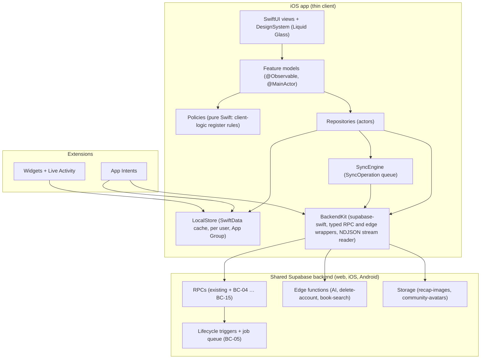
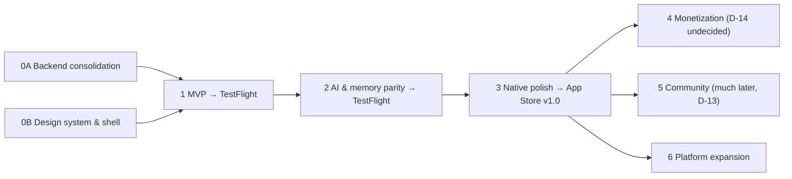

# The Chronicler for iOS — Implementation Plan

Last updated: 2026-10-18

> **What this is.** The roadmap (what and why) for the native iOS app **The Chronicler** (internal code name **BookHero**; iOS repository `bookhero-ios`). It fixes the phases, their scope, their backend prerequisites and their exit gates.
>
> **What this is not.** It is not the rulebook and not the how-to. Behaviour is specified by the numbered [business-rules catalog](business-rules/README.md) (stable rule IDs such as `SES-24`). Backend facts live in the [backend contract](backend-contract.md). Backend work packages BC-01 … BC-15 live in the [backend consolidation plan](backend-consolidation-plan.md). Per-phase kickoff briefs for Claude Code live in [ios-phase-prompts.md](ios-phase-prompts.md).
>
> **Evidence base.** Web PWA `master` @ `8d8701c` (v3.9.1) and the live Supabase project `zlndhygpqacygceivuvk`, both verified on 2026-10-18, plus the owner decisions D-01 … D-17 of the same day.

---

## Status (2026-10-18)

| Phase | Name | Status |
|---|---|---|
| 0A | Backend consolidation (BC-01 … BC-15) | In progress: the live-schema snapshot is committed (BC-03). Every other package: not started. |
| 0B | Design system & app shell | Not started. Can start now; it does not depend on Phase 0A. |
| 1 | MVP → TestFlight | Not started. Starts when Phase 0A Waves 1–3 are done. |
| 2 | AI & memory parity → TestFlight | Not started |
| 3 | Native polish → App Store v1.0 | Not started |
| 4 | Monetization | **Undecided** (D-14). Only the entitlement plumbing (BC-12) is planned. |
| 5 | Community | Much later (D-13). The backend exists and stays dormant. |
| 6 | Platform expansion | Later |

## Contents

1. [Vision & principles](#1-vision--principles)
2. [Owner decisions](#2-owner-decisions)
3. [Tech stack (iOS 26+)](#3-tech-stack-ios-26)
4. [Architecture overview](#4-architecture-overview)
5. [Project structure](#5-project-structure)
6. [Backend reuse](#6-backend-reuse)
7. [Phased roadmap](#7-phased-roadmap)
8. [Cross-cutting concerns](#8-cross-cutting-concerns)
9. [Working with Claude Code (ultracode)](#9-working-with-claude-code-ultracode)
10. [Open decisions that affect this plan](#10-open-decisions-that-affect-this-plan)
11. [Companion documents](#11-companion-documents)

---

## 1. Vision & principles

### 1.1 Vision

The Chronicler removes the friction of returning to a book after a break. It tracks reading on absolute page numbers. It remembers what the reader read (page captures, recaps, Insights, words and quotes). It brings that memory back at the moment the reader returns (Memory Check, "Previously", recaps).

The iOS app is a **native rebuild of the client** on the **same backend** as the live web PWA. It should feel like a first-party Apple app: Liquid Glass, Dynamic Island, widgets, Siri and Shortcuts, haptics. It must never disagree with the web about what happened.

### 1.2 Principles

| # | Principle | In practice |
|---|---|---|
| P1 | **One backend, many clients** (D-05) | The PWA stays live. iOS now, Android later, all on one Supabase backend and one rules catalog. Every backend change is client-agnostic and backward compatible, and the PWA migrates to new RPCs too. |
| P2 | **Thin native client** (D-06) | Completion effects, recap eligibility, Insights, achievements, review scheduling and progress writes run on the server (Phase 0A). The app renders state, collects input and calls RPCs. What stays on the client is listed in the [client-logic register](business-rules/12-client-logic-register.md) and in [BC plan §5](backend-consolidation-plan.md#5-what-stays-client-side). |
| P3 | **Server clock, server truth** | Session and progress timestamps come from the server (BC-04). Client time is used only for the occurred-at time of an offline replay (D-08). RPC responses replace local state; optimistic UI is always reconfirmed by the server. |
| P4 | **Rules are tests** | Every feature cites catalog rule IDs, and tests are named after them. A behaviour that has no rule ID is either added to the catalog first or flagged as a new iOS design choice. |
| P5 | **Native first, HIG wins** | SwiftUI throughout, system components first. Where the PWA and the Human Interface Guidelines disagree, the HIG wins, unless a catalog rule says the behaviour is a product rule (for example the page-sheet validation, SES-24). |
| P6 | **Liquid Glass is the glass** (D-04) | iOS 26+ only: `.glassEffect` and `GlassEffectContainer` directly. No `Material` fallback branch, and no re-creation of the PWA's emulated blur recipes. Reduce Transparency and Increase Contrast are honoured. |
| P7 | **Privacy by construction** | Only the publishable key ships. No gating on the client alone. Third-party AI consent comes before the first AI call (Guideline 5.1.2(i)). Page images are never stored. Logs never contain titles, words, notes, page text or recap text. |
| P8 | **Offline-tolerant core loop** | The cached library is readable offline. Page saves (including ending a running session) queue and replay with their original time (D-08). Session start/pause/resume and AI features need a connection in v1. |
| P9 | **Never copy PWA defects** | Each catalog file lists its known defects (`<PREFIX>-Dnn`). The iOS app implements the rule, not the bug. Examples: per-user offline queue and full local wipe on user change (PLT-15, XD-42 … XD-44), per-book velocity cache (LIB-108), capped image polling (REC-48). |
| P10 | **Incrementally shippable** | Every phase ends at an explicit exit gate. Phases 1 and 2 end in TestFlight; Phase 3 ends in App Store v1.0. |

### 1.3 Non-goals for v1.0

- No on-device AI generation and no provider keys on the device.
- No social surfaces: follow graph, discovery, circles, public profiles (D-13, Phase 5).
- No subscriptions or paywall (D-14, Phase 4).
- No iPad-specific layouts (iPhone first, D-04; Phase 6).
- No re-implementation of server logic, even where the PWA still does it client-side during the transition.

---

## 2. Owner decisions

Made 2026-10-18. They are authoritative and recorded in the [catalog decisions log](business-rules/README.md).

| ID | Decision | Effect on this plan |
|---|---|---|
| D-01 | Numbered business-rules catalog in `docs/business-rules/` (README index + per-domain files). `docs/wiki/Features.md` becomes an overview that links into it. | Every feature list and acceptance criterion below cites catalog rule IDs. |
| D-02 | No Spec Kit. The native app and future features are built with Claude Code using Opus 5.5 in ultracode mode. The iOS repo gets a `CLAUDE.md` derived from [ios-constitution.md](ios-foundation/ios-constitution.md). | [§9](#9-working-with-claude-code-ultracode). Phase prompts are ultracode kickoff briefs. |
| D-03 | Product and App Store name: **The Chronicler**. "BookHero" stays the internal code name (repo, Supabase project, code identifiers). | Display name, App Store listing, email templates and the sign-in screen say "The Chronicler". Identifiers and the repo `bookhero-ios` may use the code name. |
| D-04 | iOS 26+ minimum, iPhone first. Native Liquid Glass (`.glassEffect` / `GlassEffectContainer`) is the glass implementation, with no pre-iOS-26 fallback branch. Reduce Transparency and Increase Contrast are respected. | [§3](#3-tech-stack-ios-26), Phase 0B. The `docs/ios-foundation/` files were rewritten on 2026-10-18 to apply it; the earlier iOS 18 floor and `.appGlass()` availability helper are gone. |
| D-05 | The PWA stays live. Long-term: iOS + Android + web on one shared Supabase backend. Every backend change is client-agnostic and backward compatible, and the PWA migrates to new RPCs too. | P1. Phase 0A is shared work; Phase 6 adds Android. |
| D-06 | Move core logic server-side **before** the iOS build: atomic save-progress RPC, recap eligibility enforced in `generate-recap`, server-side achievements and Insight generation. Native clients stay thin. | Phase 0A is a hard prerequisite of Phase 1. |
| D-07 | All day/week/month/year boundaries use the reader's IANA time zone. Stats RPCs take a time-zone parameter, and the zone is stored server-side for jobs. | The app calls `set_my_time_zone` at launch and on zone change, and passes `p_timezone` everywhere (BC-06). |
| D-08 | Any forward page change counts for pages, streaks and charts, including offline saves replayed with their original timestamp. Session XP, session-count badges and the Last Session card require a real timed session. | Offline queue design ([§4.4](#44-offline--sync)). Last Session card behaviour. |
| D-09 | Deployed edge functions are canonical (`generate-lore` v18 accuracy-first, temperature 0.35; `generate-reading-dna` v8 with Google Search grounding). Repo sources must be synced to deployed. | iOS assumes deployed behaviour. BC-03 syncs the repo. |
| D-10 | Account deletion: immediate hard delete via a new `delete-account` edge function (Storage purge, Apple token revocation, `auth.admin.deleteUser`, FK cascades), with confirmation and re-authentication, on web **and** iOS. | Phase 1 (BC-11). |
| D-11 | Sign in with Apple + email/password. Password reset on both clients. Magic links and reset links via universal links. Existing email users can link an Apple ID from Settings. | Phase 1 auth (BC-11). |
| D-12 | Insights: when no qualifying recap exists, generate from the reader's page captures or from spoiler-guarded book metadata. Backfill milestones that were skipped, crossed offline or failed. | Phase 2 Insights (BC-08). |
| D-13 | iOS v1 profile = username + display name + avatar **only** (no bio, no privacy settings, no public toggle). Follow graph, discovery and circles come in a much later Community phase; that backend stays dormant. | Phase 2 profile; Phase 5. |
| D-14 | Subscriptions and paywall: **undecided**. Any tier table is a non-binding draft. Design server-side entitlement and AI-usage checks without fixing tiers or prices. | Phase 4 is plumbing only (BC-12). |
| D-15 | iOS OCR: on-device Apple Vision text recognition first; fall back to the `ocr-page` (Gemini) edge function on low confidence. The 0.90 auto-save and 0.70 warning thresholds are Gemini-calibrated and must be recalibrated for Vision. | Phase 2 capture (CAP-Q07). |
| D-16 | A read-only live-schema snapshot is committed at [`supabase/reference/live-baseline-2026-10-18.sql`](../supabase/reference/live-baseline-2026-10-18.sql) (+ [README](../supabase/reference/README.md)). The repo will be private, so security findings are documented in full. | [§6](#6-backend-reuse) and [contract §12](backend-contract.md#12-security-status). |
| D-17 | A documentation scope exclusion, recorded in the decisions log. | No effect on this plan. |

---

## 3. Tech stack (iOS 26+)

### 3.1 Platform and frameworks

| Layer | Choice | Notes |
|---|---|---|
| Minimum OS / devices | **iOS 26.0**, iPhone (D-04) | iOS 26 runs on iPhone 11 / SE (2nd generation) and later. Every supported device has the A12+ chip that VisionKit's live scanner requires. Portrait-only on iPhone in v1, matching the PWA manifest (open to change). |
| Toolchain | Xcode 26 SDK, **Swift 6 language mode with complete strict concurrency checking** | Evaluate default main-actor isolation (Swift 6.2) for the app target. Repositories and the sync engine are actors; views and feature models are `@MainActor`. |
| UI | **SwiftUI** | UIKit only through representables where no SwiftUI API exists: `VNDocumentCameraViewController` and `DataScannerViewController`. |
| State | **Observation** (`@Observable`) | No `ObservableObject` / Combine pipelines. |
| Local data | **SwiftData** | Per-user cache of server data plus the `SyncOperation` queue. The store lives in an App Group container so widgets and intents can read it. |
| Backend SDK | **supabase-swift** | Auth (session in the Keychain by default), PostgREST tables and `.rpc`, Functions, Storage (signed URLs, avatar upload), Realtime later (BC-14). `URLSession.bytes(for:)` for the streamed `generate-recap` v2 NDJSON response. |
| Design | **Liquid Glass**: `.glassEffect(_:in:)`, `GlassEffectContainer`, glass button styles, the iOS 26 floating tab bar and `.tabViewBottomAccessory` | System sheets, menus and alerts keep their system materials; text-dense surfaces stay opaque. Reduce Transparency and Increase Contrast are verified on every custom glass surface. |
| Charts | **Swift Charts** | "Your year" monthly chart, with audio-graph accessibility (`AXChartDescriptor`). |
| OCR | **Apple Vision** text recognition, with the **`ocr-page`** fallback (D-15) | The Swift Vision API (`RecognizeTextRequest`, accurate level, language correction). Evaluate iOS 26 document recognition for paragraph structure. The capture page is never derived from OCR (CAP-28). |
| Page capture input | VisionKit `VNDocumentCameraViewController` (edge detection, perspective correction) or an AVFoundation still; `PhotosPicker` and `.fileImporter` for uploads | No photo-library permission is needed with `PhotosPicker`. HEIC decodes natively. Images are normalised to ≤ 2000 px JPEG 0.85, ≤ 5 MiB, and never persisted (CAP-15, CAP-90). |
| ISBN scan | VisionKit `DataScannerViewController` (EAN-13, Bookland 978/979) | `AVCaptureMetadataOutput` fallback if `isAvailable` is false (camera restricted). |
| Speech | **AVSpeechSynthesizer**, pinned to `en-US` (fallback any `en-*`) | Codex pronunciation (LEX-69). |
| Live Activities | **ActivityKit** | Reading-session timer on the Lock Screen and Dynamic Island (Phase 3). |
| Widgets | **WidgetKit** | Currently Reading, Word of the Day, quest ring (Phase 3). |
| Siri / Shortcuts | **App Intents** | `AppEntity` for books; `LiveActivityIntent` for pause/resume (Phase 3). |
| Background | **BackgroundTasks** (`BGAppRefreshTask`, `BGProcessingTask`) | Opportunistic queue drain only; the main drain runs on foreground and on network-path changes. Evaluate iOS 26 continued-processing tasks for long imports. |
| Notifications | **UserNotifications** (local) | Focus-goal end, review reminders (Phase 3). Remote push (APNs) only once `device_tokens` (BC-14) and a sender exist (Phase 5). |
| Auth UI | **AuthenticationServices** (Sign in with Apple), Associated Domains (universal links) | PKCE flow for magic and reset links (BC-11). |
| Purchases | **StoreKit 2** — later | Phase 4, only after D-14 is decided. |
| Analytics / crash | **Open decision** (PLT-Q15) | The PWA uses **no** crash-reporting or analytics SDK today (no Sentry or any other). Recommendation: MetricKit + Xcode Organizer first; any third-party SDK must collect no book titles, words, notes or recap text and must appear in the privacy manifest and App Privacy labels. |

### 3.2 Dependencies (Swift Package Manager)

| Package | Status | Why |
|---|---|---|
| `supabase-swift` | Required | Backend SDK |
| Image pipeline (Nuke or Kingfisher), **or** a small `URLCache`-backed loader | Decide in Phase 0B | `AsyncImage` has no disk cache. Covers are hot-linked from Google Books / Open Library; recap images are cached by recap id, never by signed URL. |
| `swift-snapshot-testing` | Test target only | Design-system and screen snapshots |

No other runtime dependencies without a written reason in the iOS repo's `CLAUDE.md`. Not needed: a Keychain wrapper (supabase-swift already stores the session in the Keychain), a collections package, or a crash SDK by default.

---

## 4. Architecture overview

### 4.1 Layers



| Layer | Responsibility | Must not |
|---|---|---|
| Views | Layout, design system, accessibility, haptics | Call the network or hold business rules |
| Feature models | Screen state, user intents, mapping typed errors to copy | Compute server-owned results (completion, eligibility, achievements, Insights, XP) |
| Policies | Pure functions for the rules that stay client-side: hero inference (SES-59 … SES-62), onboarding states (SES-55), page-sheet validation (SES-24 … SES-27), Memory Check gating (CAP-61 … CAP-64), formatting (PLT-67 … PLT-69) | Touch I/O. Each is unit-tested by rule ID. |
| Repositories | One per domain; freshness (SWR) per key; invalidation; per-user scoping | Leak data across users |
| SyncEngine | Queue, drain and replay of offline writes with idempotency keys | Replay under another user |
| BackendKit | Auth session, typed DTOs (snake_case tables, camelCase RPC JSON), error mapping (`P0001` message codes, `42501`, `57014`), retry, timeouts, streaming | Hold the service-role key or any provider key |

### 4.2 Patterns

- **Server responses are the truth.** The BC-04 RPCs return a progress-state object (`currentPage`, `status`, `sessionStartAt`, `sessionPausedAt`, `dnfAt`, `completedAt`, `serverTime`). `save_progress` also returns `effects` (`insightMilestonesQueued`, `passportQueued`, `achievementsEarned`, `captureAllowed`) and `completion`. The UI is driven from these, never from client recomputation.
- **SWR semantics, not PWA quirks.** Keep per-key TTLs and the invalidation matrix ([08 · Platform](business-rules/08-platform-auth-account.md), PLT-24 … PLT-31). Refresh stale keys on `scenePhase == .active`, but only for on-screen data. "Invalidate" means "show cached, refresh in background", not a blocking reload (PLT-28 defect).
- **Percentage is derived at use time** from `(current_page, total_pages)`, rounded to 2 decimals and capped at 100. It is never cached separately (XD-02).
- **Typed errors.** RPC business errors arrive as HTTP 400 `{code:"P0001", message:"<code>"}`; the app switches on `message` and never retries them. `57014` (statement timeout, 8 s for `authenticated`) and network failures are retried with backoff for reads and idempotent writes only (PLT-Q10). On a 401, refresh the session and retry once. Request timeouts are ≥ 10 s for PostgREST and ≥ 120 s for recap generation.
- **Identity.** Always call with the signed-in user; new RPCs take no `p_user_id`. Legacy RPCs keep `p_user_id`, which must equal the caller (BC-01).
- **One signed-in account per device** (PLT-Q11 recommendation). A user change triggers a full wipe: SwiftData store, queue, image caches, App Group caches, widget timelines, Live Activities, per-user defaults, and cancellation of in-flight tasks (XD-41 … XD-46).
- **Cross-device coexistence.** The PWA and iOS run side by side on the same account. Refresh sessions, pause state and per-book caches on foreground. `sessionPausedAt` comes from the library RPC once BC-14 adds it (SES-20).

### 4.3 Repository map

| Repository | Reads | Writes | Replaces (PWA) | Rules |
|---|---|---|---|---|
| `AccountRepository` | Auth session, `get_my_community_profile` | Sign in/up, Sign in with Apple, magic link, password reset, `linkIdentity`, `delete-account`, `record_ai_consent`, `set_my_time_zone`, partial profile upsert, avatar upload | `stores/auth.ts`, `useCommunityIdentity` | PLT-01 … PLT-17a, PLT-71 … PLT-75, PRO-73 … PRO-90 |
| `LibraryRepository` | `get_library_with_progress` (later `get_library_changes`) | `books` insert/update/delete, `up_next_order`, `set_initial_status`, `import_library`, `find_library_duplicates`, `book-search` | `stores/books.ts`, `stores/upNext.ts`, `useLibraryImport`, `bookSearchService`, `useIsbn` | LIB-01 … LIB-117 |
| `ProgressRepository` | Progress-state objects | `start_session`, `pause_session`, `resume_session`, `cancel_session`, `save_progress`, `set_session_note`, `mark_dnf`, `resume_dnf` | `stores/progress.ts`, `useReadingSession`, `useOfflineSync` | SES-01 … SES-98 |
| `StatsRepository` | `get_last_session`, `get_reading_velocity`, `get_reading_stats`, `get_reading_quest_summary`, `get_reading_calendar`, `get_monthly_reading`, `get_reading_records`, `get_library_breakdown`, `reading_goals` | `reading_goals` upsert | `useLastSession`, `useReadingVelocity`, `useReadingProfile`, `stores/readingQuest.ts`, calendar/monthly/records/breakdown composables | SES-70 … SES-74, PRO-01 … PRO-46 |
| `CaptureRepository` | `page_captures`, `book_quizzes` | `ocr-page`, capture upsert, resume (`generate-page-resume` + update), quiz (`generate-book-quiz` + upsert), vocabulary pipeline | `stores/captures.ts`, `useCapture`, `usePageResume`, `useSessionResume`, `useBookQuiz`, `useVocabularyExtraction` | CAP-01 … CAP-90, LEX-83 … LEX-92 |
| `RecapRepository` | `get_recap_eligibility`, `recaps`, `get_recap_request`, signed URLs | `generate-recap` v2 | `stores/recaps.ts`, `recapService`, `useRecapLock`, `useRecapImage`, `useRecapGallery` | REC-01 … REC-73 |
| `InsightRepository` | `lore_cards`, `get_my_jobs` | `mark_insights_seen` | `stores/loreCards.ts`, `loreService` | INS-01 … INS-61 |
| `CodexRepository` | `lexicon_entries` (paged), `get_todays_review` | `lexicon_entries` insert, `review_lexicon_entry`, `undo_lexicon_review`, `request_more_reviews`, `record_anki_session` | `stores/lexicon.ts`, `stores/ankiSession.ts`, `useLeitner`, `useAnkiSession`, `useGreatLibrarySearch` | LEX-01 … LEX-103 |
| `PassportRepository` | `book_passports` (frozen stats, `summary_status`) | — | `stores/bookPassport.ts` | SES-44 … SES-52 |
| `AchievementsRepository` | `sync_achievements` | — | `useAchievements` | PRO-47 … PRO-51 |
| `ReadingDNARepository` | `reading_dna`, `request_dna_refresh` | — | `stores/readingDna.ts`, `useDnaRecommendations` | PRO-52 … PRO-68 |
| `EntitlementsRepository` (Phase 4) | `get_my_entitlements` | StoreKit 2 transactions (server mirror via BC-12) | — | BC-12 |

### 4.4 Offline & sync

| Concern | v1 rule | Rules |
|---|---|---|
| Reading offline | The last library, progress, dashboard and Codex data render from SwiftData with an "as of" hint. | PLT-24 … PLT-31 |
| Page saves offline | Queued as `save_progress(book, page, note, p_client_occurred_at, p_idempotency_key)`. Replay keeps the original time; the server accepts it within the replay window (OP-04.5), marks stale replays (`"stale": true`) without rewinding the page, and runs every lifecycle effect (history, completion, Insights). | D-08, SES-76 … SES-78, BC-04 |
| Ending a running session offline | Allowed: it is a queued save whose occurred time falls after `session_start_at`, so the server records a timed session. | D-08, BC-04 step 4 |
| Session start / pause / resume / cancel | Online only in v1. | SES-09, OP-04.1 (SES-Q03) |
| Library mutations (add, edit, delete, reorder, DNF) | Online only in v1. | LIB-115 |
| AI features, capture save, search, import | Online only. On-device OCR could make captures possible offline, but a capture queue is an open decision. | CAP-Q08 |
| Queue hygiene | Scoped by user id; FIFO per user; drop on permanent errors (`book_not_found`, FK `23503`, RLS `42501`); exponential backoff with a cap; a persistent "pending sync" indicator built from the queue's real contents; drained on foreground, on `NWPathMonitor` satisfied, and opportunistically in background. | PLT-43 … PLT-49 (defects not copied), XD-10, XD-43 |
| Offline is detected from failures | A request failing with a connectivity error moves the save to the queue (with the same idempotency key). Reachability alone is not trusted. | PLT-43 |

---

## 5. Project structure

Repository `bookhero-ios` (code name per D-03; display name "The Chronicler").

```text
bookhero-ios/
├── CLAUDE.md                     # Copy of docs/ios-foundation/ios-constitution.md, a drop-in that already applies D-02/D-04/D-06 (§9)
├── bookhero/                     # Read-only git submodule of the web repo; canonical docs under bookhero/docs/ (§9.4)
├── docs/                         # iOS-only: ios-design-choices.md, phases/<phase>/ notes, generated rule-coverage.md
├── Config/                       # .xcconfig per environment: SUPABASE_URL, SUPABASE_ANON_KEY (publishable) — names only in git
├── App/                          # @main, scene setup, Router, DeepLinkHandler, AppDelegate (BG tasks, notifications)
├── Packages/
│   ├── ChroniclerCore/           # Domain models, Policies (pure), formatters — no UI, no network
│   ├── BackendKit/               # supabase-swift client, DTOs, typed RPC/edge wrappers, errors, retry, NDJSON reader
│   ├── Persistence/              # SwiftData models (cache + SyncOperation), per-user store, App Group access
│   └── DesignSystem/             # Tokens, glass usage, components, preview gallery
├── Features/
│   ├── Auth/  Settings/  Home/  Library/  AddBook/  Import/  BookDetail/
│   ├── Session/  Focus/  Capture/  Recaps/  Insights/  Codex/  Review/
│   └── Passport/  Profile/  TrophyRoom/  ReadingStats/
├── Intents/                      # App Intents, AppEntity definitions (Phase 3)
├── Extensions/
│   └── ChroniclerWidgets/        # WidgetKit + Live Activity UI (Phase 3)
└── Tests/
    ├── ChroniclerCoreTests/      # Rule-ID named unit tests (Swift Testing)
    ├── BackendContractTests/     # Against the staging backend (§8.5)
    ├── SnapshotTests/
    └── UITests/
```

Navigation: a `TabView` with **Home, Library, Codex, Profile**, matching the PWA's tabs. The PWA's "More" sheet becomes native placements: Add Book is a `+` toolbar action (sheet) on Home and Library; Settings is pushed from Profile (theme, sign out, link Apple ID, delete account, legal links, AI-consent status, version). Each tab owns a `NavigationStack` with typed routes: book detail, recap history, passport, DNF list, Trophy Room, Reading Stats, profile edit, review, search detail.

---

## 6. Backend reuse

### 6.1 What exists today (live, verified 2026-10-18)

| Item | Live state | Reference |
|---|---|---|
| Tables | 26 product tables, all RLS-enabled | [contract §3](backend-contract.md#3-tables) |
| Functions | 69 in `public` (60 `SECURITY DEFINER`) | [contract §8](backend-contract.md#8-rpc-catalogue) |
| Edge functions | 7: `generate-recap` v84, `generate-lore` v18, `ocr-page` v2, `extract-vocabulary` v2, `generate-reading-dna` v8, `generate-page-resume` v3, `generate-book-quiz` v1 | [contract §10](backend-contract.md#10-edge-functions) |
| Storage | `recap-images` (private), `community-avatars` (public) | [contract §7](backend-contract.md#7-storage) |
| Auth | `email` provider only (password + magic link). No Sign in with Apple, no password reset, no account deletion. | [contract §1](backend-contract.md#1-connection-auth--runtime-limits) |
| Realtime / jobs | No tables in `supabase_realtime`; no `pg_cron`, no `pg_net` | [contract §1.5](backend-contract.md#1-connection-auth--runtime-limits) |
| Runtime | `statement_timeout` 8 s (`authenticated`); DB time zone UTC; `safeupdate` (every UPDATE/DELETE needs a filter) | [contract §1.4](backend-contract.md#1-connection-auth--runtime-limits) |
| Security | Cross-user RPC reads, an anon bypass, anon-executable destructive functions, and three edge functions that only decode the JWT | [contract §12](backend-contract.md#12-security-status), fixed by BC-01/BC-02 |
| Gating | No quota, rate limit, entitlement or consent check in any AI function; the recap lock exists only in the PWA | REC-11, PLT-85; fixed by BC-07, BC-11.9, BC-12 |
| Client-owned logic | The PWA computes completion effects, recap eligibility, Insights, achievements, review scheduling and DNA eligibility, and writes their results itself | [12 · Client-logic register](business-rules/12-client-logic-register.md); moved server-side by BC-04 … BC-10 |

The backend is **not** reused as-is. A native binary makes the publishable key and every endpoint trivially extractable, and a second client would have to duplicate client-only logic. Phase 0A fixes both, for every client.

### 6.2 What the iOS app calls (after Phase 0A)

| Area | Calls | Phase |
|---|---|---|
| Account | Auth (password, magic link, Sign in with Apple, reset, `linkIdentity`), `delete-account`, `record_ai_consent`, `set_my_time_zone`, `get_my_community_profile`, partial `upsert_my_community_profile`, `is_username_available`, `community-avatars` upload | 1 (auth, deletion, zone), 2 (profile, consent) |
| Library | `get_library_with_progress` (+ `sessionPausedAt`, `completedAt`), `books` CRUD, `up_next_order`, `set_initial_status`, `import_library`, `find_library_duplicates`, `book-search` | 1 |
| Sessions & progress | `start_session`, `pause_session`, `resume_session`, `cancel_session`, `save_progress`, `set_session_note`, `mark_dnf`, `resume_dnf` | 1 |
| Stats | `get_last_session`, `get_reading_velocity` (both in 1); `get_reading_stats`, `get_reading_quest_summary`, `get_reading_calendar`, `get_monthly_reading`, `get_reading_records`, `get_library_breakdown`, `reading_goals` (2) — all with `p_timezone` | 1–2 |
| Capture & warm-up | `ocr-page` (fallback), `page_captures`, `generate-page-resume`, `generate-book-quiz`, `book_quizzes`, `extract-vocabulary` + ledger | 2 |
| Recaps | `get_recap_eligibility`, `generate-recap` v2 (NDJSON), `get_recap_request`, `recaps`, `recap-images` signed URLs | 2 |
| Insights | `lore_cards` select, `mark_insights_seen`, `get_my_jobs` | 2 |
| Codex | `lexicon_entries` (insert, paged search), `get_todays_review`, `review_lexicon_entry`, `undo_lexicon_review`, `request_more_reviews`, `record_anki_session`; dictionary lookups | 2 |
| Profile extras | `book_passports`, `sync_achievements`, `reading_dna`, `request_dna_refresh` | 2 |
| Monetization | `get_my_entitlements` | 4 |
| Sync | Realtime on `recaps` / `reading_progress` (optional), `get_library_changes`, `register_device_token` | 3–5 |

Rules for every call: [contract §15 · Notes for native clients](backend-contract.md#15-notes-for-native-clients).

### 6.3 Phase 0A packages the iOS app depends on

| BC | Title | Wave | Needed by | What iOS relies on |
|---|---|---|---|---|
| [BC-01](backend-consolidation-plan.md#bc-01--security-hardening) | Security hardening | 1 | Any external build | No cross-user reads; no anon-executable destructive functions; child-table RLS checks book ownership |
| [BC-02](backend-consolidation-plan.md#bc-02--edge-function-auth) | Edge-function auth | 1 | Phase 1 (before Sign in with Apple), Phase 2 | Real JWT verification; no spurious 401 for non-ASCII metadata; no internal error text |
| [BC-03](backend-consolidation-plan.md#bc-03--source-of-truth--drift) | Source of truth & drift | 1 | Contract tests | Repo == live; `supabase/config.toml`; deployed sources canonical (D-09) |
| [BC-04](backend-consolidation-plan.md#bc-04--atomic-progress--session-rpcs) | Atomic progress & session RPCs | 2 | Phase 1 | Session and save RPCs, server clock, idempotency, offline replay, `completed_at`, D-08 counting |
| [BC-05](backend-consolidation-plan.md#bc-05--server-owned-completion--lifecycle-effects) | Completion & lifecycle effects | 2 | Phase 1 (completion), Phase 2 (passport, DNA) | One server owner for completion; job queue; frozen passport stats; `request_dna_refresh` |
| [BC-06](backend-consolidation-plan.md#bc-06--timezone-standardisation) | Timezone standardisation | 2 | Phase 1 (dashboard), Phase 2 (stats, review) | `set_my_time_zone`; `p_timezone` on every stats RPC |
| [BC-07](backend-consolidation-plan.md#bc-07--recap-eligibility--persistence-server-side) | Recap eligibility & persistence | 3 | Phase 2 | `get_recap_eligibility`, `generate-recap` v2, server-side persistence, "once paid, finish and save" |
| [BC-08](backend-consolidation-plan.md#bc-08--insights-orchestration-server-side--fallback) | Insights orchestration + fallback | 3 | Phase 2 | Server-generated Insights with recap → captures → metadata fallback and backfill (D-12) |
| [BC-09](backend-consolidation-plan.md#bc-09--achievements-server-side) | Achievements server-side | 3 | Phase 2 | `sync_achievements`; server catalog of the 17 keys |
| [BC-10](backend-consolidation-plan.md#bc-10--review-leitner-rpc) | Review (Leitner) RPC | 3 | Phase 2 (also widgets and notification actions in Phase 3) | Review, undo, today's set, Word of the Day, Anki aggregates — adopt before iOS v1 (LEX-Q27) |
| [BC-11](backend-consolidation-plan.md#bc-11--account-lifecycle--auth) | Account lifecycle & auth | 4 (starts after BC-02) | Phase 1 (auth, deletion), Phase 2 (consent, partial profile) | `delete-account`, Sign in with Apple, linking, reset, universal links, SMTP, consent record |
| [BC-12](backend-consolidation-plan.md#bc-12--entitlements--ai-usage-foundation) | Entitlements & AI usage | 4 | External TestFlight (ledger); Phase 4 (gating) | `ai_usage` ledger, shared guard (allow-all), `entitlements` |
| [BC-13](backend-consolidation-plan.md#bc-13--storage-hygiene--ai-job-robustness) | Storage hygiene & AI-job robustness | 4 | Phase 1 (book delete), Phase 2 (images) | Image cleanup, no row stuck `pending` > 10 min |
| [BC-14](backend-consolidation-plan.md#bc-14--sync--realtime-readiness) | Sync & realtime readiness | 4 | Phase 1 (`sessionPausedAt`), Phase 3 (cross-device Live Activity), Phase 5 (APNs) | Additive library fields, delta RPC, optional Realtime, `device_tokens` |
| [BC-15](backend-consolidation-plan.md#bc-15--book-data-hygiene) | Book data hygiene | 4 | Phase 1 | ISBN normalisation, `book-search` proxy (no Google key in the app), atomic `import_library`, duplicate check |

### 6.4 Coexistence with the PWA

- **Same data from day one.** Both clients use the same Supabase project, so nothing migrates server-side. A reader who signs in on iOS sees the library, history, recaps, words and goals created on the web.
- **Device-local web state does not carry over:** theme, library view preferences, the Word-of-the-Day cache, the DNA cover cache, the explicitly chosen dashboard hero, and any offline saves still queued in the PWA (they replay only when the PWA is reopened online).
- **Concurrent use.** Sessions are server-confirmed, so a session started on one client is visible on the other after a refresh. iOS refreshes sessions and pause state on foreground (SES-20) and never assumes its cache is current.
- **One behaviour.** Because the PWA migrates to the same RPCs in Phase 0A, the two clients cannot disagree about completion, eligibility, Insights, achievements or stats. Retroactive number changes from D-07 and D-08 are announced once, for both clients (BC plan §7, R-1).
- **Accounts created on iOS work on the web.** Sign in with Apple also ships on the web (OAuth flow, BC-11), so an iOS-created Apple account can use the PWA.

---

## 7. Phased roadmap

### 7.1 Overview

| Phase | Goal | Builds on | Ends with |
|---|---|---|---|
| **0A** Backend consolidation | Secure, server-owned, client-agnostic backend; PWA migrated | — | Waves 1–3 done → Phase 1 may start; Wave 4 done → external TestFlight allowed |
| **0B** Design system & app shell | Liquid Glass design system, navigation shell, BackendKit skeleton, CI | — (parallel with 0A) | Gallery + shell on device, CI green |
| **1** MVP | Auth, library, reading sessions, dashboard, book detail, offline queue | 0A Waves 1–3 (+ BC-11, BC-14 fields, BC-15), 0B | TestFlight |
| **2** AI & memory parity | Capture, warm-up, recaps, Insights, Codex, passport, profile, Trophy Room, Stats, DNA | 1, BC-07 … BC-10, BC-11 consent | TestFlight |
| **3** Native polish & App Store v1.0 | Live Activity, widgets, App Intents, notifications, compliance | 2, Wave 4 complete | App Store v1.0 |
| **4** Monetization | Server-mirrored entitlements; StoreKit 2 once tiers exist | 3, BC-12, D-14 decided | v1.x with subscriptions (only if decided) |
| **5** Community | Social surfaces on the dormant backend, with moderation | 3, community fixes, APNs | v2.x |
| **6** Platform expansion | iPad, Mac, Watch, visionOS, Android | 3 | Ongoing |



Every phase section below has the same blocks: **Goal**, **Features** (with catalog links and rule IDs), **Backend prerequisites**, **Out of scope**, **Acceptance criteria**, **Exit gate**.

---

### Phase 0A — Backend consolidation (shared prerequisite)

**Goal.** Before any iOS feature work, make the one backend safe for a public native binary and move core logic server-side (D-06), so iOS stays thin and cannot drift from the web. The PWA adopts every change too (D-05). This phase runs in the web repository, not in `bookhero-ios`.

**Features (work packages).** Full scope, rollout and acceptance criteria: [backend-consolidation-plan.md](backend-consolidation-plan.md).

| Wave | Packages | Outcome |
|---|---|---|
| 1 · Security & drift | BC-03 (baseline first) → BC-01, BC-02 | No cross-user reads or deletes; no forgeable AI endpoints; repo == live; `supabase/config.toml` committed |
| 2 · Core RPCs | BC-04 → BC-06 → BC-05 | One atomic, server-clocked write path for progress and sessions; one time-zone convention; one owner for completion effects |
| 3 · Server features | BC-07, BC-08, BC-09, BC-10 | Recap lock, Insights, achievements and review math on the server |
| 4 · Platform | BC-11, BC-12, BC-13, BC-14, BC-15 | Account deletion, Sign in with Apple, reset, consent; AI-usage ledger; storage hygiene; sync readiness; book data hygiene and search proxy |

**PWA adoption.** [BC plan §4](backend-consolidation-plan.md#4-pwa-changes-required) lists the PWA files that change per package. Server-side effects switch on through backend flags only after the PWA stops performing them itself.

**Backend prerequisites.** None (this is the backend phase).

**Out of scope.** Community and circle defects, the weekly session goal, push sending, subscription tiers, the offline capture queue, server-side vocabulary extraction and a server session warm-up RPC ([BC plan §6](backend-consolidation-plan.md#6-out-of-scope-for-phase-0)).

**Acceptance criteria.**

| # | Criterion |
|---|---|
| 0A-1 | Every BC acceptance criterion of the delivered waves passes (database tests via `supabase test db` and edge-function tests, named by rule ID). |
| 0A-2 | The security advisor is clean for the allowlist in BC-01; no function is anon-executable unless intended; `supabase db diff` against live is empty. |
| 0A-3 | The PWA writes progress only through the BC-04 RPCs and no longer runs passport, DNA, Insight or achievement generation itself (flags flipped). |
| 0A-4 | [backend-contract.md](backend-contract.md) and the catalog are updated in the same change: rules that moved server-side change from "client-only" to "server-enforced". |

**Exit gate.** Waves 1–3 done → Phase 1 may start ([BC plan §2.1](backend-consolidation-plan.md#21-waves)). Wave 4 done → external TestFlight testing is allowed. BC-11 blocks App Store submission.

---

### Phase 0B — Design system & app shell

**Goal.** A Liquid Glass design system and an empty but working app shell, so every later screen composes shared parts instead of inventing look-and-feel. It runs in parallel with Phase 0A.

**Features.**

| Area | Content | Input |
|---|---|---|
| Repo & tooling | Xcode project, Swift packages ([§5](#5-project-structure)), `CLAUDE.md` ([§9](#9-working-with-claude-code-ultracode)), xcconfig environments, SwiftLint + swift-format, CI pipeline ([§8.6](#86-cicd)) | — |
| Tokens | Indigo accent ramp (primary `#6366F1`), page background (two radial glows over `#0a0a14` dark / `#f0f4ff` light), text opacities, type scale on Dynamic Type, spacing, continuous corner radii, semantic colours (success, warning, danger, caution, open-thread quote) | [design-tokens.md](ios-foundation/design-tokens.md) (values, plus the Liquid Glass mapping of its §5.2; the PWA's rgba/blur recipes are reference only, D-04) |
| Glass | `.glassEffect` on custom surfaces, `GlassEffectContainer` for grouped glass, glass button styles; opaque dialogs and menus for dense text; behaviour verified under Reduce Transparency and Increase Contrast | D-04 |
| Components | `BookCover` (placeholder and broken-cover handling, LIB-99), progress bar and ring, stat tile, chips, empty/loading/error/offline states, glass toast equivalent (top banner, PLT-37), section headers, page sheet scaffold, confirm dialogs | [component-inventory.md](ios-foundation/component-inventory.md) |
| Shell | Auth gate → `TabView` (Home, Library, Codex, Profile) with the iOS 26 floating tab bar; a `.tabViewBottomAccessory` slot for the running-session mini timer (wired in Phase 1); typed routes per tab; Settings screen scaffold; deep-link router skeleton for universal links | [screen-inventory.md](ios-foundation/screen-inventory.md), PLT-18 … PLT-23 |
| BackendKit skeleton | Client setup from xcconfig, session restore that never blocks launch (PLT-10), typed error mapping, retry policy, request timeouts, a decoding test harness | [contract §15](backend-contract.md#15-notes-for-native-clients) |
| Persistence skeleton | SwiftData container in an App Group, per-user store, wipe-on-user-change hook | XD-41 … XD-46 |
| Theme | System appearance by default with a Light/Dark/System override (PLT-Q06 recommendation); dark-first artwork | PLT-40 |
| Gallery | Preview gallery of every component in light, dark, Reduce Transparency, Increase Contrast and accessibility text sizes; snapshot baseline | — |

**Backend prerequisites.** None. BackendKit is exercised against the staging backend ([§8.5](#85-testing)) and decoding fixtures; it never writes to production.

**Out of scope.** Any feature screen beyond placeholders. Any `Material`-based fallback for pre-iOS-26.

**Acceptance criteria.**

| # | Criterion |
|---|---|
| 0B-1 | The app installs on an iOS 26 device, shows the auth gate, and after a test sign-in shows the four tabs with placeholder content. |
| 0B-2 | Every component renders correctly in the gallery in light and dark, with Reduce Transparency and Increase Contrast on, and at the largest accessibility text size (snapshots recorded). |
| 0B-3 | Every interactive component has a VoiceOver label and a ≥ 44 pt target. |
| 0B-4 | No colour, font size, spacing or radius literal exists outside `DesignSystem` (lint rule). |
| 0B-5 | CI builds, lints and runs unit and snapshot tests on every push. |

**Exit gate.** Design system and shell merged; the gallery reviewed by the owner on device.

---

### Phase 1 — MVP → TestFlight

**Goal.** A reader can sign in, build a library (search, scan, manual, CSV import), read with timed sessions, save pages online or offline, and see the dashboard and book detail — with numbers identical to the web for the same account.

**Features.**

| Area | Features | Rules |
|---|---|---|
| **Auth** | Sign in with Apple; email + password sign-in and sign-up; magic link; password reset (universal link to a "set new password" screen); Link Apple ID from Settings; Hide-My-Email guidance ("Already have an account? Sign in with email first"); sign out (scope per PLT-Q01); full local wipe on user change; one account per device | [08 · Platform](business-rules/08-platform-auth-account.md) PLT-01 … PLT-17a, PLT-82; D-11; BC-11 |
| **Account deletion** | Settings → Delete account: confirmation listing what is deleted, re-authentication (password, fresh Apple credential or OTP) within 5 minutes, `delete-account`, local wipe, return to sign-in | PLT-71 … PLT-75, XD-54 … XD-57; D-10 |
| **Time zone** | `set_my_time_zone(TimeZone.current.identifier)` at launch and on system zone change | PLT-62 … PLT-65, PLT-83; D-07 |
| **Library views** | Now Reading / Queue / Completed sections in list and grid, with per-device persistence of view mode, tab and collapsed state; accent-insensitive search with grouped results including the DNF group; DNF toolbar entry shown only when ≥ 1 book is shelved; days-left forecast cached per book | [01 · Library](business-rules/01-library.md) LIB-44 … LIB-54, LIB-101, LIB-104, LIB-108, LIB-109 |
| **Add book** | Search via the `book-search` proxy (ISBN-aware, device-language restriction for free text), search detail page with recommendations and duplicate notice, ISBN barcode scan and typed ISBN, manual entry; initial status (Want to read / Reading at page N / Finished) through `set_initial_status` | LIB-01 … LIB-43, LIB-103, LIB-105 … LIB-107; SES-33; BC-15 |
| **CSV import** | Goodreads / StoryGraph export via `.fileImporter`; RFC 4180 parsing on device; rows sent to `import_library` (server dedupe, statuses, DNF shelf, placeholder pages); summary screen; enrichment through the proxy | LIB-66 … LIB-86; XD-33 … XD-40; BC-15 |
| **Edit & delete** | Swipe actions, context menu and a Book Detail toolbar action (no touch-only limitation); metadata edit (page-count edits follow the server rule, OP-05.4); delete with confirmation (XP and level can drop, earned badges never regress: XD-07, LIB-Q15), server cascade, purge of every per-book local artefact, cancellation of per-book tasks and queued operations | LIB-61 … LIB-65, LIB-87 … LIB-89, LIB-102; XD-03 … XD-12, XD-47 … XD-53 |
| **Up Next** | Reorder in edit mode with VoiceOver move actions; dense positions saved in one upsert with revert on failure | LIB-55 … LIB-60 |
| **DNF** | "Didn't finish it?" shelve (confirm) via `mark_dnf`; shelved state replaces the session and AI surfaces with "Start reading again"; DNF list sorted by `dnf_at` with per-row Resume via `resume_dnf` | LIB-90 … LIB-95; SES-75; XD-25 … XD-32 |
| **Reading sessions** | Start, pause, resume and cancel through the BC-04 RPCs; elapsed timer derived from server timestamps (`M:SS`, `H:MM:SS` past one hour); mini timer in the tab-bar accessory; concurrent sessions per OP-04.6 | [02 · Reading sessions](business-rules/02-reading-sessions.md) SES-08 … SES-22, SES-87 |
| **Page sheet** | "Where did you stop?" / "Update your page", stepper + number pad, exact validation copy, unchanged-page block with "Cancel session instead", server errors mapped (`page_out_of_range`, `page_unchanged`, `no_pages_read`); pencil correction outside sessions; session note (≤ 160) via `set_session_note` | SES-24 … SES-36 |
| **Completion** | Completion prompt "Finished: {title}" with Continue (View Journey once Phase 2 ships passports); hero rotation; server effects come from `save_progress` (`completion`, `effects`); no capture prompt when `captureAllowed` is false | SES-39 … SES-43, SES-89, SES-95, SES-96; XD-13 … XD-24 |
| **Focus mode (parity)** | Full-screen cover + large timer + pause/End; idle timer disabled while visible; auto-dim after 30 s (black overlay; real brightness per SES-Q13); goal chips 15/30/45/60 min counting from the current elapsed value; at goal end: chime, haptic, "Time's up", overtime `+M:SS`, session keeps running | SES-79 … SES-83 |
| **Dashboard** | Greeting; hero with progress, forecast line and session controls; In Progress list; Up Next cover shelf (tap to make hero); Completed row; onboarding states (`empty`, `oneInProgress`, `oneQueued`, `completedOnly`, `standard`) with the Import action; Last Session card (real timed sessions only, D-08) | SES-53 … SES-74 |
| **Book detail** | Centered cover hero, clamped description (backfill through the proxy), progress panel with session controls, pencil, DNF link or shelved state | LIB-40 … LIB-42, SES-42, SES-66 |
| **Offline queue** | As [§4.4](#44-offline--sync) | SES-76 … SES-78, PLT-43 … PLT-49; D-08 |
| **Settings** | Theme, sign out, link Apple ID, delete account, privacy policy and terms links, version | PLT-Q04, PLT-Q06 |

**Backend prerequisites.** BC-01 … BC-06 (Waves 1–2) and Wave 3 per the gate; BC-11 (auth, deletion, universal links, SMTP); BC-13 (image cleanup on book delete); BC-14 (`sessionPausedAt` and `completedAt` in `get_library_with_progress`); BC-15 (`book-search`, `import_library`, ISBN normalisation, `find_library_duplicates`).

**Out of scope.** All AI features and the AI-consent sheet (Phase 2); the pre-session Memory Check and "Previously" gates (Phase 2: Start Session starts immediately in Phase 1); Word of the Day, Insights, "New Lore" chip and Insight nudge (Phase 2); passport viewing (Phase 2); Live Activity, widgets, App Intents, notifications (Phase 3); subscriptions; community; iPad layouts; offline session start.

**Acceptance criteria.**

| # | Criterion | Rules |
|---|---|---|
| 1-1 | Sign in with Apple, email sign-in/sign-up and magic link all reach the dashboard. A magic or reset link tapped in Mail opens the app and completes the flow. | PLT-01, BC-11 (11-4) |
| 1-2 | An existing email user links an Apple ID in Settings, signs out, signs in with Apple and sees the same library. | BC-11 (11-5) |
| 1-3 | Delete account with a stale authentication asks for re-auth; after deletion the server holds no rows or objects for the user and the device holds no data. | PLT-73, PLT-74, XD-57, BC-11 (11-1, 11-2) |
| 1-4 | After sign-out and sign-in as another user, no data of the first user is visible anywhere, and no queued save of the first user is replayed. | PLT-15, XD-42 … XD-44 |
| 1-5 | Each add path writes the book and its initial status: "Reading" pages are clamped to `[1, total − 1]`; no session XP or Last Session entry results. | LIB-13 … LIB-17, SES-33, BC-04 (04-9) |
| 1-6 | A hyphenated ISBN from scan or typing is stored normalised; no Google API key exists in the app bundle. | LIB-04, LIB-05, BC-15 (15-1, 15-2) |
| 1-7 | Importing the same CSV twice imports nothing the second time; DNF-shelf rows land on the DNF list; a "read" row stays finished after enrichment corrects its page count. | LIB-70 … LIB-83, BC-15 (15-3, 15-4) |
| 1-8 | Deleting a book removes it everywhere on the device (library, dashboard, queue, caches) and server-side; stats refresh. | LIB-87 … LIB-89, XD-04 … XD-10 |
| 1-9 | Shelving hides session and AI surfaces; resuming never changes `current_page`; a DNF book cannot start a session. | LIB-90 … LIB-93, SES-10, SES-75, BC-04 (04-5, 04-6) |
| 1-10 | A running session survives app termination and relaunch with the correct elapsed time; pause → resume excludes the paused span, measured on the server clock. | SES-17 … SES-21, BC-04 (04-7) |
| 1-11 | The page sheet blocks out-of-range and unchanged pages with the catalog copy; the same cases rejected by the server map to the same copy. | SES-24 … SES-27 |
| 1-12 | A session ended in airplane mode replays on reconnect as a timed session at its original time; a double replay creates one history row; a replay older than a newer save from the PWA does not rewind the page. | D-08, BC-04 (04-3, 04-4) |
| 1-13 | A completing save shows the completion prompt once, rotates the hero, and suppresses the capture prompt. | SES-39, SES-41, XD-13 |
| 1-14 | Focus mode keeps the screen awake, dims after 30 s without touches, and fires chime + haptic + "Time's up" at goal end while the session keeps running; closing Focus mode never changes the session. | SES-79 … SES-83 |
| 1-15 | For a fixture account in each onboarding state, the dashboard shows the sections and copy of SES-55/SES-56; hero inference matches SES-59 … SES-62. | SES-55 … SES-62 |
| 1-16 | A session started or paused on the PWA appears correctly on iOS after the app returns to the foreground. | SES-20 |
| 1-17 | Dashboard numbers (Last Session, forecast) equal the PWA's for the same account and time zone. | SES-70 … SES-74, D-07 |
| 1-18 | VoiceOver can complete add book → start session → end session → save page without sighted help; all Phase 1 screens work at the largest accessibility text size. | — |

**Exit gate.** Internal TestFlight on every merge to `main`. External TestFlight once Wave 4 is done and the [§8.9](#89-release-checklist) "TestFlight" items pass. No P0/P1 defects open for 7 days of internal use.

---

### Phase 2 — AI & memory parity → TestFlight

**Goal.** Bring the reading memory to iOS: capture pages, warm up before a session, generate recaps, unlock Insights, collect and review words, and show the reader's passport, profile, Trophy Room, stats and Reading DNA — all through server-owned logic.

**Features.**

| Area | Features | Rules |
|---|---|---|
| **AI consent** | One-time consent sheet before the first AI feature (capture, recap, Insight, DNA, quiz, resume, vocabulary), naming Google (Gemini, including Google Search grounding) and OpenAI; recorded with `record_ai_consent`; non-AI features keep working without consent | PLT-79, PLT-81, PLT-Q03; BC-11.9 |
| **Capture** | Post-save prompt ("Capture this page": camera / upload / add note / skip) after any save that wrote history, unless `captureAllowed` is false; camera via document camera or still capture; upload via `PhotosPicker` / Files; normalisation; **on-device Apple Vision OCR first, `ocr-page` fallback on low confidence** (D-15); auto-save vs review with thresholds recalibrated for Vision; review with edit / retake / re-upload; capture page = current page; one capture per page | [04 · Capture](business-rules/04-capture-resume-quiz.md) CAP-01 … CAP-35, CAP-81 … CAP-85, CAP-90; CAP-Q07 |
| **Capture side effects** | Vocabulary extraction (ledger, proper-noun filter, dedupe, auto words) and resume generation, both run in tasks that survive the sheet and briefly survive backgrounding | CAP-36 … CAP-40, LEX-83 … LEX-92 |
| **Session Resume ("Previously")** | Before a session: highest-page capture's stored resume (≤ 3 bullets + tension line), backfilled once at Start if missing; suppressed by a fresh recap; the session starts only on "Begin reading"; swipe-dismiss aborts | CAP-48 … CAP-57, CAP-86; SES-14, SES-15 |
| **Memory Check** | Session mode (away ≥ 48 h, material, no fresh recap, covering quiz unanswered): intro → up to 3 questions → summary → "Begin reading"; on-demand chip on Book Detail; quiz cached per book and regenerated from the last 6 captures | CAP-58 … CAP-78, CAP-87 |
| **Recaps** | Get Recap on hero and Book Detail with the lock state and labels from `get_recap_eligibility` (re-queried when `unlockAt` passes); inferred-recap spoiler warning; `generate-recap` v2 with staged progress (accepted → extracting → composing → recap) instead of rendering raw model text; "once paid, finish and save"; recap sheet (image-first story layout); recap history with journal framing; images with capped polling or Realtime; Book Detail carousel; Profile "Recap memories" gallery | [03 · Recaps](business-rules/03-recaps.md) REC-01 … REC-19, REC-36 … REC-57, REC-69, REC-70; BC-07 |
| **Insights** | Book Detail Insights card; Codex Insights tab with book filter; "New Lore" chip on hero, In Progress and library list; generation banner driven by `effects.insightMilestonesQueued` and bounded `get_my_jobs` polling; `mark_insights_seen` on Book Detail; "N pages to your next Insight" nudge; "Based on book info" label on metadata-sourced cards | [06 · Insights](business-rules/06-insights.md) INS-37 … INS-53, INS-60; D-12; BC-08 |
| **Codex: lexicon & quotes** | Lexicon list with server-side search, type filter, book filter, sort and paging; header counts; add Word (dictionary lookup) or Quote from Codex and Book Detail; Wiktionary CC BY-SA attribution | [05 · Codex](business-rules/05-codex-lexicon.md) LEX-01 … LEX-23, LEX-70 … LEX-82, LEX-102, LEX-103 |
| **Codex: Word of the Day & review** | WotD card (state precedence, advance, Codex link) and the Vocabulary Review prompt on the dashboard; Anki-style review deck with flip, swipe + buttons, undo, pronunciation (`en-US`), summary and missed words; daily limit 20 + "Review more" — all via the BC-10 RPCs | LEX-24 … LEX-69; BC-10 |
| **Book Passport** | Passport screen (frozen stats, AI summary or its failed state); "View Reading Journey" shown exactly when a passport row exists; Share Journey via `ShareLink` | SES-44 … SES-52; BC-05 |
| **Profile (D-13)** | Identity header (avatar inside yearly-goal ring, level badge, reader name); "Set up your reader profile" CTA; profile edit with **username, display name and avatar only** (availability check, reserved names, avatar ≤ 512 px JPEG uploaded → saved → old files cleaned up); partial profile update that never resets web-set fields; new profiles not public | [07 · Profile](business-rules/07-profile-stats-goals.md) PRO-73 … PRO-90, PRO-92, PRO-104; [10 · Community](business-rules/10-community-circles.md) COM-01 … COM-14; BC-11.8 |
| **Trophy Room** | Yearly quest ring and pace, goal dialog (1–999 books, current local year), XP and level strip, achievements wall (17 badges, server catalog and `earned_at`, newly earned celebrated) | PRO-01 … PRO-20, PRO-37 … PRO-39, PRO-47 … PRO-51, PRO-106; BC-09 |
| **Reading Stats** | Stat pills; "Your year" monthly chart (Swift Charts); reading calendar; lifetime stats; personal records; book lengths; library breakdown — all in the reader's zone | PRO-21 … PRO-35, PRO-40 … PRO-46; BC-06 |
| **Reading DNA & recommendations** | DNA strip + full analysis sheet; below-threshold onboarding; `request_dna_refresh` on Profile open without blocking first paint; recommendation covers row → search detail | PRO-52 … PRO-68; BC-05 |
| **Dashboard & Book Detail additions** | Hero: Get Recap / lock label (hidden during a session on the hero), capture prompt, New Lore chip, Insight nudge; Book Detail chips (Codex +, Words N, Memory check), Insights card, Recap memories section and history link, View Reading Journey | REC-02, SES-66, SES-68, INS-38, LEX-102 |

**Backend prerequisites.** BC-02 (verified AI endpoints), BC-05 (passport, DNA, completion purge timing), BC-06, BC-07, BC-08, BC-09, BC-10 (adopt before v1, LEX-Q27), BC-11.8 (partial profile update) and BC-11.9 (consent record), BC-12 (ledger before external testers), BC-13 (image job robustness), BC-15 (proxy for recommendation covers and description backfill). BC-14 Realtime is optional (polling with a cap is acceptable).

**Out of scope.** On-device AI generation; an offline capture queue (CAP-Q08); offline review (OP-10.5); lexicon edit, delete or un-master (LEX-Q02); bio, privacy settings or public toggle (D-13); recap deletion or regeneration (REC-Q08); Game Center; sharing recap images (legal review §6 keeps them private); widgets, Live Activity and notifications (Phase 3).

**Acceptance criteria.**

| # | Criterion | Rules |
|---|---|---|
| 2-1 | The first AI action shows the consent sheet; declining keeps the library, sessions and stats working; accepting records consent server-side, visible from the web too. | PLT-Q03, BC-11 (11-8) |
| 2-2 | A clear page photo auto-saves from on-device OCR; an unclear one opens review; a below-threshold result is retried through `ocr-page`; the image is never written to disk or Storage. | CAP-20 … CAP-24, CAP-90, D-15 |
| 2-3 | The capture is stored at the reader's current page; re-capturing that page updates the same row. | CAP-28, CAP-30, CAP-31 |
| 2-4 | Each new capture produces at most one extraction ledger row and at most one resume. | CAP-36, CAP-37, LEX-84 |
| 2-5 | Start Session runs Memory Check → "Previously" → start in that order; dismissing any gate writes nothing; the timer and session begin only on confirm. | SES-14, SES-15, CAP-54, CAP-58 … CAP-64 |
| 2-6 | The recap button state and labels equal `get_recap_eligibility` and change on time without reopening the screen; a locked request is refused by the server (409) even if forced. | REC-03 … REC-10, BC-07 |
| 2-7 | Closing the recap sheet or backgrounding the app after generation started still produces the recap in history. | BC-07 (scope item 7) |
| 2-8 | Every recap image ends in a terminal state; the UI never shows "Illustrating this stretch…" for longer than the poll cap. | REC-42, REC-48, REC-49, BC-13 (13-2) |
| 2-9 | Crossing 10 % on a book with no recap yields an Insight from captures or metadata; a jump from 8 % to 35 % eventually yields 10/20/30 %; the "New Lore" chip clears when Book Detail opens. | INS-03, INS-04, INS-12, INS-40, BC-08 (08-1, 08-3) |
| 2-10 | Review results equal the BC-10 fixtures; "Review more" survives relaunch and resets at local midnight; the WotD is never a quote; undo restores the previous state. | LEX-24 … LEX-43, LEX-63, BC-10 |
| 2-11 | "View Reading Journey" appears exactly when a passport row exists; stats never change on view; a failed summary shows the stats without a dead end. | SES-44 … SES-52, BC-05 (05-2, 05-3) |
| 2-12 | Saving the profile from iOS leaves privacy settings made on the web unchanged; reserved and invalid usernames show the catalog copy. | PRO-74 … PRO-78, COM-03 … COM-08, BC-11 (11-6) |
| 2-13 | Trophy Room, Reading Stats and Profile numbers equal the PWA's for the same account and time zone. | PRO-01 … PRO-46, BC-09 (09-1) |
| 2-14 | Opening Profile on two devices at once triggers one DNA generation; Profile renders before DNA finishes. | PRO-55 … PRO-60, BC-05 (05-6) |
| 2-15 | No AI call is made from the app without a recorded consent once `ai_consent_enforced` is on; every AI call appears in the `ai_usage` ledger. | BC-11 (11-8), BC-12 (12-1) |

**Exit gate.** External TestFlight build with all Phase 2 criteria green; Vision OCR calibration (CAP-Q07) approved by the owner on a fixture set of real page photos; no P0/P1 defects open for 7 days.

---

### Phase 3 — Native polish & App Store v1.0

**Goal.** Make iOS clearly better than the web and pass App Review: Lock Screen and Dynamic Island presence, widgets, Siri and Shortcuts, notifications, and complete privacy and accessibility compliance.

**Features.**

| Area | Features | Rules |
|---|---|---|
| **Live Activity / Dynamic Island** | Reading-session timer started only when a session is confirmed; `ActivityAttributes {bookId, title, author, totalPages}` + content state `{sessionStartAt (shifted), pausedAt?, currentPage}`; rendered with `Text(timerInterval:pauseTime:)` so the system ticks without updates; Pause/Resume as `LiveActivityIntent`s calling the BC-04 RPCs (session shared through a Keychain access group, [§8.1](#81-security)); End deep-links to the page sheet; ended on save, cancel, DNF, completion, sign-out, or when a refresh shows the session ended elsewhere; 8 h activity limit handled with the stale-session rule | SES-08 … SES-22, SES-Q19, OP-04.7 |
| **Widgets** | Currently Reading (cover, page X of Y, forecast), Lock Screen inline "p. 142/380", Word of the Day (content per LEX-Q17), quest ring; read from the App Group cache, reloaded after saves and reviews; interactive "Start session" where appropriate; wiped on sign-out | LEX-44 … LEX-50, PRO-37 |
| **App Intents / Shortcuts** | "Start reading {book}", "Log page {n} for {book}", "Add book by ISBN", "Review today's words"; `AppEntity` for books; same server errors and copy as the app | SES-24 … SES-27, LEX-25 |
| **Home Screen quick actions** | "Current read", "Add book" (parity with the PWA manifest shortcuts) | — |
| **Local notifications** | Focus-goal end while locked or backgrounded (cancelled when the goal is cleared or the session ends); review reminder ("N words due"; the word itself only if LEX-Q17 allows); optional streak nudge in the reader's zone; permission requested in context | SES-82, SES-83, SES-Q13, LEX-Q17, OP-10.3 |
| **Haptics & motion** | `.sensoryFeedback` on save, block, completion, recap ready, badge earned; zoom navigation transition from cover to detail; all gated by Reduce Motion | — |
| **Share** | Share Journey text (and an optional rendered card) from the passport | SES-51 |
| **Accessibility audit** | Full audit ([§8.3](#83-accessibility)) | — |
| **Compliance** | Privacy manifest; App Privacy labels ([§8.2](#82-privacy--app-store-compliance)); third-party-AI consent per Guideline 5.1.2(i) verified; in-app account deletion verified on a production build including Sign in with Apple token revocation; privacy policy and terms URLs; Wiktionary attribution; age rating questionnaire | PLT-79 … PLT-81, D-10 |
| **Store presence** | App Store name "The Chronicler" (trademark search done, legal review §7), screenshots, App Preview, support URL, review notes explaining AI processing and content filtering | D-03 |

**Backend prerequisites.** Wave 4 complete (BC-11 … BC-15). BC-14 Realtime on `reading_progress` if a session started on the web must update the Live Activity without opening the app (otherwise refresh on foreground; OP-14.1). No push backend is needed (local notifications only).

**Out of scope.** Remote push; iPad layouts; Apple Watch; subscriptions; community. Spotlight indexing is optional in this phase and may slip to Phase 6.

**Acceptance criteria.**

| # | Criterion | Rules |
|---|---|---|
| 3-1 | Starting a session shows a Live Activity whose timer matches the app to the second; Pause/Resume from the Lock Screen changes the server state and the app shows the same state on open; the activity ends on save, cancel, DNF and completion. | SES-17 … SES-22 |
| 3-2 | Widgets show the current read within one timeline reload after a save; after sign-out no widget shows the previous user's data. | XD-42 |
| 3-3 | Each App Intent completes from Siri and from Shortcuts, and an invalid page through "Log page" returns the same message as the page sheet. | SES-24 |
| 3-4 | A focus goal reached while the phone is locked delivers a notification at the goal time; clearing the goal or ending the session cancels it. | SES-83 |
| 3-5 | The accessibility checklist in [§8.3](#83-accessibility) passes on every screen. | — |
| 3-6 | Account deletion on a production build with a Sign in with Apple account revokes the Apple token and leaves no server data. | BC-11 (11-1, 11-3) |
| 3-7 | The [§8.9](#89-release-checklist) v1.0 checklist is complete. | — |

**Exit gate.** App Review approval and release of **v1.0** on the App Store.

---

### Phase 4 — Monetization (undecided, D-14)

**Goal.** Be ready to monetize without deciding tiers now. Entitlements and AI usage are mirrored server-side (BC-12), and all gating is enforced in the edge functions, never on the device.

**Features.**

| Area | Features | Status |
|---|---|---|
| Entitlement plumbing | `get_my_entitlements`; map `402 entitlement_required` and `429 quota_exceeded` to copy; show entitlement state from the server only | Build once BC-12 lands (allow-all until policies exist) |
| StoreKit 2 | Product fetch, purchase with `appAccountToken` = Supabase user id, transaction updates, Restore Purchases, Manage Subscription, introductory offers | Only after D-14 is decided |
| Server mirror | App Store Server Notifications v2 → `app-store-notifications` edge function, or RevenueCat → `revenuecat-webhook` | OP-12.1 / PLT-Q14 open |
| Paywall | Contextual paywall at a gated action | Only after D-14 is decided |

**Non-binding draft.** Possible gate dimensions, kept only so the plumbing is general: recaps per period, inferred recaps (Gemini 2.5 Pro + Google Search grounding is the costliest path), recap images, OCR fallback calls, Memory Check quizzes, Session Resume generation, Insight backfill, DNA regeneration, auto vocabulary extraction. Every dimension maps to an `ai_usage` feature (BC-12) and would be enforced in the edge function or job, never in the app. No tiers, product IDs or prices are fixed here (D-14).

**Backend prerequisites.** BC-12 (entitlements, `ai_usage`, shared guard, abuse ceilings OP-12.2); BC-02 (no unauthenticated AI calls).

**Out of scope until D-14 is decided.** Tier names, prices, trials, Family Sharing, paywall copy, web purchases.

**Acceptance criteria.**

| # | Criterion | Rules |
|---|---|---|
| 4-1 | With an empty policy table, no user ever sees a paywall or a gating error. | BC-12 (12-2) |
| 4-2 | A sandbox purchase creates or updates the user's `entitlements` row through the server mirror; Restore reproduces it on a second device. | BC-12 (12-3) |
| 4-3 | With a test policy, a gated AI call from a non-entitled user is refused by the server before any provider call, regardless of what the client believes. | BC-12 (12-2) |

**Exit gate.** D-14 decided; App Review approval of the in-app purchases.

---

### Phase 5 — Community (much later, D-13)

**Goal.** Social reading on the backend that already exists and stays dormant: reader search, follows, public profiles, "also reading" and spoiler-safe reading circles — only once moderation exists.

**Features (candidate order).** Each step needs a product decision before it starts.

1. **Profile completion:** bio, public toggle and per-surface privacy (beyond the v1 identity of D-13); privacy defaults stay `nobody` (legal review §1–2).
2. **Discovery:** reader search, public profile, follow/unfollow, followers/following, block, "also reading" on Book Detail ([10 · Community](business-rules/10-community-circles.md) COM-19 … COM-65).
3. **Reading circles + invite links:** circle creation, invitations, membership, spoiler-gated reactions that use the server-side normalised reading location, not the page (COM-66 … COM-98). Invite links need new backend work.
4. **Following feed and book clubs:** not built anywhere (no tables); new backend work.
5. **Push:** APNs through `device_tokens` (BC-14) plus a new sender (edge function or job).

**Backend prerequisites.** Fix the dormant community findings before any surface ships: direct follows-insert bypass and profile writes outside the RPC (contract §12 S-11), free-text `avatar_url` (S-14), privacy leaks (S-15), and the pagination and ownership defects in the COM catalog. Report/moderation backend. A circle cascade and ownership decision (BE-Q07, COM-Q08).

**Out of scope.** Anything that makes captures, capture-derived text, long quotes or recap images public (legal review §1, §2, §6).

**Acceptance criteria.**

| # | Criterion | Rules |
|---|---|---|
| 5-1 | Every user-generated surface (profile, bio, avatar, reaction) has report, hide and block, a filtering mechanism and published contact info (Guideline 1.2). | — |
| 5-2 | No reaction is ever visible to a member whose server-side location is behind it. | COM-86 … COM-93 |
| 5-3 | A public profile shows only the sections its owner allows. | COM-19 … COM-32 |
| 5-4 | Contract §12 S-11, S-14 and S-15 are closed. | — |

**Exit gate.** Owner sign-off on moderation operations; App Review approval with the UGC questionnaire answered.

---

### Phase 6 — Platform expansion

**Goal.** Bring The Chronicler to more devices and to Android, on the same backend and the same catalog.

| Platform | Scope | Notes |
|---|---|---|
| **iPad** | `NavigationSplitView` (library + detail side by side), drag-and-drop queue management, keyboard shortcuts, Stage Manager | v1 is an iPhone app (D-04) |
| **Mac** | The iPad app on Mac or a native macOS SwiftUI target | Menu commands, window sizing |
| **Apple Watch** | Currently-reading complication, quick "log page", WotD complication, review on wrist | Uses the BC-04 and BC-10 RPCs |
| **visionOS** | Low-priority experiment (spatial reading session, recap panel) | — |
| **Android** | A native client on the same Supabase backend (`supabase-kotlin`), implementing the same catalog rules and passing the same contract-test suite | Rules are client-agnostic by construction (D-05). Play Billing would need its own entitlement ingestion (extends BC-12). |
| **Share Extension** | Select text in Books, Kindle or Safari → Share → definition + "Add to Codex for {current book}" | Uses the Codex insert path |
| **Audio recaps** | `AVSpeechSynthesizer` playback with Now Playing controls | No backend change |
| **Recap formats & recommendations** | New recap formats, continuity across recaps, recommendations beyond Reading DNA | Each needs new backend work and a catalog entry first |

**Backend prerequisites.** Per item; none are planned in Phase 0A.

**Acceptance criteria.** Per item, defined in its kickoff brief. For Android: the shared contract-test suite passes against the same staging backend.

**Exit gate.** Per item.

---

## 8. Cross-cutting concerns

### 8.1 Security

| Rule | Detail |
|---|---|
| Keys | Only the publishable key and project URL ship (xcconfig, names `SUPABASE_URL` / `SUPABASE_ANON_KEY`). The service-role key, provider keys (`GEMINI_API_KEY`, `OPENAI_API_KEY`) and the Google Books key never reach the app (BC-15 removes the client Google key). |
| Session | supabase-swift stores the session in the Keychain. Extensions that call RPCs (Live Activity intents, App Intents) share it through a Keychain access group; widgets read only the App Group cache. |
| Identity | Never pass another user's id; never rely on client checks for isolation (BC-01 adds server guards; RLS checks book ownership). |
| Edge functions | Send `Authorization: Bearer <access token>` and `apikey` on every call. On a 401, refresh once and retry. Never auto-retry `generate-recap` or `generate-lore` (costly, not idempotent). |
| Gating | All entitlement, quota, eligibility and consent checks happen on the server (BC-07, BC-11.9, BC-12). |
| Local data | Default file protection for the SwiftData store; full wipe on user change and on account deletion; images cached by id; no page images on disk. |
| Transport | No App Transport Security exceptions; Google thumbnails are rewritten from `http:` to `https:` (LIB-11). |
| Logging | `OSLog` with privacy redaction. Never log titles, words, quotes, notes, page text, recap text or tokens. |
| Universal links | Associated Domains for the canonical web domain; the AASA file is served by the web host for `/auth/*` (PLT-Q05). |

### 8.2 Privacy & App Store compliance

| Requirement | How it is met | Phase |
|---|---|---|
| **Guideline 5.1.1(v)** in-app account deletion | Settings → Delete account → re-auth → `delete-account` (Storage purge, Apple token revocation, `auth.admin.deleteUser`, cascades) → local wipe (D-10, BC-11) | 1, verified in 3 |
| **Guideline 5.1.2(i)** sharing personal data with third-party AI | One-time consent sheet naming Google (Gemini, incl. Google Search grounding for inferred recaps and Reading DNA) and OpenAI, recorded server-side; the server refuses AI calls without it once enforced (BC-11.9, BC-12) | 2 |
| **Guideline 4.8** login services | Sign in with Apple offered alongside email/password (D-11) | 1 |
| Sign in with Apple token revocation | `delete-account` revokes via Apple's REST endpoint using the stored refresh token (`store-apple-token`, BC-11) | 1 |
| Privacy manifest (`PrivacyInfo.xcprivacy`) | `NSPrivacyTracking = false`; required-reason APIs actually used (for example `UserDefaults`, reason `CA92.1`; file timestamps only if used); manifests of every SDK | 3 |
| Usage strings | `NSCameraUsageDescription` (ISBN scan and page capture). `PhotosPicker` needs no photo-library permission. Notification permission is requested in context. | 1–3 |
| Legal pages | Privacy policy and terms on the canonical web domain, linked from sign-in, Settings and App Store Connect; 16+ self-declaration at sign-up (PLT-Q04) | 1 (links), 3 (final) |
| Data processors | Gemini key on a paid, billing-enabled project before more data flows (legal review §4) | 0A |
| Dictionary attribution | "Definitions from Wiktionary (CC BY-SA)" in the Codex (LEX-103) | 2 |
| Age rating | Questionnaire answered for AI-generated content; UGC answers only from Phase 5 | 3 |

**App Privacy labels inventory** (all "linked to the user", none used for tracking):

| Data type (App Privacy) | What | Purpose | Leaves Supabase to |
|---|---|---|---|
| Contact Info → Email Address | Account email | App Functionality | Email provider (custom SMTP, BC-11) |
| Contact Info → Name | Display name; an Apple-provided name only if stored with consent | App Functionality | — |
| User Content → Photos or Videos | Avatar (stored); page photos (sent for OCR fallback, never stored) | App Functionality | Google Gemini (`ocr-page` fallback) |
| User Content → Other User Content | Library, notes, captured page text, words and quotes, recaps, Insights, passport summaries | App Functionality | Google Gemini (recaps, Insights, resume, quiz, vocabulary, DNA, passport summary, image-prompt refiner); OpenAI (image prompt derived from recap text) |
| Usage Data → Product Interaction | Reading sessions, page progress, reviews, goals | App Functionality (+ Analytics only if a provider is chosen) | — |
| Search History | Book search queries and ISBNs | App Functionality | Google Books and Open Library through the `book-search` proxy (BC-15); dictionary terms to dictionaryapi.dev |
| Identifiers → User ID | Supabase user id | App Functionality | — |
| Diagnostics | Only if a third-party or custom crash/performance collector is added (PLT-Q15) | App Functionality | Chosen provider |

Third parties to name in the privacy policy: Supabase (hosting, auth, database, storage, edge functions), Google (Gemini API, including Google Search grounding), OpenAI (image generation), Google Books, Open Library / Internet Archive (metadata; covers are hot-linked from the device), dictionaryapi.dev (Wiktionary data), Apple (Sign in with Apple; StoreKit and APNs later).

### 8.3 Accessibility

| Area | Requirement |
|---|---|
| Text | Dynamic Type everywhere, including the Focus timer (`.monospacedDigit()` with `@ScaledMetric`); long definitions and recap prose scroll |
| VoiceOver | Labels on every control; "Cover of {title}"; timer label such as "Session 12 minutes, paused" without per-second announcements; lock button includes the reason ("Locked, 12 more pages"); custom actions for flashcards (Knew it / Didn't know / Pronounce) and queue reordering (Move up / Move down); announcements for banner states (Insight generating, sync pending) |
| Gestures | Every swipe has a button equivalent (review cards, edit/delete) |
| Visual | Reduce Transparency and Increase Contrast verified on all glass; colour never the only signal (Insight type badges, quest status); WCAG AA contrast for custom text |
| Motion | Reduce Motion disables shimmer sweeps, zoom transitions, ring fill animations and the dim fade |
| Charts | Audio graphs for the monthly chart; calendar days have full-date labels |
| Targets | ≥ 44 pt hit targets |

### 8.4 Localisation

- **v1: English content, i18n-ready from day one.** Every string goes into a String Catalog (`.xcstrings`) with plural variants ("%lld more pages", "Recap in %lld hours"). This is the PLT-Q08 recommendation; the owner has not decided yet (open).
- Dates and numbers use `FormatStyle` and follow the device locale. Whether relative-time wording matches the web's phrasing or uses native phrasing is open (SES-Q12).
- English is pinned where content is English: pronunciation `en-US` (LEX-69), the dictionary `/en/` endpoint (LEX-Q11), English AI prompts. Free-text book search restricts to the device language (LIB-28; LIB-Q13 open).
- RPC `YYYY-MM-DD` fields are floating calendar dates, never UTC midnights (PLT-68).

### 8.5 Testing

| Layer | What | How |
|---|---|---|
| Rule tests | Every client-side rule and every mapping of a server rule to UI | Swift Testing; **test names start with the rule ID**, e.g. `@Test("SES-24 · page outside 0…total is blocked")`. Fixtures ported from the PWA unit tests where they exist (recap lock, milestone detection, master recap, Leitner). |
| Contract tests | Every RPC and edge function the app calls: request encoding, response decoding (0–6 fractional seconds, absent keys, nullable numbers), typed errors (`P0001` messages), auth (401 refresh), time zones (`p_timezone`, invalid zone) | `BackendContractTests` against a staging backend (a Supabase branch or a separate project, seeded with fixture accounts; never the production project). Run nightly and on every BC change. The same fixture set is reused by the PWA, and later by Android. |
| Sync tests | Queue replay, idempotency, stale replay, user switch, deleted book, clock skew | Unit tests with a fake backend + contract tests for `save_progress` |
| Snapshot tests | Design system and key screens in light/dark, accessibility sizes, Reduce Transparency | `swift-snapshot-testing` |
| UI tests | Critical flows: sign in, add book, session start → end → save, offline save and replay, delete account | XCUITest on CI simulators |
| Manual | Haptics, Live Activity, widgets, OCR on real pages, Sign in with Apple | TestFlight checklists per phase |

### 8.6 CI/CD

- One pipeline (Xcode Cloud or GitHub Actions macOS runners — choose in Phase 0B; low impact).
- On every push: build, swift-format check, SwiftLint, unit and snapshot tests.
- Nightly and on backend changes: contract tests against staging.
- On merge to `main`: archive and upload to TestFlight (internal group).
- On release tag: external TestFlight, then App Store submission.
- Secrets (App Store Connect API key, signing) live in the CI secret store; xcconfig values are injected per environment; nothing secret is committed.
- Version and build numbers come from the tag and CI build number.

### 8.7 Analytics & diagnostics (undecided)

- **Open decision PLT-Q15.** The PWA has no analytics or crash SDK today. Recommendation: MetricKit + Xcode Organizer for crashes, hangs and energy; no third-party SDK in v1.
- If a product-analytics provider is added later: counts of product interactions only (e.g. `book_added`, `session_ended`, `recap_generated`, `capture_saved`, `review_completed`), never titles, words, quotes, notes, page text or recap text; declared in the privacy manifest and App Privacy labels; no tracking.
- Operational health comes from the server: the `ai_usage` ledger (BC-12) and job status (BC-05).

### 8.8 Performance budgets

| Metric | Budget |
|---|---|
| Cold launch → library visible (from cache) | < 1.5 s |
| Warm launch | < 0.5 s |
| Book Detail open (cached) | < 200 ms |
| Page save round trip (online) | < 1 s p95 (server budget: `save_progress` stays well under the 8 s `statement_timeout`) |
| Corpus recap: first progress event | < 2 s; full recap in seconds |
| Inferred recap | Tens of seconds (up to 3 Gemini 2.5 Pro calls with search grounding before composing); staged progress shown; request timeout ≥ 120 s |
| Recap image | p90 ≈ 57 s from insert to `succeeded`; poll cap ~3 min |
| Widget timeline build | < 100 ms from the App Group cache (no network) |

### 8.9 Release checklist

**TestFlight (external)**

- [ ] Phase 0A Wave 4 complete; BC-01 and BC-02 security criteria green.
- [ ] Contract tests green against staging; decoding fixtures cover every RPC used.
- [ ] Account deletion works end to end; sign-out wipes all local data.
- [ ] Privacy policy URL live; tester notes explain AI processing.
- [ ] No analytics or crash SDK beyond the decided one.

**App Store v1.0**

- [ ] All Phase 1–3 acceptance criteria green.
- [ ] App Privacy labels and privacy manifest complete ([§8.2](#82-privacy--app-store-compliance)).
- [ ] Third-party-AI consent shown and enforced (`ai_consent_enforced` on).
- [ ] Account deletion verified on a production build, including Sign in with Apple token revocation.
- [ ] Sign in with Apple, email sign-in, magic link and password reset verified on device.
- [ ] Wiktionary attribution in the Codex; terms of service and privacy policy linked in-app.
- [ ] Gemini key confirmed on a paid project; Google Books key rotated and server-side only.
- [ ] Accessibility audit passed; Dynamic Type, VoiceOver, Reduce Motion, Reduce Transparency, Increase Contrast.
- [ ] App name "The Chronicler" cleared by a trademark search; screenshots, App Preview, support URL, age rating.
- [ ] Review notes: AI providers, content filtering, demo account.
- [ ] 7 days of external TestFlight with no P0/P1 defects.

**Post-launch**

- Monitor crashes and hangs (Organizer / MetricKit), AI cost per user (`ai_usage`), job failures (BC-05 daily check).
- Answer App Store reviews within 48 h.
- Keep the PWA and iOS on the same backend version; announce retroactive number changes from D-07/D-08 (BC plan §7 R-1).

---

## 9. Working with Claude Code (ultracode)

The native app and future features are built with **Claude Code using Opus 5.5 in ultracode mode** (D-02). There is no Spec Kit: no `.specify/` folder, no generated spec/plan/tasks files and no Spec Kit commands.

### 9.1 The iOS repository's `CLAUDE.md`

`bookhero-ios/CLAUDE.md` is a copy of [ios-foundation/ios-constitution.md](ios-foundation/ios-constitution.md). That file is a drop-in `CLAUDE.md` that already applies the owner decisions; only its *Docs root* and *Commands* placeholders are filled in at scaffold time. Compared with the earlier Spec Kit constitution (v1.0.0), it keeps and changes:

| Kept from v1.0.0 | Changed in v2 |
|---|---|
| Memory continuity, physical-to-digital bridge, data integrity, native-first, design-system-first | Spoiler policy: corpus recaps use only the reader's own captured text; inferred recaps use book metadata and search grounding and always show the spoiler warning (REC-17). |
| HIG wins over PWA look; every state designed; calm gamification | iOS 26+ and native Liquid Glass only (D-04): the iOS 18 floor, the `MeshGradient` floor notes and the `.appGlass()` fallback helper are removed. |
| Accessibility as part of every feature | Thin client (D-06): the client persists nothing that the server owns (recaps, Insights, passports, DNA, achievements); it calls the BC RPCs. "Backend reused as-is" became "one shared backend, changed only through Phase 0A-style, client-agnostic migrations in the web repo". |
| — | Spec Kit governance is replaced by: tests named by rule IDs, the catalog as the source of behaviour, the phase kickoff brief as the scope of a session, and docs updated in the same change. |
| — | Sign in with Apple is decided product scope (D-11), not described as a store requirement. |

The `CLAUDE.md` also lists: build and test commands, the package layout ([§5](#5-project-structure)), the dependency policy ([§3.2](#32-dependencies-swift-package-manager)), logging and secret rules ([§8.1](#81-security)), and where the canonical docs live (the docs root, §9.4).

### 9.2 Phase kickoff briefs

[ios-phase-prompts.md](ios-phase-prompts.md) holds one ultracode kickoff brief per phase (0A, 0B, 1 … 6). Each brief names the repository to work in (Phase 0A runs in the web repo; the others in `bookhero-ios`), the catalog files and rule IDs in scope, the BC packages it depends on, the acceptance criteria from this plan, and the exit gate.

### 9.3 Working loop per phase

1. Start a Claude Code session in the right repository and paste the phase brief.
2. Claude reads the brief's catalog files, the relevant [contract](backend-contract.md) sections and this plan's phase section before writing code.
3. Work in vertical slices (one feature end to end: backend call → repository → model → view → tests).
4. Every rule implemented gets a test named by its rule ID; every server call gets a contract test.
5. A behaviour not covered by the catalog is either added to the catalog first (web repo) or recorded as an iOS design choice in the iOS repo.
6. Docs change in the same change set: the catalog (rules moving to "server-enforced" in Phase 0A), the contract, and the status table at the top of this plan.
7. A phase is done only when its acceptance criteria are green and its exit gate is met.

### 9.4 Keeping the iOS repo's docs in sync

The iOS repo reaches `docs/business-rules/`, `backend-contract.md`, `backend-consolidation-plan.md`, this plan, the phase briefs and `ios-foundation/` through a read-only git submodule of the web repo at `bookhero/` (recommended, [phase prompts §3.2](ios-phase-prompts.md#32-how-the-ios-repo-reaches-them--recommendation-a-git-submodule)). A sibling checkout or a vendored snapshot with a `SOURCE_COMMIT` file are the alternatives ([ios-foundation/README.md](ios-foundation/README.md), step 3). Bump the submodule pointer (or refresh the snapshot) whenever a BC package lands or the catalog changes. The docs are never edited in the iOS repo.

---

## 10. Open decisions that affect this plan

Decisions already made (D-01 … D-17) are in [§2](#2-owner-decisions). Open points of the backend plan (`OP-xx.y`) are listed in each [BC package](backend-consolidation-plan.md). The ones below shape the iOS phases.

| ID | Question | Recommendation | Blocks |
|---|---|---|---|
| PLT-Q15 | Crash reporting and analytics provider for native clients | MetricKit + Xcode Organizer first; no third-party SDK in v1 | Phase 1 (decide before external TestFlight) |
| CAP-Q07 | Apple Vision calibration: which metric and thresholds drive auto-save, the warning and the `ocr-page` fallback | Calibrate on a fixture set of real page photos (print and screenshots); until then, review every on-device result below the provisional threshold and fall back to `ocr-page` | Phase 2 exit |
| PLT-Q08 | Localisation: English-only v1 with String Catalogs? | English content, i18n-ready (String Catalog from day one), locale-aware dates | Phase 0B |
| SES-Q03 / OP-04.1 | Offline session start, pause, resume | Online-only in v1; offline end-of-session and page saves are queued (D-08) | Phase 1 |
| D-14 / OP-12.1 | Tiers and prices; StoreKit 2 + App Store Server Notifications directly vs RevenueCat | Stay undecided; ship BC-12 allow-all plumbing; prefer StoreKit 2 + ASSN v2 unless web purchases are planned | Phase 4 |
| PLT-Q01 / OP-11.2 | Sign-out scope | Local by default + "Sign out of all devices"; sign out locally even offline | Phase 1 |
| PLT-Q02 / OP-11.1 | Email confirmation | Enable before Sign in with Apple ships (identity-linking safety) | Phase 1 |
| PLT-Q05 / OP-11.7 | Canonical web domain and universal-link scope | One domain; v1 claims `/auth/*`; add `/books/*` later | Phase 1 |
| PLT-Q06 | Theme default | System appearance by default + override, on both clients | Phase 0B |
| SES-Q01 | Should the chosen dashboard hero survive relaunch (per device or per account)? | Open | Phase 1 |
| SES-Q13 | Focus mode: real brightness dimming, goal persistence, notification at goal end | Overlay dim in Phase 1; notification in Phase 3 | Phases 1, 3 |
| SES-Q19 | Live Activity and widgets in v1 | Live Activity in v1.0; widgets may follow | Phase 3 |
| LEX-Q17 | May the word and definition appear in notifications and widgets on the Lock Screen? Does "I know this" advance or master? | Advance (OP-10.3); hide the word on the Lock Screen unless the owner opts in | Phase 3 |
| LEX-Q27 | Adopt BC-10 (review RPC) before iOS v1? | Yes — iOS, widgets and notification actions all write reviews | Phase 2 |
| OP-07.1 / OP-07.8 | Corpus window and wire format of `generate-recap` v2; how the client learns the mode in advance to show the inferred-recap warning | One window for warning and mode; expose the expected mode in `get_recap_eligibility` | Phase 2 |
| OP-11.6 | `is_public` default for profiles created from iOS (no toggle in v1) | `false` | Phase 2 |
| — | iPad in v1: iPhone-only target vs iPhone app on iPad | iPhone-only target in v1; iPad layouts in Phase 6 | Phase 3 |

---

## 11. Companion documents

| Document | Role |
|---|---|
| [business-rules/README.md](business-rules/README.md) | Catalog index, legend, glossary and the decisions log (D-01 … D-17). Domain files: [01 · Library](business-rules/01-library.md) · [02 · Reading sessions](business-rules/02-reading-sessions.md) · [03 · Recaps](business-rules/03-recaps.md) · [04 · Capture, resume & quiz](business-rules/04-capture-resume-quiz.md) · [05 · Codex & lexicon](business-rules/05-codex-lexicon.md) · [06 · Insights](business-rules/06-insights.md) · [07 · Profile, stats & goals](business-rules/07-profile-stats-goals.md) · [08 · Platform, auth & account](business-rules/08-platform-auth-account.md) · [09 · Database invariants](business-rules/09-database-invariants.md) · [10 · Community & circles](business-rules/10-community-circles.md) · [11 · Cross-domain](business-rules/11-cross-domain.md) · [12 · Client-logic register](business-rules/12-client-logic-register.md) |
| [backend-contract.md](backend-contract.md) | What the live backend does today (§1–§15) and the planned changes (§16) |
| [backend-consolidation-plan.md](backend-consolidation-plan.md) | Phase 0A: BC-01 … BC-15 with scope, rollout, PWA changes and acceptance criteria |
| [ios-phase-prompts.md](ios-phase-prompts.md) | Ultracode kickoff briefs, one per phase |
| [ios-native-migration-details.md](ios-native-migration-details.md) | Client-side migration notes (PWA store → iOS repository detail) |
| [ios-foundation/](ios-foundation/README.md) | Design input extracted from the PWA: tokens, component and screen inventories, design brief, the constitution that is copied as `CLAUDE.md`. Rewritten on 2026-10-18 for D-02/D-04; on phase scope, this plan wins. |
| [legal-compliance-review.md](legal-compliance-review.md) | Privacy and copyright invariants ("captures and recap images stay private") |
| [wiki/Features.md](wiki/Features.md) | Feature overview that links into the catalog (D-01) |
| [supabase/reference/](../supabase/reference/README.md) | Read-only live-schema snapshot (D-16) |
