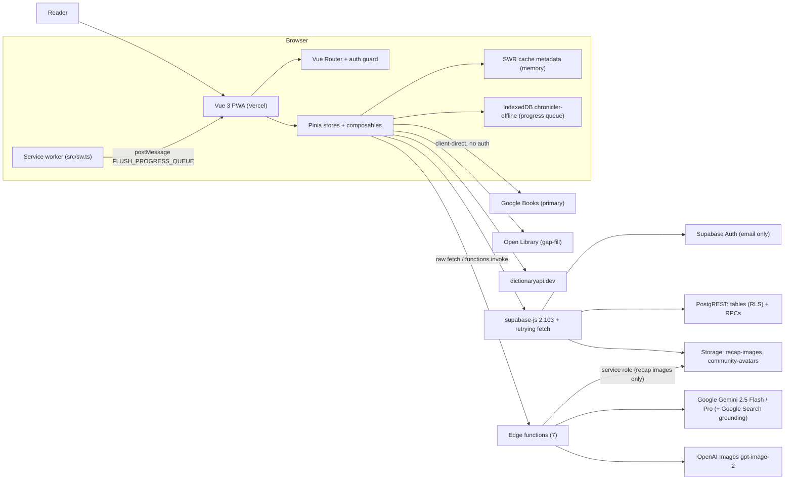
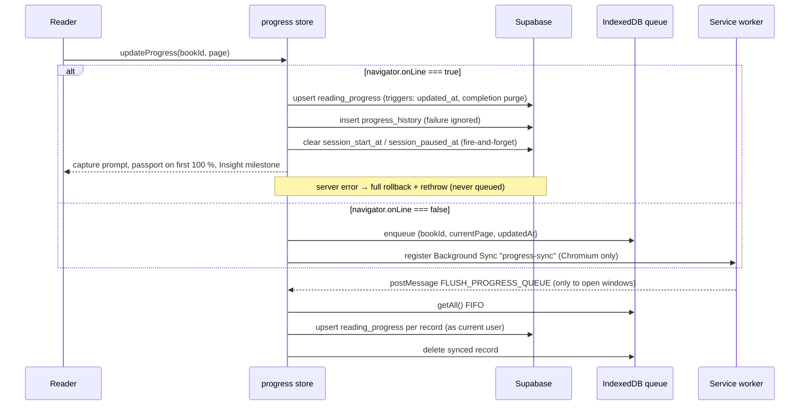
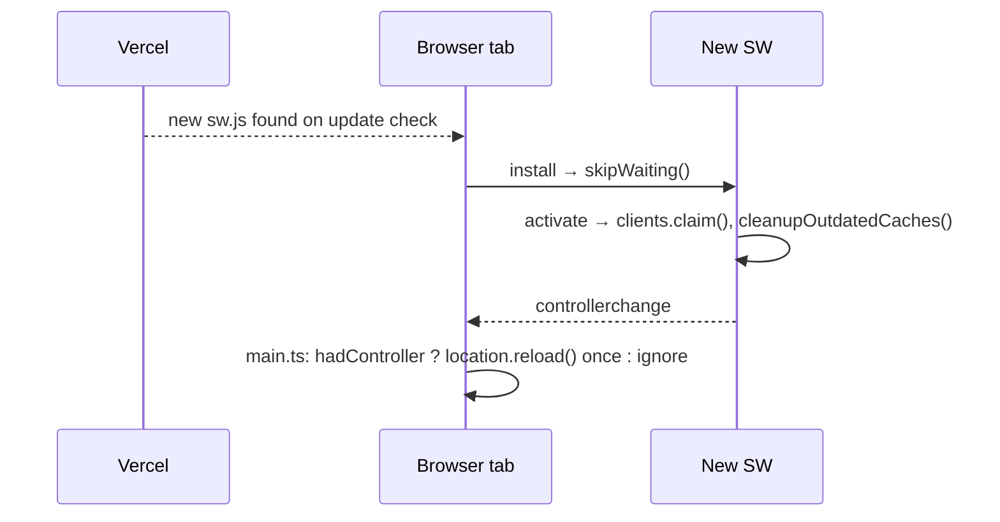
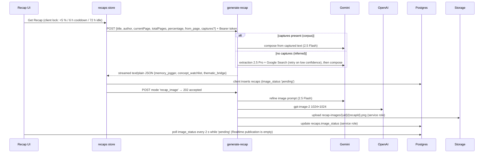
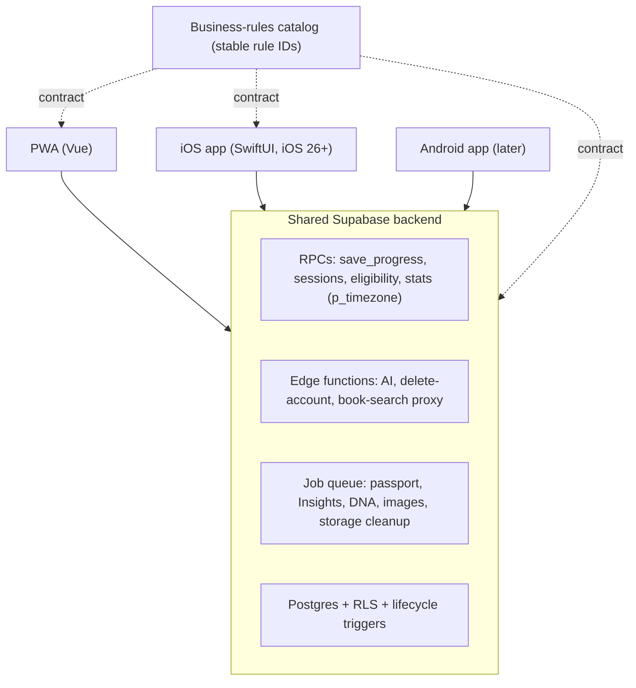

# Architecture

Last updated: 2026-10-18

**The Chronicler** (internal code name **BookHero**, D-03) is a client-heavy Vue 3 PWA on one shared Supabase backend (project `zlndhygpqacygceivuvk`, Postgres 17, DB time zone UTC). The browser app owns routing, UI state, caching, the offline progress queue and most workflow logic. Supabase provides Auth, PostgreSQL with RLS, SECURITY DEFINER RPCs, Storage and seven product edge functions for AI work.

This page describes the **structure** of the system. The **behaviour** (numbered, testable rules) lives in the [business-rules catalog](../business-rules/README.md); the live backend surface lives in the [backend contract](../backend-contract.md); the planned backend changes live in the [Phase 0 consolidation plan](../backend-consolidation-plan.md).

Verified against web `master` @ `8d8701c` (package version 3.9.1) and the live project on 2026-10-18.

---

## System overview

The service worker never reads IndexedDB and holds no auth token. On a Background Sync event it only asks the open windows to drain the queue ([PLT-47](../business-rules/08-platform-auth-account.md#plt-47--drain-triggers)).

| Tier | Runs | Owns today |
|---|---|---|
| Vercel static hosting | `dist/` from `pnpm build` | Cache headers only (`vercel.json`); no rewrites ([Deployment](Deployment.md)) |
| Browser (PWA) | Vue 3.5, Pinia 3, Vue Router 4, PrimeVue 4, VueUse 14, date-fns 4 | Routing, auth UX, SWR caching, offline queue, recap lock, Insight milestones, achievements catalog, completion side effects, AI result persistence |
| Supabase Postgres | 26 product tables (all RLS), 69 public functions (60 SECURITY DEFINER), 14 triggers | Ownership (RLS), aggregates (stats RPCs), completion purge triggers, XP events |
| Supabase Edge (Deno) | 7 product functions | AI calls (Gemini, OpenAI); recap-image job (the only server-side write) |
| Supabase Storage | 2 buckets | Recap images (private), community avatars (public) |
| Not used | — | Realtime publication is empty; no `pg_cron`, no `pg_net`, no webhooks |

---

## Frontend layers

| Layer | Path | Responsibility |
|---|---|---|
| Bootstrap | `src/main.ts`, `src/App.vue` | Theme before mount, `controllerchange` reload, Pinia/Router/PrimeVue setup; full-page splash until auth init; global ConfirmDialog, PrimeVue Toast, lore banner and glass toast; SW message bridge |
| Router | `src/router/index.ts` | Lazy routes under one auth-gated layout; guard; `scrollBehavior → top` |
| Layout | `src/layouts/DefaultLayout.vue` | Page outlet + bottom nav (rendered only when a user is signed in) |
| Pages | `src/pages/*` | Route-level composition and screen workflows |
| Components | `src/components/<area>/*` | UI per area: `anki`, `book`, `books`, `capture`, `dashboard`, `import`, `lexicon`, `library`, `lore`, `profile`, `recap`, `session`, `shared` |
| Composables | `src/composables/*` | Shared stateful logic; many are module singletons (state shared by every caller) |
| Stores | `src/stores/*` | Domain state, Supabase reads/writes, SWR keys, cross-feature effects |
| Services | `src/services/*` | Supabase client, retrying fetch, edge-function and Google Books clients |
| Utils | `src/utils/*` | Pure rules (milestones, page-save validation, master recap, achievements catalog, import parsers, dates) |
| Types | `src/types/index.ts` | Domain types (camelCase) and row mappers from snake_case |
| Service worker | `src/sw.ts` | Precache, SPA navigation fallback, runtime caches, Background Sync relay |

---

## Routes & layouts

Every route except `/login` and the 404 is a child of the auth-gated layout (`meta.requiresAuth`). All components are lazy-loaded; history mode with `BASE_URL = '/'`.

| Path | Name | Page | Notes |
|---|---|---|---|
| `/` | `dashboard` | `DashboardPage.vue` | Home tab; ordered mount sequence (PLT-36) |
| `/library` | `library` | `LibraryPage.vue` | List/grid views, search, queue reorder |
| `/library/dnf` | `library-dnf` | `DnfListPage.vue` | Did-not-finish shelf |
| `/books/add` | `add-book` | `AddBookPage.vue` | Search, scan, manual, CSV import hub; manifest shortcut target |
| `/books/add/details/:source/:key(.*)` | `add-book-details` | `BookSearchDetailPage.vue` | `key` is URI-encoded; `source` is ignored by the service |
| `/books/:id` | `book-detail` | `BookDetailPage.vue` | `props: true` |
| `/books/:id/recaps` | `recap-history` | `RecapHistoryPage.vue` | |
| `/books/:id/passport` | `book-passport` | `BookPassportPage.vue` | |
| `/lexicon` | `lexicon` | `GreatLibraryPage.vue` (tab label "Codex") | `?tab=lore` (Insights tab), `?bookId=` filter, kept in sync with `router.replace` |
| `/profile` | `profile` | `ProfilePage.vue` | |
| `/profile/trophy-room` | `trophy-room` | `TrophyRoomPage.vue` | Quest ring, level/XP, achievements |
| `/profile/stats` | `profile-stats` | `ReadingStatsPage.vue` | Monthly chart, calendar, lifetime stats, records, breakdown |
| `/profile/edit` | `profile-edit` | `ProfileEditPage.vue` | Username, display name, avatar |
| `/anki-review` | `anki-review` | `AnkiReviewPage.vue` | Highlights no tab |
| `/login` | `login` | `AuthPage.vue` | Public; signed-in users are redirected to the dashboard |
| `/:pathMatch(.*)*` | `not-found` | `NotFoundPage.vue` | Public, outside the layout (no nav) |

**Shell chrome**

| Surface | Source | Behaviour |
|---|---|---|
| Bottom nav | `src/components/shared/AppBottomNav.vue` | Home · Library (active for `/library*` and `/books*`) · Codex · Profile · More |
| "More" sheet | same | Add Book, Light/Dark mode, Sign out. Not closed by tab navigation (PLT-D19) |
| Glass toast | `useGlassToast` + `GlassToast.vue` | Top-centre single slot: success (5 s), loading (until dismissed), warn (6 s) |
| PrimeVue Toast | `App.vue` | Bottom-centre page-level success/error, above the nav |
| ConfirmDialog | `App.vue` | Global, used by Book Detail, Dashboard and Library |
| Lore banner | `LoreGenerationBanner.vue` | "Chronicler is weaving new lore" while an Insight generates; shares the top slot with the glass toast (PLT-D38) |
| Theme | `useAppTheme.ts` | `dark` (default) / `light` in `bookhero_theme`; `data-p-theme` on `<html>`; no system mode (PLT-40) |

Unrouted dead pages: `src/pages/LexiconPage.vue`, `src/components/HelloWorld.vue` (PLT-D40).

Rules: [08 · Platform › Routing & navigation](../business-rules/08-platform-auth-account.md#routing--navigation).

---

## Stores, composables & services map

### Pinia stores (`src/stores/`)

| Store | Domain | Backend objects | SWR keys |
|---|---|---|---|
| `auth` | Session, user snapshot, sign-in/up/out | Supabase Auth | clears all keys on user change |
| `books` | Library, add/edit/delete, CSV import | `books`, `reading_progress` (import), RPC `get_library_with_progress` | `books:{uid}`, `library:{uid}` |
| `progress` | Page saves, sessions (start/pause/resume/clear), DNF, offline queue drain | `reading_progress`, `progress_history` | `progress:{uid}` |
| `upNext` | Up Next order | `up_next_order` | `upNext:{uid}` |
| `recaps` | Recap generation, history, image kick-off | edge `generate-recap`, `recaps` | `recaps:{uid}:{bookId}`, ad-hoc `recaps:all:{uid}` |
| `captures` | Page captures | `page_captures` | none (store state) |
| `lexicon` | Codex entries, Leitner review, Word of the Day | `lexicon_entries` | `lexicon:{uid}:{bookId}`, `lexicon:{uid}:all` |
| `ankiSession` | Daily review session counters | `anki_review_sessions` | none |
| `loreCards` | Insights (lore) unlock and seen state | edge `generate-lore`, `lore_cards` | `lore:{uid}:{bookId}`, `lore:{uid}:all` |
| `bookPassport` | Book Passport stats and AI summary | RPC `get_book_passport_stats`, edge `generate-recap` (`passport_summary`), `book_passports` | `bookPassport:{uid}:{bookId}` |
| `readingQuest` | Yearly goal, XP, level | RPC `get_reading_quest_summary`, `reading_goals` | `readingQuest:{uid}:{year}` |
| `readingDna` | Reading DNA | edge `generate-reading-dna`, `reading_dna` | none |

### Composables (`src/composables/`)

| Group | Composables |
|---|---|
| Platform | `useCache` (SWR primitive), `useOfflineSync` (IndexedDB queue + Background Sync registration), `useLoadFailureNotice`, `useGlassToast`, `useAppTheme`, `useWakeLock`, `useRelativeTime` (unused wrapper of `utils/date.ts`) |
| Dashboard & sessions | `useActiveBook` (hero selection, module singleton), `useDashboardOnboardingState`, `useReadingSession` (start/pause/resume; refuses offline), `useSessionResume` ("Previously" dialog data), `useRecapLock` (+5 % / 6 h / 72 h lock; `DISABLE_RECAP_LOCK` flag) |
| Library | `useBookSearch` (Google Books search, module singleton), `useIsbn` (Google first, Open Library fallback/gap-fill), `useScanner` (barcode), `useLibraryImport` (CSV import orchestration), `useReadingVelocity` (`velocity:{uid}`) |
| Capture & AI helpers | `useCapture` (camera/upload → `ocr-page`), `usePageResume` (`generate-page-resume`), `useBookQuiz` (Memory Check, `generate-book-quiz`), `useVocabularyExtraction` (`extract-vocabulary`), `useRecapImage` (status polling), `useRecapGallery` (signed URLs) |
| Codex | `useLexicon` (dictionary lookup), `useLeitner`, `useAnkiSession`, `useGreatLibrarySearch` (server-side paginated Codex search) |
| Profile & stats | `useReadingProfile` (`readingStats:{uid}`), `useLastSession` (`lastSession:{uid}`), `useLibraryBreakdown` (`libraryBreakdown:{uid}`), `useReadingRecords` (`readingRecords:{uid}`), `useReadingCalendar`, `useMonthlyReading` (session-lifetime caches), `useAchievements`, `useDnaRecommendations`, `useCommunityIdentity` (profile identity + avatar upload) |

### Services (`src/services/`)

| Service | Role |
|---|---|
| `supabase.ts` | The one `createClient` (`persistSession`, `autoRefreshToken`, `detectSessionInUrl`) with `global.fetch = createRetryingFetch()`; throws at module load if `VITE_SUPABASE_URL` / `VITE_SUPABASE_ANON_KEY` are missing |
| `retryingFetch.ts` | Retries one PostgREST 401 after 400 ms (see [Network resilience](#network-resilience--error-surfacing)) |
| `recapService.ts` | Raw `fetch` to `generate-recap` (streamed text; image mode) |
| `loreService.ts` | Raw `fetch` to `generate-lore` |
| `bookSearchService.ts` | Google Books search, volume detail, recommendations; Open Library gap-fill |

### Utils (`src/utils/`)

`achievements` (catalog), `cleanDescription`, `completionPrompt`, `coverFallback`, `date`, `duplicateBook`, `imageNormalize`, `import/*` (CSV format detection, Goodreads and StoryGraph parsers, shared helpers), `masterRecap`, `milestoneDetect`, `pageSave`, `searchText`.

---

## SWR cache primitive (`src/composables/useCache.ts`)

The cache holds **freshness metadata only** (`fetchedAt`, `ttlMs`, `inflight`, `subscriberCount`) in a module-level `Map`. The data itself lives in Pinia and composable refs. Nothing is persisted; everything is lost on reload.

| Operation | Semantics |
|---|---|
| `swrStatus(key, ttl)` | `fetchedAt === 0` → `'loading'`; age ≤ TTL → `'fresh'`; else `'background'`. The TTL is fixed when the entry is first created |
| Store contract | `'fresh'` → no network; `'background'` → fire-and-forget refresh (errors swallowed); `'loading'` → awaited fetch (stores set `loading`) |
| `swrRun(key, fn)` | De-duplicates concurrent runs per key. Success stamps `fetchedAt = now`; failure leaves it unchanged and rethrows. Unknown keys get a 60 s TTL |
| `invalidate(key \| prefix)`, `revalidate(key)` | Set `fetchedAt = 0`, so the **next access is a blocking `'loading'` fetch**, not a background one (PLT-28). Data stays on screen, but skeletons can flash |
| `swrTouch(key)` | Marks an existing key fresh after a local mutation; no-op for unknown keys |
| Refocus | On `visibilitychange → visible`, every stale, not-in-flight key that ever registered a revalidator refreshes in the background. Revalidators are never unregistered, so a refocus refreshes every stale key visited in the session (PLT-D20) |
| `clearAll()` | Called by the auth store whenever the user id changes (sign-in, sign-out, switch); token refreshes do not clear |
| Dev inspector | `window.__bookheroCache` (`keys()`, `get(k)`, `stats()`) in dev builds only |

A fetch that completes after an `invalidate` re-marks the key fresh with pre-mutation data (race noted in [01 · Library](../business-rules/01-library.md)).

### Key catalogue (TTLs)

| Key | TTL | Fetcher | Refocus |
|---|---|---|---|
| `books:{uid}` | 60 s | `booksStore.fetchLibrary` (`books.select('*')`) | yes |
| `library:{uid}` | 60 s | `booksStore.fetchLibraryWithProgress` (RPC `get_library_with_progress`, also rebuilds `books`) | yes |
| `progress:{uid}` | 30 s | `progressStore.fetchProgress` (derives from library entries when present; drains the queue when online) | yes |
| `upNext:{uid}` | 60 s | `upNextStore.fetchOrder` | yes |
| `lexicon:{uid}:{bookId}` / `lexicon:{uid}:all` | 60 s | `lexiconStore.fetchEntriesForBook` / `fetchEntriesForAllBooks` | yes |
| `recaps:{uid}:{bookId}` | 60 s | `recapsStore.fetchRecapsForBook` | yes |
| `recaps:all:{uid}` (not in `cacheKeys`) | 60 s | `recapsStore.fetchRecapsForAllBooks` | yes |
| `bookPassport:{uid}:{bookId}` | 60 s | `bookPassportStore.fetchPassport` | yes |
| `lore:{uid}:{bookId}` / `lore:{uid}:all` | 120 s | `loreStore.fetchLoreForBook` / `fetchLoreForAllBooks` | yes |
| `readingStats:{uid}` | 120 s | `useReadingProfile` (RPC `get_reading_stats`) | yes |
| `lastSession:{uid}` | 30 s | `useLastSession` (RPC `get_last_session`) | yes |
| `libraryBreakdown:{uid}` | 120 s | `useLibraryBreakdown` (RPC) | yes |
| `readingQuest:{uid}:{year}` | 60 s | `readingQuestStore.fetchQuestSummary` (RPC) | yes |
| `readingRecords:{uid}` | 120 s | `useReadingRecords` (RPC) | yes |
| `velocity:{uid}` | 365 days ("explicit invalidation only") | `useReadingVelocity` (RPC with the current book ids; the key ignores them, PLT-D21) | no |

### Invalidation semantics (summary)

T = `swrTouch`, I = `invalidate` (blocking reload on next access), I\* = prefix.

| Mutation | Effects |
|---|---|
| `addBook`, `updateBook` | T books · I library, libraryBreakdown, readingQuest\* |
| `addBookWithInitialStatus`, `importBooks` | T books · I library, progress, libraryBreakdown, readingStats, readingQuest\*, velocity |
| `removeBook` | T books · I library, progress, libraryBreakdown, readingQuest\*, lexicon\*, recaps(book), bookPassport(book) |
| `startSession` | I library · T progress |
| `clearSession` | I library |
| `markDnf` / `resumeDnf` | I library · T progress |
| `setInitialProgress` | I library, libraryBreakdown, readingStats, readingQuest\*, velocity · T progress |
| `updateProgress` (online) | T progress · I library, lastSession, readingStats, readingQuest\*; velocity only when a session ended |
| `updateProgress` (offline) | I library only |
| `saveCapture`, `generateRecap` insert, `saveGoal` | I readingQuest\* (recap insert also I recaps(book)) |
| Lore unlock / mark seen | T lore (book + all); unlock also I readingQuest\* |
| Lexicon add / Leitner update / master / restore | T lexicon (book + all) |
| `saveOrder` | T upNext |
| Passport refresh / generate | T bookPassport(book) |

Never invalidated by a mutation (TTL or refocus only): `readingRecords`, `recaps:all`, `lore:*` after a book delete, `lastSession` after a delete or DNF, `readingStats` after a delete or DNF. The full matrix is normative in [08 · Platform › Mutation → cache effect matrix](../business-rules/08-platform-auth-account.md#mutation--cache-effect-matrix).

### Session-lifetime caches and browser storage

| Cache / key | Where | Scope | Cleared on sign-out |
|---|---|---|---|
| Reading-calendar months, monthly-reading years | `useReadingCalendar`, `useMonthlyReading` | per user, never refetched (PLT-D24) | reset on next user change |
| Codex search results | `useGreatLibrarySearch` | per uid | on first search by another uid |
| Quiz cache | `useBookQuiz` | module | no |
| `sb-<project-ref>-auth-token` | localStorage | session | yes |
| `bookhero-auth-user` | localStorage | `{id, email}` snapshot | yes |
| `bookhero_theme` | localStorage | device | no |
| `bookhero_wotd_{uid}` | localStorage | per user (UTC date) | no |
| `bookhero:dna-covers` | localStorage | signature-keyed | no |
| `library-view-mode`, `library-active-tab`, `library-grid-collapsed` | localStorage | device | no |
| `chronicler-offline` / `progress_queue` | IndexedDB | **not user-scoped** | no (PLT-D12) |
| Workbox precache, `book-covers`, `isbn-api` | Cache Storage | device | no |

Sign-out leaves Pinia stores and module singletons populated until the next fetch overwrites them ([PLT-15](../business-rules/08-platform-auth-account.md#plt-15--sign-out-clears-almost-nothing-locally)).

---

## Network resilience & error surfacing

| Layer | Behaviour | Source |
|---|---|---|
| 401 retry (app) | Every supabase-js request goes through `createRetryingFetch()`. A **401** on a `/rest/v1/` URL with an `Authorization` header waits **400 ms** and retries **once**. A second 401 calls `notifyLoadFailure()`. Auth, Storage and Functions URLs are not retried | `src/services/retryingFetch.ts` |
| Why | PostgREST intermittently rejects a valid token (`PGRST303`) during the refresh burst on cold start | same |
| Library retry (postgrest-js 2.103.2) | Only GET/HEAD/OPTIONS (table selects) on a network error or 503/520, up to 3 times with 1 s → 2 s → 4 s backoff. RPCs are POST and are never auto-retried. Offline, a table read takes about 7 s to fail while an RPC fails at once | `node_modules` (library default) |
| Load-failure notice | One warn glass toast "Some things didn't load / Reopen the app or refresh the page to try again." at most every 30 s | `useLoadFailureNotice.ts` |
| Background refresh errors | Always silent; stale data stays on screen | `useCache.ts` |
| Edge errors | Raw-fetch callers throw `body.error ?? 'HTTP <status>'`; functions answer JSON `{ error, … }` with 400/401/405/500/502/503/504; `generate-recap` image mode answers 202 | [PLT-39](../business-rules/08-platform-auth-account.md#plt-39--edge-function-error-transport) |
| Database budget | `statement_timeout` 8 s (`authenticated`), 3 s (`anon`); `lock_timeout` 8 s; `safeupdate` rejects unfiltered UPDATE/DELETE | [PLT-86](../business-rules/08-platform-auth-account.md#plt-86--per-request-database-budget) |

---

## Offline queue & service worker

### Progress queue

| Aspect | Today |
|---|---|
| What is queued | Only page saves, and only when `navigator.onLine === false` **at the moment** of the save. An online save that fails is rolled back and rethrown |
| Storage | IndexedDB `chronicler-offline` v1, store `progress_queue` (`keyPath id`, autoIncrement); record `{ id, type: 'progress_update', payload: { bookId, currentPage, updatedAt }, retries: 0 }`. No user id; `retries` and `updatedAt` are unused |
| Offline save does | Optimistic local update, `invalidate(library)`, enqueue, `pendingSync = true`, Background Sync registration |
| Offline save skips | `progress_history` row, session end, capture prompt, Insight milestone, passport generation, stats invalidations. Offline reading never reaches stats, streaks or the calendar (PLT-D25) |
| Replay | FIFO bare upsert `reading_progress {book_id, user_id: <current user>, current_page}` on `book_id,user_id`, then delete the record; failures stay queued silently. `updated_at` is stamped at replay time. Completion triggers do fire at replay |
| Drain triggers | `window 'online'`; SW `sync` (tag `progress-sync`) → `FLUSH_PROGRESS_QUEUE` to every window client; every progress fetch while online. No mutex (PLT-D27) |
| Sessions | Start / Pause / Resume refuse to run offline ("You appear to be offline. Start Session requires a connection.") |

Target: [D-08](../business-rules/README.md) and [BC-04](../backend-consolidation-plan.md#bc-04--atomic-progress--session-rpcs). The queue becomes user-scoped `save_progress` operations with `client_occurred_at` and an `idempotency_key`; offline replays count for pages, streaks and charts with their original time.

### Service worker (`src/sw.ts`, VitePWA `injectManifest`)

| Concern | Behaviour |
|---|---|
| Build & registration | VitePWA `registerType: 'autoUpdate'`, `strategies: 'injectManifest'`, `filename: 'sw.ts'`, `manifest: false`; registered by the generated `registerSW.js` on `window.load`, scope `/`. Disabled in dev (`devOptions.enabled: false`) |
| Precache | Every build output matching `**/*.{js,css,html,ico,png,svg,woff2}` plus `icons/*`; outdated precaches cleaned |
| Navigation | Every navigation is served the precached `index.html` (no allow/deny list). The shell loads offline; data does not |
| Runtime caches | `covers.openlibrary.org` CacheFirst `book-covers` (200 entries, 30 days; caches nothing in practice, PLT-D33); `openlibrary.org/api/*` NetworkFirst `isbn-api` (100 entries, 7 days). Supabase, Google Books, Google covers, `search.json` and dictionaryapi.dev are not cached |
| Background Sync | `sync` event with tag `progress-sync` → `postMessage({type:'FLUSH_PROGRESS_QUEUE'})` to all window clients (`includeUncontrolled: true`). Chromium-only; iOS Safari has none. With no window open nothing flushes |
| Update flow | `skipWaiting()` at install, `clients.claim()` on activate; `main.ts` reloads **once** on `controllerchange` if the page already had a controller (a first install never reloads). No prompt; an open sheet or form is interrupted (PLT-D36, PLT-Q09) |

---

## Data flows

### Online page save — database side

1. Upsert `reading_progress` (`onConflict: book_id,user_id`). Trigger `reading_progress_updated_at` sets `updated_at = now()` on **every** update (also session and DNF writes, PLT-D29).
2. Triggers `page_captures_delete_on_completion` and `book_quizzes_delete_on_completion` (AFTER INSERT OR UPDATE OF `current_page`) delete the book's captures and quiz when `current_page >= total_pages > 0`, whatever client or path wrote it.
3. The client inserts `progress_history` with a device-clock `recorded_at` and clears the session columns.

Detail: [02 · Reading sessions](../business-rules/02-reading-sessions.md), [09 · Database invariants](../business-rules/09-database-invariants.md).

### AI recap and recap image

A failed image request, an upload error or a killed background job leaves the row `pending` forever, and the panel polls without a cap ([03 · Recaps](../business-rules/03-recaps.md); BC-13). Targets: server-side lock, corpus window and persistence ([BC-07](../backend-consolidation-plan.md#bc-07--recap-eligibility--persistence-server-side)).

### Insights (lore) milestone pipeline

`progressStore.updateProgress` (online only) → `detectCrossedMilestone(prev, next)` on 10 … 90 % → `loreCards.maybeUnlockForMilestone` → builds the master recap from the book's recap history (no recap → no Insight) → raw `fetch` to `generate-lore` → the client inserts `lore_cards` → the global banner shows while `isGenerating`. Target: server-side orchestration with recap → captures → metadata fallback and backfill ([D-12](../business-rules/README.md) · [BC-08](../backend-consolidation-plan.md#bc-08--insights-orchestration-server-side--fallback)).

### Capture, resume and Memory Check

| Step | Flow |
|---|---|
| Capture | Camera or upload → image normalised to `ocr-page` limits → raw `fetch` `ocr-page` (`{imageBase64, mimeType}`, ≤ 5 MB, JPEG/PNG, 10 s budget) → review (auto-save at confidence ≥ 0.90, warning below 0.70) → `captures.saveCapture` upserts `page_captures` (`onConflict user_id,book_id,page`). Images are never persisted |
| Capture trigger | `record_page_capture_quest_event` records the +5 XP event, then deletes **all** the book's captures if the book is already complete |
| After save (fire-and-forget) | `extract-vocabulary` → the client inserts `lexicon_entries` + `vocabulary_extractions`; `generate-page-resume` → the client writes `page_captures.resume` |
| Start-session gate | `SessionStartButton`: Memory Check when away ≥ 48 h with material and no fresh recap (`generate-book-quiz` → client upsert `book_quizzes`), else the "Previously" resume dialog when the latest capture has a resume and no recap covers the current page. Only "Begin reading" writes `session_start_at` |

Native iOS: Apple Vision OCR first, `ocr-page` fallback on low confidence; thresholds recalibrated (D-15). Detail: [04 · Capture, resume & quiz](../business-rules/04-capture-resume-quiz.md).

### Other AI results the client persists

| Result | Edge function | Client write |
|---|---|---|
| Book Passport summary (first ≥ 100 % save online) | `generate-recap` `mode: 'passport_summary'` + RPC `get_book_passport_stats` | upsert `book_passports` (`onConflict book_id`) |
| Reading DNA | `generate-reading-dna` | upsert `reading_dna` (`onConflict user_id`) |
| Achievements | none (catalog in `src/utils/achievements.ts`) | upsert `achievements` (`ignoreDuplicates`) |

Only the recap-image job writes server-side. Every other edge function is a stateless transformer. Targets: [BC-05](../backend-consolidation-plan.md#bc-05--server-owned-completion--lifecycle-effects) (completion effects), [BC-09](../backend-consolidation-plan.md#bc-09--achievements-server-side) (achievements).

---

## Backend surface (summary)

| Area | Live state (2026-10-18) | Detail |
|---|---|---|
| Tables | 26 product tables, RLS enabled on all; owner policies check `user_id` only, never `book_id` ownership | [backend contract §3, §5](../backend-contract.md#5-row-level-security) |
| RPCs | Library/stats/quest/calendar/records/passport/profile-identity RPCs. 4 read RPCs have no caller check, the quest RPC guard is NULL-bypassable by `anon` | [Authentication & Authorization](Authentication-Authorization.md#rpc-caller-checks) |
| Triggers | 14: `updated_at` stampers, completion purges (captures, quizzes), capture XP event, community/circle housekeeping | [backend contract §9](../backend-contract.md#9-triggers--internal-functions) |
| Edge functions | `generate-recap` v84, `generate-lore` v18, `ocr-page` v2 (`verify_jwt: false`); `extract-vocabulary` v2, `generate-reading-dna` v8, `generate-page-resume` v3, `generate-book-quiz` v1 (`verify_jwt: true`) | [backend contract §10](../backend-contract.md#10-edge-functions) |
| Storage | `recap-images` (private, 10 MiB, png/jpeg/webp, `{uid}/{recapId}.png`); `community-avatars` (public, 5 MiB, jpeg/png/webp, `{uid}/avatar-{ms}.jpg`). Never cleaned on delete | [backend contract §7](../backend-contract.md#7-storage) |
| Realtime / jobs | Publication `supabase_realtime` has no tables; no `pg_cron`, `pg_net` or webhooks | PLT-84 |
| Dormant | Follow graph, discovery, reading circles (D-13); weekly session goal (`user_settings.weekly_goal`, `upsert_weekly_goal`, `get_retention_summary`) | [10 · Community & circles](../business-rules/10-community-circles.md) |
| Reference | Read-only live snapshot `supabase/reference/live-baseline-2026-10-18.sql` (D-16) | [Deployment](Deployment.md#database-changes) |

---

## External integrations

| Integration | Called from | Purpose |
|---|---|---|
| Supabase Auth | browser (supabase-js) | Email + password and magic link; session persistence ([Authentication & Authorization](Authentication-Authorization.md)) |
| Supabase PostgREST | browser | Tables (RLS) and RPCs |
| Supabase Storage | browser (signed URLs, avatar upload), edge (recap images) | Recap images, avatars |
| Supabase Edge Functions | browser (raw `fetch` for `generate-recap`, `generate-lore`, `ocr-page`; `functions.invoke` for the rest) | AI and OCR |
| **Google Books API** (`www.googleapis.com/books/v1/volumes`) | browser, key optional (`VITE_GOOGLE_BOOKS_API_KEY`) | **Primary** for search (20 per page, `printType=books`, `langRestrict` from `navigator.language` except ISBN queries), ISBN lookup (scan, typed ISBN, import enrichment), volume detail, recommendations, description backfill, DNA cover resolution |
| **Open Library** (`openlibrary.org/api/books?bibkeys=ISBN:…&jscmd=data`, `covers.openlibrary.org`) | browser | **Gap-fill** by ISBN: author, cover, pages, genre, subjects when Google is incomplete; full fallback when Google has no ISBN hit. Never supplies descriptions |
| dictionaryapi.dev (`/api/v2/entries/en/{term}`) | browser (`useLexicon`) | Definitions in the Codex add flow |
| Google Gemini (`@google/genai`, unpinned) | edge | `gemini-2.5-flash` (recaps, passport, lore, OCR, vocabulary, resume, quiz, DNA, image-prompt refiner); `gemini-2.5-pro` + Google Search grounding (inferred recap extraction); Google Search grounding in deployed `generate-reading-dna` v8 |
| OpenAI Images API | edge (`generate-recap` image mode) | `gpt-image-2`, 1024×1024, `quality: low` |

Book-metadata calls are client-direct with no proxy, cache or rate limit; the Google key ships in the bundle. Target: a server-side `book-search` proxy ([BC-15](../backend-consolidation-plan.md#bc-15--book-data-hygiene)). Rules: [01 · Library](../business-rules/01-library.md).

---

## Key design decisions

| Decision | Status |
|---|---|
| Supabase Auth session persistence in the browser via supabase-js | Current |
| RLS-backed tables and SECURITY DEFINER RPCs instead of a custom backend server | Current; caller checks being fixed (BC-01) |
| AI provider keys only in edge-function secrets | Current; edge auth being fixed (BC-02) |
| Postgres RPCs for aggregates (library, stats, velocity, quest, passport, calendar, records) | Current; time-zone parameter everywhere (BC-06) |
| Client-side SWR cache with explicit invalidation | Current; stays client-side (each client implements the catalog rules) |
| IndexedDB only for the offline progress queue; no offline data cache | Current; queue moves to `save_progress` replays (BC-04) |
| Page-capture images are never persisted; reviewed OCR text is | Protective invariant (PLT-80) |
| Business logic (completion effects, recap lock, Insights, achievements) in the client | **Changing**: moves server-side before the iOS build (D-06) |

---

## Architecture direction

### One backend, three clients

The PWA stays live (D-05). The long-term shape is **web + iOS + Android on one shared Supabase backend**. Consequences:

- Every backend change is **client-agnostic** and **backward compatible**. The PWA keeps working during each transition and migrates to the new RPCs too.
- Rules are written once, client-agnostically, in the [business-rules catalog](../business-rules/README.md) (D-01). Its stable IDs (LIB, SES, REC, CAP, LEX, INS, PRO, PLT, BE, COM, XD, CL) are **the cross-client contract**: acceptance tests, PRs and native briefs cite them.
- Native clients stay **thin** (D-06): they render server state, collect input and call RPCs. They do not re-implement completion, eligibility, achievements or Insight logic.
- iOS first: iOS 26+, iPhone first, native Liquid Glass (D-04). Android follows later on the same backend.

### Phase 0 — backend consolidation

Phase 0 is the backend work that lands **before the native iOS build starts**: [backend-consolidation-plan.md](../backend-consolidation-plan.md).

| Wave | Packages | Goal |
|---|---|---|
| 1 · Security & drift | BC-03 → BC-01, BC-02 | No cross-user reads or deletes, no forgeable AI endpoints, repo == live |
| 2 · Core RPCs | BC-04 → BC-06 → BC-05 | One atomic, server-clocked write path for progress and sessions; reader time zone everywhere (D-07); one owner for completion effects |
| 3 · Server features | BC-07, BC-08, BC-09, BC-10 | Recap lock, Insights, achievements and review math on the server |
| 4 · Platform | BC-11, BC-12, BC-13, BC-14, BC-15 | Account deletion + Sign in with Apple, entitlement/AI-usage hooks, storage hygiene, sync readiness, book-data hygiene |

The iOS build starts when Waves 1–3 are done. BC-11 blocks App Store submission.

| ID | Package | Status |
|---|---|---|
| [BC-01](../backend-consolidation-plan.md#bc-01--security-hardening) | Security hardening | Required |
| [BC-02](../backend-consolidation-plan.md#bc-02--edge-function-auth) | Edge-function auth | Required |
| [BC-03](../backend-consolidation-plan.md#bc-03--source-of-truth--drift) | Source of truth & drift | Decided (live snapshot committed) |
| [BC-04](../backend-consolidation-plan.md#bc-04--atomic-progress--session-rpcs) | Atomic progress & session RPCs | Decided |
| [BC-05](../backend-consolidation-plan.md#bc-05--server-owned-completion--lifecycle-effects) | Server-owned completion & lifecycle effects | Decided |
| [BC-06](../backend-consolidation-plan.md#bc-06--timezone-standardisation) | Timezone standardisation | Decided |
| [BC-07](../backend-consolidation-plan.md#bc-07--recap-eligibility--persistence-server-side) | Recap eligibility & persistence server-side | Decided |
| [BC-08](../backend-consolidation-plan.md#bc-08--insights-orchestration-server-side--fallback) | Insights orchestration server-side + fallback | Decided |
| [BC-09](../backend-consolidation-plan.md#bc-09--achievements-server-side) | Achievements server-side | Decided |
| [BC-10](../backend-consolidation-plan.md#bc-10--review-leitner-rpc) | Review (Leitner) RPC | Recommended |
| [BC-11](../backend-consolidation-plan.md#bc-11--account-lifecycle--auth) | Account lifecycle & auth | Decided |
| [BC-12](../backend-consolidation-plan.md#bc-12--entitlements--ai-usage-foundation) | Entitlements & AI-usage foundation | Decided in principle; tiers undecided (D-14) |
| [BC-13](../backend-consolidation-plan.md#bc-13--storage-hygiene--ai-job-robustness) | Storage hygiene & AI-job robustness | Recommended |
| [BC-14](../backend-consolidation-plan.md#bc-14--sync--realtime-readiness) | Sync & realtime readiness | Recommended |
| [BC-15](../backend-consolidation-plan.md#bc-15--book-data-hygiene) | Book data hygiene | Recommended |

Principles every package follows: client-agnostic rules (P1); expand → migrate → contract (P2); the PWA migrates too (P3); server clock and server-owned effects, client time only for offline replays (P4); rule IDs are the acceptance tests (P5); least privilege (P6); migration discipline (P7); thin native clients (P8). What stays in the clients is listed in the plan's [§5 What stays client-side](../backend-consolidation-plan.md#5-what-stays-client-side) and the [12 · Client-logic register](../business-rules/12-client-logic-register.md).

### What changes in this PWA

Each package lists its PWA changes in the plan's [§4 PWA changes required](../backend-consolidation-plan.md#4-pwa-changes-required). The largest: `progress` store and `useReadingSession` move to the BC-04 RPCs; client passport/DNA/Insight/achievement generation is removed (BC-05, BC-08, BC-09); recaps use `generate-recap` v2 with a server-side lock (BC-07); stats calls pass `p_timezone` (BC-06); Auth adds password reset, Sign in with Apple and Delete account (BC-11).

---

## Related pages

[Authentication & Authorization](Authentication-Authorization.md) · [Configuration](Configuration.md) · [Project Structure](Project-Structure.md) · [Deployment](Deployment.md) · [Testing](Testing.md) · [Troubleshooting](Troubleshooting.md) · [Development Workflow](Development-Workflow.md) · [Features](Features.md)
