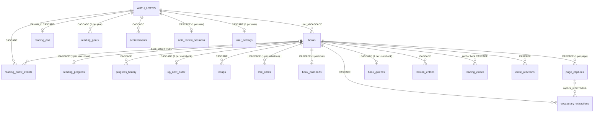
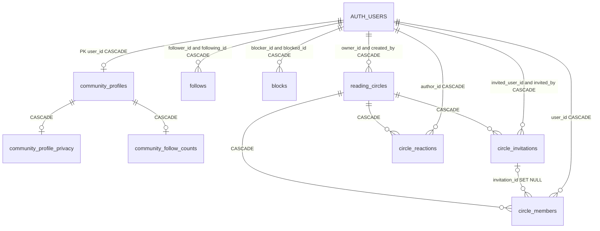

# Database Data Model

Last updated: 2026-10-18 · Verified against the live Supabase project `zlndhygpqacygceivuvk` and web `master` @ `8d8701c`.

> **What this page is.** A curated map of the Supabase PostgreSQL schema behind **The Chronicler**. "BookHero" is the internal code name. It covers every product table, how the tables relate, what cascades, who may touch what (RLS), and how far the repo's migrations have drifted from production.
>
> **Sources of truth.** The **live database** is canonical, not `supabase/migrations/`.
> - A read-only snapshot of the live catalog is committed at [`supabase/reference/live-baseline-2026-10-18.sql`](../../supabase/reference/live-baseline-2026-10-18.sql) (see its [README](../../supabase/reference/README.md)). It holds every function, trigger, policy, constraint, index, enum and bucket.
> - Column-level shapes, cascades and policies are in the [backend contract](../backend-contract.md) sections [3 Tables](../backend-contract.md#3-tables), [4 Cascades & lifecycle effects](../backend-contract.md#4-cascades--lifecycle-effects) and [5 Row-level security](../backend-contract.md#5-row-level-security).
> - The rules these objects enforce are in [09 · Database invariants](../business-rules/09-database-invariants.md) (BE-xx).
>
> **Related pages:** [API Documentation](API-Documentation.md) · [API Quick Reference](API-Quick-Reference.md).

## Contents

1. [Inventory](#1-inventory)
2. [Tables](#2-tables)
3. [Relationships and cascades](#3-relationships-and-cascades)
4. [Triggers](#4-triggers)
5. [Enums and value sets](#5-enums-and-value-sets)
6. [Row-level security](#6-row-level-security)
7. [Storage](#7-storage)
8. [Indexes and advisors](#8-indexes-and-advisors)
9. [Migrations and drift](#9-migrations-and-drift)
10. [Planned schema changes](#10-planned-schema-changes)
11. [Where the rules live](#11-where-the-rules-live)

---

## 1. Inventory

| Object (schema `public`) | Live count | Notes |
|---|---|---|
| Tables | 26 | RLS **enabled on all**, forced on none. No views, materialized views or sequences. |
| Functions | 69 (60 `SECURITY DEFINER`) | 36 client RPCs; the remaining 33 are trigger and internal helpers. All pin `search_path = public`. |
| Triggers | 14 | All row-level and enabled. None on `auth.users`, `books`, `progress_history`, `recaps`, `lexicon_entries`, `lore_cards`, `book_quizzes`, `up_next_order` or `user_settings`. |
| Foreign keys | 48 | 13 point at `books(id)` |
| RLS policies | 54 | All PERMISSIVE |
| Enums | 4 | Community and circles only |
| Storage buckets | 2 | `recap-images` (private), `community-avatars` (public) |

**Extensions** installed: `plpgsql`, `pgcrypto`, `uuid-ossp`, `pg_stat_statements`, `supabase_vault`.

**Not installed:** `pg_cron` (no scheduled jobs), `pg_net` (no webhooks), `pg_graphql`, `pgmq`, `http`.

**Realtime:** the `supabase_realtime` publication contains **no tables**.

**Runtime:**

- DB `TimeZone = UTC`.
- `statement_timeout` is 8 s for `authenticated` and 3 s for `anon`.
- PostgREST preloads `safeupdate`.

See [BE-08a](../business-rules/09-database-invariants.md#be-08a--per-request-runtime-limits-and-server-timezone).

**Sign-up creates only the `auth.users` row.** No trigger bootstraps a profile, settings or community row (BE-88).

---

## 2. Tables

**Conventions:**

- `id uuid` is the PK with default `gen_random_uuid()`, unless noted.
- Timestamps are `timestamptz`.
- "→ users" = FK to `auth.users(id)`; "→ books" = FK to `books(id)`. The ON DELETE action is given in [§3](#3-relationships-and-cascades).
- Length CHECKs count Unicode code points (`char_length`), so validate the same way in every client (BE-90).
- "Written by" describes **today**. Under D-06, server-owned writes move behind RPCs (BC-04 / BC-05 / BC-07 / BC-08 / BC-09).

### 2.1 Library & reading

| Table | Purpose | Key columns | Keys, constraints & defaults | Written by |
|---|---|---|---|---|
| `books` | The reader's books (metadata only) | `user_id` → users, `title`, `author`, `isbn`, `cover_url`, `total_pages`, `genre`, `description`, `source`, `page_count_estimated`, `created_at` | **Lengths:** `title` 1–500, `author` 1–200, `total_pages ≥ 1`. **`isbn`:** NULL or `^\d{9}[\dX]$\|^\d{13}$` (no hyphens or spaces; uppercase `X`; no checksum). **`source`:** default `'manual'`, **no CHECK**. Values `manual`, `goodreads`, `storygraph`; never changes after insert. **`page_count_estimated`:** default `false`; cleared **by the client** when `total_pages` is edited. **Not enforced:** no uniqueness per user, no `updated_at`, no triggers. | Client (add, edit, import, delete) |
| `reading_progress` | Current position, session state and DNF shelf. One row per (book, user). | `book_id` → books, `user_id`, `current_page`, `updated_at`, `session_start_at`, `session_paused_at`, `dnf_at` | **Keys:** UNIQUE `(book_id, user_id)` — the upsert target. **`current_page`:** default 0 with **no range CHECK**. **`updated_at`:** set to `now()` on **every** UPDATE (trigger). **No row = "want to read".** **No `created_at`.** | Client upserts and updates; completion triggers fire on it |
| `progress_history` | Append-only log of online page saves. A row with `session_start_at` marks the end of a timed session. | `book_id`, `user_id`, `page`, `recorded_at`, `session_start_at`, `session_note` | `page ≥ 0`; `session_note ≤ 160`. `recorded_at` defaults to `now()`, but the PWA sends the device time. No uniqueness or idempotency key. **Feeds every stats RPC.** | Client (insert per online save; note update) |
| `up_next_order` | User-defined order of **queued (unread)** books | `user_id`, `book_id`, `sort_position`, `updated_at` | UNIQUE `(user_id, book_id)`; `sort_position` default 0. A row is not removed when its book leaves the queue. | Client (drag reorder) |

### 2.2 AI memory

| Table | Purpose | Key columns | Keys, constraints & defaults | Written by |
|---|---|---|---|---|
| `recaps` | Blurbs and mid-book recaps, plus the recap illustration status | `book_id`, `user_id`, `progress_snapshot numeric(5,2)`, `page_snapshot`, `memory_jogger`, `concept_watchlist`, `thematic_bridge`, `mode`, `created_at`, `image_path`, `image_status`, `image_generated_at` | The three text columns must be non-empty. `mode ∈ {corpus, inferred}`, default `inferred`. `image_status` is NULL or one of `pending`, `succeeded`, `failed_safety`, `failed_transient`, `skipped`. `skipped` is never written. Many recaps per book. | **Client** inserts (BC-07 moves this into `generate-recap`). The edge function updates `image_*` with the service role. |
| `lore_cards` | Insights: one AI card per reading milestone | `user_id`, `book_id`, `title`, `content`, `type`, `linked_entities text[]`, `unlocked_at_page`, `unlocked_at_milestone`, `seen`, `created_at` | UNIQUE `lore_cards_unique_milestone (user_id, book_id, unlocked_at_milestone)` — a `23505` means "already unlocked". Milestone ∈ {10, 20, …, 90}. **`type` has no CHECK live**; the function emits `History`, `Culture`, `Geography`, `Technology`, `Lore`. No `updated_at`. | Client inserts `generate-lore` output (BC-08 moves it server-side) |
| `book_passports` | Completed-book journey summary | `book_id`, `user_id`, `total_days`, `peak_day date`, `peak_day_pages`, `vocabulary_count`, `ai_summary`, `generated_at` | **UNIQUE `book_id`** (one per book) | Client upsert `onConflict book_id` (BC-05 freezes stats at completion) |
| `reading_dna` | Reader identity profile. **PK = `user_id`.** | `personality`, `mood_tone`, `mood_emojis text[]`, `suggestions jsonb`, `books_finished_at_generation`, `generated_at` | `personality` 50–800; `mood_tone` 1–40; `mood_emojis` 1–5 elements — but an **empty array passes** (`array_length` is NULL). `books_finished_at_generation ≥ 0`. `suggestions` is unconstrained. | Client upsert `onConflict user_id` |

### 2.3 Capture, resume & Memory Check

| Table | Purpose | Key columns | Keys, constraints & defaults | Written by |
|---|---|---|---|---|
| `page_captures` | Reviewed OCR text per page, plus the "Previously" resume. Images are never stored. | `user_id`, `book_id`, `page`, `text`, `word_count`, `confidence numeric(3,2)`, `captured_at`, `source`, `resume jsonb`, `resume_generated_at` | **Keys:** UNIQUE `(user_id, book_id, page)` — the upsert target. A re-capture keeps the row id and the old resume. **Checks:** `page ≥ 0`; `text` 1–10 000 (whitespace-only passes); `confidence` 0–1; `source ∈ {ocr, manual, import}`, of which only `ocr` is written. **`resume` shape:** `{bullets[1..3], tension}`. One legacy row also has `characters`. **Purge:** every capture of a book is **deleted on completion**. | Client upsert and resume update; triggers delete |
| `book_quizzes` | Memory Check quiz, one per (user, book) | `user_id`, `book_id`, `page_snapshot`, `questions jsonb`, `score`, `answered_at`, `generated_at` | UNIQUE `(user_id, book_id)`. `page_snapshot ≥ 0`; `score` NULL or 0–3. `questions` is unconstrained (1–3 items). **Deleted on completion.** | Client upsert `onConflict user_id,book_id`; trigger deletes |
| `reading_quest_events` | Durable XP ledger (+5 XP per distinct captured page, ever) | `user_id`, `book_id`, `event_type`, `page`, `source_id`, `occurred_at`, `created_at` | `event_type = 'page_capture'`. Partial UNIQUE `(user_id, book_id, page) WHERE event_type = 'page_capture' AND book_id IS NOT NULL AND page IS NOT NULL`. `book_id` → books **SET NULL**, so XP survives capture and book deletion. `source_id` has no FK. | **Trigger only** — clients have SELECT only |

### 2.4 Codex / lexicon

| Table | Purpose | Key columns | Keys, constraints & defaults | Written by |
|---|---|---|---|---|
| `lexicon_entries` | Words (`dictionary`) and keepsake quotes (`quote`) collected per book | `user_id`, `book_id`, `term`, `definition`, `entry_type`, `context_sentence`, `page_found`, `leitner_box`, `next_review_at date`, `source`, `mastered`, `last_reviewed_at`, `created_at` | **Text:** `term` 1–200 (a quote's passage is stored here); `definition` ≥ 1 (a quote's note). **Enums:** `entry_type ∈ {dictionary, quote}`; `source ∈ {manual, auto}`. The legacy `lore` type was retired. **Review:** `leitner_box` 1–5, default 1; `page_found` NULL or ≥ 1; `next_review_at` default `CURRENT_DATE` (**UTC** date). **No uniqueness** on terms: dedupe is client-only. | Client (manual add, review, auto-vocabulary insert) |
| `vocabulary_extractions` | Auto-vocabulary ledger, one row per capture | `user_id`, `capture_id`, `book_id`, `page`, `words_added`, `status`, `error_message`, `created_at` | **UNIQUE `capture_id`** (idempotency key, nullable). `capture_id` → `page_captures` **SET NULL**. `words_added` 0–5; `status ∈ {pending, succeeded, failed, skipped}` (no default). No DELETE policy; no sweeper. | Client |
| `anki_review_sessions` | Lifetime review aggregates, one row per user | `user_id`, `last_reviewed_at`, `total_sessions`, `known_count`, `unknown_count` | UNIQUE `user_id`; `total_sessions` default 1 | Client upsert `onConflict user_id` |

### 2.5 Goals, gamification & settings

| Table | Purpose | Key columns | Keys, constraints & defaults | Written by |
|---|---|---|---|---|
| `reading_goals` | Yearly book target | `user_id`, `year`, `target_books`, `created_at`, `updated_at` | UNIQUE `(user_id, year)`; `year` 2000–2100; `target_books ≥ 1`. `updated_at` is set by trigger. | Client upsert `onConflict user_id,year` |
| `achievements` | Insert-only trophy ledger | `user_id`, `achievement_key`, `earned_at` | UNIQUE `(user_id, achievement_key)`. **No CHECK** on the key: the 17-key catalog is client-side today. BC-09 moves catalog and evaluation server-side. No UPDATE or DELETE policy, so trophies never regress. | Client insert `ON CONFLICT DO NOTHING` |
| `user_settings` | Per-user settings (**dormant**) | `user_id`, `weekly_goal`, `created_at`, `updated_at` | UNIQUE `user_id`; `weekly_goal` 1–7, default 3. `updated_at` is set inside `upsert_weekly_goal` (no trigger). BC-06 plans to store the reader's IANA zone here (e.g. `time_zone`). | `upsert_weekly_goal` only; no client caller |

### 2.6 Profile identity & community

Live for profile identity (`/profile/edit`). iOS v1 uses username, display name and avatar only (D-13). The follow graph and circles are **dormant**.

| Table | Purpose | Key columns | Keys, constraints & defaults | Written by |
|---|---|---|---|---|
| `community_profiles` | Profile identity. **PK = `user_id`** → users. | `username`, `display_name`, `bio`, `avatar_url`, `is_public`, `created_at`, `updated_at` | **`username`:** `^[a-z0-9_-]{3,30}$`, UNIQUE on `lower(username)`. **`bio`:** ≤ 160. **`display_name`:** **no server limit** (the PWA caps it at 60). **`avatar_url`:** free text. **`is_public`:** table default **`false`**, but the RPC defaults an omitted value to `true`. **No row exists until the first save.** | `upsert_my_community_profile` (direct writes are also possible, S-11) |
| `community_profile_privacy` | Per-section visibility. PK = `user_id` → `community_profiles`. | `progress_visibility`, `currently_reading_visibility`, `lexicon_visibility`, `reader_dna_visibility`, `created_at`, `updated_at` | All four are `profile_visibility`, default `'nobody'` | Profile RPC |
| `community_follow_counts` | Denormalised counters. PK = `user_id` → `community_profiles`. | `followers_count`, `following_count`, `updated_at` | Both counts ≥ 0, default 0 | Triggers only |
| `follows` (dormant) | Follow edges | `follower_id`, `following_id` (both → users), `created_at` | PK `(follower_id, following_id)`; CHECK no self-follow | Follow RPCs (direct insert bypass: S-11) |
| `blocks` (dormant) | Block edges | `blocker_id`, `blocked_id` (both → users), `created_at` | PK `(blocker_id, blocked_id)`; CHECK no self-block | Block RPCs |
| `reading_circles` (dormant) | A small group reading one book | `owner_id`, `created_by` (both → users), `book_id` → books, `canonical_book_id` (unused, no FK), `normalized_isbn`, `title`, `author`, `cover_url`, `name`, `status`, `created_at`, `updated_at` | `name` trimmed 1–80; `status circle_status`, default `active`. Title, author and cover are snapshots taken at creation. | Circle RPCs only (SELECT-only RLS) |
| `circle_invitations` (dormant) | Invitations | `circle_id`, `invited_user_id`, `invited_by`, `status`, `created_at`, `responded_at` | Partial UNIQUE `(circle_id, invited_user_id) WHERE status = 'pending'` | Circle RPCs, block trigger |
| `circle_members` (dormant) | Membership | `circle_id`, `user_id`, `role`, `invitation_id`, `joined_at` | PK `(circle_id, user_id)`. Partial UNIQUE: one `owner` per circle. Trigger caps membership at 10 and blocks members with a block between them. | Circle RPCs, block trigger |
| `circle_reactions` (dormant) | Spoiler-gated reactions | `circle_id`, `author_id`, `book_id` → books, `source_page`, `source_total_pages`, `normalized_location numeric(6,3)`, `content`, `created_at`, `deleted_at` (unused) | `content` trimmed 1–280; `0 < source_page ≤ source_total_pages`; location 0–100 | `add_circle_reaction` |

---

## 3. Relationships and cascades

### 3.1 Reading domain

Every user-owned table also has `user_id → auth.users ON DELETE CASCADE`. For readability the diagram draws that edge only for `books` and for the per-user tables.

### 3.2 Community and circles (dormant except profile identity)

`AUTH_USERS` is Supabase Auth's `auth.users`. `storage.objects` has **no** FK to it, so Storage is never cascaded.

### 3.3 Foreign keys by ON DELETE action

| Parent | Children | ON DELETE |
|---|---|---|
| `books(id)` (13 FKs) | `reading_progress`, `progress_history`, `up_next_order`, `book_passports`, `page_captures`, `book_quizzes`, `recaps`, `lexicon_entries`, `lore_cards`, `vocabulary_extractions`, `reading_circles`, `circle_reactions` | **CASCADE** |
| `books(id)` | `reading_quest_events.book_id` | **SET NULL** (XP kept) |
| `auth.users(id)` | Every user-owned table: 24 tables directly. `community_profile_privacy` and `community_follow_counts` cascade via `community_profiles`. Both sides of `follows` and `blocks`; `reading_circles.owner_id` **and** `created_by`. | **CASCADE** |
| `page_captures(id)` | `vocabulary_extractions.capture_id` | **SET NULL** (ledger kept) |
| `reading_circles(id)` | `circle_invitations`, `circle_members`, `circle_reactions` | **CASCADE** |
| `circle_invitations(id)` | `circle_members.invitation_id` | **SET NULL** |

### 3.4 What deleting or completing does

| Event | Server effect | Rules |
|---|---|---|
| **Delete a book** | **Deleted (cascade):** every child row in §3.3, including captures, quiz, recaps, lore, lexicon (incl. mastered words), passport, history and up-next. **Deleted for all members:** any reading circle anchored on that book. **Kept:** `reading_quest_events` with `book_id = NULL`, `achievements`, `reading_dna`, `reading_goals`, `anki_review_sessions`. **Orphaned:** `recap-images` objects. **XP:** page, completion, history, recap and Insight XP vanish, so the level can **drop**. | [BE-72](../business-rules/09-database-invariants.md#be-72--deleting-a-book), contract §4.1 |
| **Delete a user** (`auth.users`) | **Deleted (cascade):** every user-owned row, both sides of follows and blocks, and circles the user owns **or originally created**. **Not deleted:** `recap-images/{uid}/` and `community-avatars/{uid}/`. **Endpoint:** none today. The planned `delete-account` edge function purges Storage, revokes the Apple token, then calls `auth.admin.deleteUser` (D-10 · BC-11). | [BE-73](../business-rules/09-database-invariants.md#be-73--deleting-a-user), contract §4.2 |
| **Book completion** (`current_page ≥ total_pages > 0` written to `reading_progress`) | **Triggers delete:** every `page_captures` row (with resumes) and the `book_quizzes` row for that user and book. **On an already-complete book:** a capture saved there is deleted **in the same statement**, while its +5 XP event is still recorded. **Moving back below the total** restores nothing. **No trigger on `books`:** lowering `total_pages` runs no effects. | [BE-19](../business-rules/09-database-invariants.md#be-19--completion-deletes-the-books-page-captures), [BE-21](../business-rules/09-database-invariants.md#be-21--capture-writes-record-xp-then-purge-if-the-book-is-complete), contract §4.5 |
| **DNF shelve / resume** | **Nothing cascades.** `dnf_at` is read only by `get_library_with_progress`; it only bumps `updated_at`. | BE-23a |
| **Delete a capture** | `vocabulary_extractions.capture_id → NULL`. The XP event survives. | BE-22 |

Cross-domain consequences of these effects are in [11 · Cross-domain](../business-rules/11-cross-domain.md). BC-05 makes the server the single owner of every completion effect, regardless of client or path.

---

## 4. Triggers

| Trigger | Table | When | Effect |
|---|---|---|---|
| `reading_progress_updated_at` | `reading_progress` | BEFORE UPDATE (any column) | `updated_at = now()` — library order, recap idle clock and quest year all key off this |
| `page_captures_delete_on_completion` | `reading_progress` | AFTER INSERT OR UPDATE OF `current_page` | Delete the book's captures when it is complete. Fires even when the value is unchanged. |
| `book_quizzes_delete_on_completion` | `reading_progress` | Same | Delete the book's quiz when it is complete |
| `page_capture_quest_event_after_save` | `page_captures` | AFTER INSERT OR UPDATE | 1. Upsert the `page_capture` XP event (earliest `occurred_at` wins). 2. Purge every capture of the book if it is already complete. |
| `set_reading_goals_updated_at` | `reading_goals` | BEFORE UPDATE | `updated_at = now()` |
| `community_profiles_touch_updated_at`, `community_profile_privacy_touch_updated_at` | Profiles, privacy | BEFORE UPDATE | `updated_at = now()` |
| `community_ensure_count_on_profile_insert` | `community_profiles` | AFTER INSERT | Create a `(0, 0)` follow-count row |
| `community_follow_counts_after_follow_insert` / `_delete` | `follows` | AFTER INSERT / DELETE | ±1 counters, floored at 0 |
| `community_block_cleanup_follows` | `blocks` | AFTER INSERT | Delete follows in both directions |
| `circle_block_cleanup_memberships` | `blocks` | AFTER INSERT | Prune invitations and memberships for the pair; close empty circles (global sweep) |
| `reading_circles_touch_updated_at` | `reading_circles` | BEFORE UPDATE | `updated_at = now()` |
| `circle_members_assert_insert` | `circle_members` | BEFORE INSERT | Raise `circle_full` (≥ 10) or `blocked` |

The function `after_page_capture_saved()` (prune captures to 5) is **attached to nothing**. Like `prune_page_captures_for_book`, it is dropped or locked by BC-01. Contract: [9 Triggers & internal functions](../backend-contract.md#9-triggers--internal-functions).

---

## 5. Enums and value sets

| Kind | Name | Values |
|---|---|---|
| DB enum | `profile_visibility` | `everyone`, `followers`, `nobody` |
| DB enum | `circle_status` | `active`, `closed` |
| DB enum | `circle_invitation_status` | `pending`, `accepted`, `declined`, `revoked`, `expired` (`expired` is never set) |
| DB enum | `circle_member_role` | `owner`, `member` |
| CHECK | `lexicon_entries.entry_type` / `.source` | `dictionary`, `quote` / `manual`, `auto` |
| CHECK | `recaps.mode` / `.image_status` | `corpus`, `inferred` / NULL, `pending`, `succeeded`, `failed_safety`, `failed_transient`, `skipped` |
| CHECK | `page_captures.source` | `ocr`, `manual`, `import` |
| CHECK | `vocabulary_extractions.status` | `pending`, `succeeded`, `failed`, `skipped` |
| CHECK | `reading_quest_events.event_type` | `page_capture` |
| CHECK | `lore_cards.unlocked_at_milestone` | 10, 20, …, 90 |
| Convention (no CHECK) | `books.source` | `manual`, `goodreads`, `storygraph` |
| Convention (no CHECK) | `lore_cards.type` | `History`, `Culture`, `Geography`, `Technology`, `Lore` (validated by the edge function) |
| Convention (no CHECK) | `achievements.achievement_key` | 17 client-defined keys |

Value sets emitted by RPCs (library `status`, quest `status`, level titles, `nudgeCode`) are listed in contract [6 Enums](../backend-contract.md#6-enums).

---

## 6. Row-level security

"Owner" means `auth.uid() = user_id`. Every policy is PERMISSIVE. A command with no policy is denied through PostgREST: only `SECURITY DEFINER` functions or the service role can perform it.

| Policy shape | Tables |
|---|---|
| One owner `FOR ALL` policy (role `public`) | `books`, `reading_progress`, `progress_history`, `up_next_order`, `recaps`, `book_passports`, `lexicon_entries`, `anki_review_sessions` |
| Owner select / insert / update / delete as separate policies | `lore_cards`, `page_captures` (role `public`); `book_quizzes`, `reading_goals` (role `authenticated`, initplan-safe form) |
| Owner select / insert / update, **no delete** | `reading_dna`, `vocabulary_extractions`, `user_settings` |
| Insert-only ledger (select + insert) | `achievements` |
| Read-only for clients (trigger- or RPC-written) | `reading_quest_events` (SELECT own); `community_follow_counts` (SELECT own) |
| Own row only | `community_profiles` (all four commands); `community_profile_privacy` (no delete) |
| Participant read, actor write | `follows` (SELECT either side; INSERT and DELETE as follower); `blocks` (SELECT either side; INSERT and DELETE as blocker) |
| SELECT-only, every write through RPCs | `reading_circles` and `circle_members` (active members); `circle_invitations` (invitee or owner); `circle_reactions` (**author only** — others' reactions come only from `get_visible_circle_reactions`) |

**Facts every client must respect:**

- **RLS is the only barrier.** `anon` and `authenticated` hold full DML grants on every table, which is the Supabase default ([BE-01](../business-rules/09-database-invariants.md#be-01--rls-is-the-only-barrier-for-direct-table-access)).
- **No policy checks that a `book_id` belongs to the caller** ([BE-02](../business-rules/09-database-invariants.md#be-02--owner-policies-compare-user_id-only), S-10).
  - A client can write child rows pointing at another user's book. Such rows are invisible to every RPC and are cascade-deleted with that book.
  - The PWA offline queue is not user-scoped. After an account switch it can create exactly such rows.
  - BC-01 adds book-ownership checks.
- **Direct writes bypass RPC business rules** (S-11, fixed by BC-01):
  - a direct `follows` insert skips the block and privacy checks;
  - direct `community_profiles` writes skip the reserved-name list.
- **Policies granted to `public` match nothing for `anon`,** because `auth.uid()` is NULL.
- **RPCs bypass RLS.** They are `SECURITY DEFINER`, so their own identity checks matter. Four core RPCs have none, and the quest RPC's check is NULL-unsafe (S-01, S-02, BC-01). See [API Documentation §2.3](API-Documentation.md#23-rpc-identity).
- **Initplan advisor.** 25 older policies use the per-row `auth.uid()` form (advisor `auth_rls_initplan`). BC-01 rewrites them as `(select auth.uid())`.

Full matrix: contract [5 Row-level security](../backend-contract.md#5-row-level-security).

---

## 7. Storage

| Bucket | Public | Limit | Path | Policies |
|---|---|---|---|---|
| `recap-images` | no | 10 MiB; png, jpeg, webp | `{userId}/{recapId}.png` | Owner SELECT / INSERT / DELETE on their own first folder; no UPDATE. Written by the `generate-recap` image job with the service role. |
| `community-avatars` | yes | 5 MiB; jpeg, png, webp | `{userId}/avatar-{epochMs}.jpg` | `authenticated` owner, all four commands on their own folder. Public reads by URL. |

**The database never deletes Storage objects:**

- `storage.protect_delete` blocks SQL deletes, so cleanup must use the Storage API;
- `storage.objects` has no FK to `auth.users`.

See [BE-71](../business-rules/09-database-invariants.md#be-71--the-database-never-deletes-storage-objects) and contract [7 Storage](../backend-contract.md#7-storage).

---

## 8. Indexes and advisors

Advisor findings on product objects (2026-10-18). All except the unused indexes are fixed by BC-01.

| Finding | Detail |
|---|---|
| Unindexed FKs (7) | `book_passports.user_id`; `book_id` on `lexicon_entries`, `lore_cards`, `page_captures`, `reading_quest_events`, `up_next_order` and `vocabulary_extractions`. These matter for cascade deletes. |
| Duplicate index | `progress_history_user_recorded_at_idx` ≡ `progress_history_user_recorded_at_desc_idx` |
| Redundant with a unique index (not flagged) | `idx_page_captures_user_book_page`, `idx_anki_review_sessions_user`, `reading_goals_user_year_idx`. `progress_history_user_book_recorded_at_idx` is a prefix of `…_recorded_at_id_idx`. |
| `auth_rls_initplan` | 25 policies (see §6) |
| Unused indexes (11) | Mostly community and circle indexes — review after the Community phase |

Notable functional index: `books_normalized_isbn_user_idx (normalize_isbn(isbn), user_id, id) WHERE isbn IS NOT NULL`, used for community ISBN matching. `normalize_isbn` strips `[^0-9X]` **before** uppercasing, so a lowercase `x` is dropped (BE-D32).

**Performance.** Every stats RPC recomputes from base tables with a full scan of the caller's `progress_history`. There are no materialized views or server caches. See contract [14 Advisors & performance](../backend-contract.md#14-advisors--performance).

---

## 9. Migrations and drift

### 9.1 Source of truth

- **The live database is canonical.** `supabase/migrations/` has drifted and **cannot rebuild production** ([BE-D40](../business-rules/09-database-invariants.md#known-defects)).
- **Snapshot (D-16).** The read-only baseline [`supabase/reference/live-baseline-2026-10-18.sql`](../../supabase/reference/live-baseline-2026-10-18.sql) is the closest thing to a source of truth in the repo.
  - It is **not a migration**: it lives outside `supabase/migrations/` and `supabase/schemas/`, so the Supabase CLI never applies or diffs it.
  - Regenerate it whenever the live backend changes.
- **BC-03 (Decided):**
  - squash the live baseline into a baseline migration;
  - enforce migration discipline;
  - keep [`backend-contract.md`](../backend-contract.md) in sync.

Every backend change ships three things together:

1. a migration;
2. a regenerated baseline file;
3. a contract update.

A new function also needs an explicit `revoke execute … from anon, public`, because `pg_default_acl` grants EXECUTE on every new function — and full DML on every new table — to `anon` and `authenticated` (BE-06). Follow the [F10 shipping checklist](../business-rules/09-database-invariants.md#f10--shipping-a-backend-change-privilege-and-drift-discipline).

### 9.2 Drift at a glance (product migrations only)

| Category | Count / items |
|---|---|
| Remote history entries | 44 |
| Local files in `supabase/migrations/` | 24 |
| Recorded remotely **and** present locally | 17 |
| Recorded remotely, **no local file** | 27. **Base tables:** `initial_schema`, `create_up_next_order`, `create_progress_history`, `create_lexicon_entries`, `create_book_passports`, `create_anki_review_sessions`, `add_page_snapshot_to_recaps`. **The whole community and circles layer:** `community_profiles`, `20260503_community_follows_blocks`, `20260503_community_avatar_storage` + `…_restrict_listing` + `…_owner_upsert`, `also_reading_card`, `reading_circles`, `drop_redundant_community_indexes`. **RPC fixes:** `add_genre_to_library_rpc`, `add_isbn_to_library_rpc`, `fix_reading_stats_total_pages_read`, `fix_reading_stats_pages_read`, `reading_velocity_rpc_fix_ambiguous`. **Grants:** `lock_down_reading_stats_rpc_execute`, `revoke_anon_rpc_execute`, `set_updated_at_search_path`. **Other:** `relax_books_isbn_check_allow_x`, `lexicon_quote_entry_type` (deleted the legacy `lore` lexicon rows; CHECK now `dictionary`/`quote`), and `create_recap_fragments` / `create_book_maps` (both tables later dropped). |
| Local file, **not in remote history** (applied out-of-band) | 7 (marked "no" in §9.3) |
| Live objects with **no migration anywhere** | Table `user_settings` (+ CHECK, policies), `upsert_weekly_goal`, `get_retention_summary`, `prune_page_captures_for_book`, `after_page_capture_saved` |
| Created by a recorded migration but **absent live** | Tables `recap_fragments`, `book_maps` (dropped without a migration) |
| Function bodies | Of 69 live functions, 14 are defined locally: 13 match, and **`get_reading_stats` differs**. **55 have no local definition**, including the whole community and circles layer, `normalize_isbn` and `set_updated_at`. |

### 9.3 Local migration files

| File | Adds or changes | In remote history | Replay note |
|---|---|---|---|
| `20260417_lore_cards.sql` | `lore_cards` table, indexes, RLS | yes | ⚠ Adds a `type` CHECK `('History','Myth','Geography')` that does **not** exist live and would reject live `Lore` / `Culture` rows |
| `20260424_session_stats.sql` | `session_start_at` / `session_note` columns on progress and history | yes | — |
| `20260426_corpus_recaps.sql` | `page_captures`, `recaps.mode`, capture RLS | yes | — |
| `20260428_reader_profile.sql` | `reading_dna`, `vocabulary_extractions`, `lexicon_entries.source` | **no** | Declares `capture_id NOT NULL … CASCADE`; superseded by `20260513…` (nullable, SET NULL), which matches live |
| `20260501_reading_velocity.sql` | `get_reading_velocity` (plpgsql) | yes | Superseded by the SQL version in `20260502…`, which matches live. Its "0 = finish today" comment is wrong: the RPC never returns 0. |
| `20260502_rpc_performance_improvements.sql` | Library, stats, last-session, breakdown and velocity RPCs + indexes | yes | — |
| `20260503_recap_image_columns.sql` | `recaps.image_*` columns, `recap-images` bucket and policies | yes | ⚠ Sets the bucket limit to 512 KiB (live: 10 MiB). A replay would break 1024² PNG uploads. |
| `20260512_reading_quest_goal.sql` | `reading_goals`, quest summary RPC, XP sources | **no** | — |
| `20260513_page_capture_completion_cleanup.sql` | `reading_quest_events`, capture-completion cleanup trigger, updated quest RPC | **no** | — |
| `20260517_book_passport_stats_rpc.sql` | `get_book_passport_stats` + indexes | **no** | — |
| `20260616_book_description.sql` (030) | `books.description`; the library RPC returns it | **no** | Its comment claims an `auth.uid()` filter in `get_library_with_progress`; there is none (S-01) |
| `20260617_lexicon_mastered.sql` (031) | `lexicon_entries.mastered` | **no** | — |
| `20260618_lexicon_last_reviewed.sql` (032) | `lexicon_entries.last_reviewed_at` (daily review tally) | **no** | — |
| `20260619_library_import.sql` (034) | `books.source` + `page_count_estimated`; quest and stats exclude imports; the library RPC returns `source` + `pageCountEstimated` | yes | ⚠ Applied remotely **after** the three stats fixes below, but sorts **before** them locally. A replay loses the `source = 'manual'` filter on `totalPagesRead`. |
| `20260619_sessions_this_month_fix.sql` | `get_reading_stats` meaningful-session count | yes | See above |
| `20260620_sessions_this_calendar_month.sql` | Calendar-month sessions | yes | See above |
| `20260621_pages_this_calendar_month.sql` | Calendar-month pages | yes | The latest local `get_reading_stats` here differs from live (no import filter) |
| `20260702_get_reading_calendar.sql` | `get_reading_calendar` (timezone-aware, guarded) | yes | — |
| `20260703_get_monthly_reading.sql` | `get_monthly_reading` (timezone-aware, guarded) | yes | — |
| `20260703_session_pause_resume.sql` | `reading_progress.session_paused_at`. Resume shifts `session_start_at` forward, so no RPC change was needed. | yes | — |
| `20260713_session_page_resume.sql` | `page_captures.resume` + `resume_generated_at` | yes | The column comment promises `characters: text[]`; the current function never writes it (one legacy row has it) |
| `20260715_book_quizzes.sql` | `book_quizzes` table, RLS, completion-delete trigger | yes | — |
| `20260716_records_achievements.sql` | `get_reading_records` RPC, `achievements` table + RLS | yes | — |
| `20260717_dnf_status.sql` | `reading_progress.dnf_at`; the library RPC returns `dnfAt` and the `dnf` status | yes | — |

Details: contract [13 Drift: migrations & deployed sources](../backend-contract.md#13-drift-migrations--deployed-sources).

---

## 10. Planned schema changes

These are planned, not live. Names are indicative until each package lands. All changes stay backward compatible for the PWA (D-05).

| Change | BC |
|---|---|
| **RLS and grants:** • book-ownership checks on child tables; • close the direct `follows` insert; • initplan-safe policies; • FK indexes, drop the duplicate index; • revoke `anon` / `PUBLIC` EXECUTE and fix `pg_default_acl`; • drop `after_page_capture_saved`, drop or lock `prune_page_captures_for_book`. | BC-01 |
| **Progress and sessions:** • `reading_progress.completed_at` (first completion, server clock); • an idempotency key and timed / untimed distinction on `progress_history` (D-08); • server-clock session columns written by session RPCs; • recommended baseline history row for books added mid-way. | BC-04 |
| Reader timezone stored server-side, e.g. `user_settings.time_zone` (D-07) | BC-06 |
| `recaps` rows inserted by `generate-recap` after validation | BC-07 |
| `lore_cards` inserted server-side `ON CONFLICT DO NOTHING`; backfill of missed milestones | BC-08 |
| Achievement catalog and evaluation in SQL; server-authoritative `earned_at` | BC-09 |
| Entitlements table and `ai_usage` ledger (tiers undecided, D-14) | BC-12 |
| Stale `pending` image status → `failed_transient`; Storage cleanup | BC-13 |
| `recaps` and `reading_progress` added to `supabase_realtime`; `device_tokens`; `updated_at` columns for a delta library RPC | BC-14 |
| ISBN normalisation + checksum + 10 → 13 at write time; atomic, idempotent import RPC | BC-15 |

Plan: [backend consolidation plan](../backend-consolidation-plan.md); summary: contract [16 Planned changes](../backend-contract.md#16-planned-changes).

---

## 11. Where the rules live

[09 · Database invariants](../business-rules/09-database-invariants.md) states what the backend guarantees for any client, including a raw `curl` request:

| Topic | BE rules |
|---|---|
| Identity, RLS, exposure | [BE-01](../business-rules/09-database-invariants.md#be-01--rls-is-the-only-barrier-for-direct-table-access) … BE-08, BE-08a (runtime limits) |
| Books and progress constraints | [BE-09](../business-rules/09-database-invariants.md#be-09--book-field-constraints) … BE-18 (status derivation in [BE-17](../business-rules/09-database-invariants.md#be-17--library-status-derivation)) |
| Completion triggers | [BE-19](../business-rules/09-database-invariants.md#be-19--completion-deletes-the-books-page-captures) … BE-23a, BE-87 |
| Captures, vocabulary, lexicon | BE-24 … BE-27 |
| Recaps, Insights, passports, DNA, quizzes | BE-28 … BE-32 |
| Goals, XP, quest, achievements, settings | BE-33 … BE-39 |
| Stats formulas and timezones | [BE-40](../business-rules/09-database-invariants.md#be-40--page-delta-definitions-differ-by-rpc) … BE-50 |
| Community and circles | BE-51 … BE-68 |
| Storage and cascades | BE-69 … BE-74 (book delete [BE-72](../business-rules/09-database-invariants.md#be-72--deleting-a-book), user delete [BE-73](../business-rules/09-database-invariants.md#be-73--deleting-a-user)) |
| Edge-function validation | BE-75 … BE-84 |

The same file also holds:

- the flows (F1 online save, F3 completion by write path, F6 book delete, F7 account deletion, [F10 shipping a backend change](../business-rules/09-database-invariants.md#f10--shipping-a-backend-change-privilege-and-drift-discipline));
- [Known defects](../business-rules/09-database-invariants.md#known-defects) BE-D01 … BE-D53;
- [Open decisions](../business-rules/09-database-invariants.md#open-decisions) BE-Q01 … BE-Q11.

The domain behaviour built on these tables is in the [business-rules catalog](../business-rules/README.md):

- [01 · Library](../business-rules/01-library.md)
- [02 · Reading sessions](../business-rules/02-reading-sessions.md)
- [03 · Recaps](../business-rules/03-recaps.md)
- [04 · Capture, resume & quiz](../business-rules/04-capture-resume-quiz.md)
- [05 · Codex & lexicon](../business-rules/05-codex-lexicon.md)
- [06 · Insights](../business-rules/06-insights.md)
- [07 · Profile, stats & goals](../business-rules/07-profile-stats-goals.md)
- [08 · Platform, auth & account](../business-rules/08-platform-auth-account.md)
- [10 · Community & circles](../business-rules/10-community-circles.md)
- [11 · Cross-domain](../business-rules/11-cross-domain.md)
- [12 · Client logic register](../business-rules/12-client-logic-register.md)
